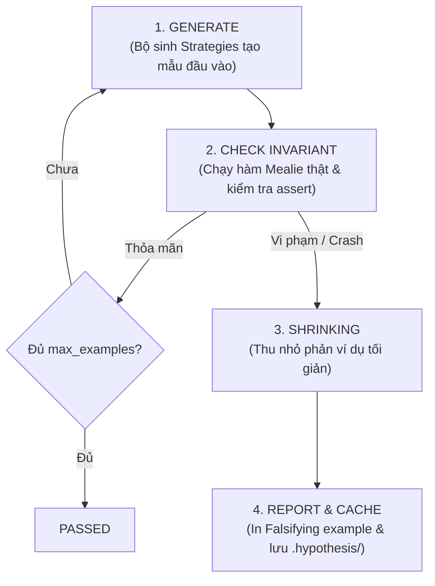

# BÁO CÁO ĐỒ ÁN MÔN HỌC KIỂM THỬ PHẦN MỀM

**Tổ hợp đề tài:** R02 (Hệ thống quản lý công thức và thực đơn Mealie v3.28.0) và K01 (Property-Based Testing với thư viện Hypothesis)  
**Giảng viên hướng dẫn:** ThS. Nguyễn Thế Lâm  
**Đơn vị:** Khoa Công nghệ Thông tin, Trường Đại học Đà Lạt  
**Nhóm thực hiện:** Nhóm 6  
**Kho lưu trữ mã nguồn:** [https://github.com/2312726-collab/KTPM-nhom6-R02-K01](https://github.com/2312726-collab/KTPM-nhom6-R02-K01)  
**Phiên bản hệ thống mục tiêu:** Release Tag `v3.28.0` (Commit SHA: `0552eaa4a80031b8572849cca0ed95d07f1be001`)  

---

## Thông tin thành viên và phân công vai trò

| STT | MSSV | Họ và tên | Tài khoản GitHub | Vai trò trong nhóm | Nhiệm vụ kỹ thuật & Kiểm thử phụ trách |
| :---: | :---: | :--- | :--- | :--- | :--- |
| 1 | `2312726` | Trần Quốc Quân | `2312726-collab` | Trưởng nhóm, Kiến trúc sư hệ thống | Tổng hợp kiến trúc, luồng dữ liệu; lập trình Property 4 (`test_pbt_scaling.py`); đóng gói nghiệm thu |
| 2 | `2312611` | Bùi Trung Hiếu | `2312611-Hieu` | Test Architect, Chuyên viên phương pháp PBT | Xây dựng phương pháp luận PBT, đặc tả 5 Properties; lập trình Property 2 (`test_pbt_unit_converter.py`) |
| 3 | `2312695` | Nguyễn Phạm Phú Nam | `2312695-netizen` | DevOps & Automation QA | Thiết lập Docker Mealie, Test Runner Python 3.14, seed data; lập trình Property 5 (`test_pbt_fraction.py`) |
| 4 | `2312687` | Võ Hùng Mạnh | `Benz2311` | QA Automation Engineer 2 & Defect Analyst | Phân tích bất đồng bộ và Mock fixture; lập trình Property 3 (`test_pbt_ingredient_parser.py`); tổng hợp báo cáo kết quả và Defect Log |
| 5 | `2312719` | Trần Ngọc Bảo Phước | `PHUOCBAOTRAN` | QA Automation Engineer 1 | Thiết lập Test Harness (`pytest.ini`, `conftest.py`), tài liệu tái lập `tests/README.md`; lập trình Property 1 (`test_pbt_string_utils.py`) |

---

## Mục lục

- [Danh mục từ viết tắt và thuật ngữ](#danh-mục-từ-viết-tắt-và-thuật-ngữ)
- [Chương 1. Tổng quan hệ thống mục tiêu (Mealie v3.28.0)](#chương-1-tổng-quan-hệ-thống-mục-tiêu-mealie-v3280)
- [Chương 2. Kiến trúc hệ thống và các luồng dữ liệu trọng tâm](#chương-2-kiến-trúc-hệ-thống-và-các-luồng-dữ-liệu-trọng-tâm)
- [Chương 3. Thiết lập môi trường, triển khai và dữ liệu mẫu](#chương-3-thiết-lập-môi-trường-triển-khai-và-dữ-liệu-mẫu)
- [Chương 4. Phương pháp luận và kế hoạch kiểm thử Property-Based Testing](#chương-4-phương-pháp-luận-và-kế-hoạch-kiểm-thử-property-based-testing)
- [Chương 5. Thiết kế kịch bản kiểm thử và triển khai mã nguồn tự động](#chương-5-thiết-kế-kịch-bản-kiểm-thử-và-triển-khai-mã-nguồn-tự-động)
- [Chương 6. Kết quả thực thi, độ bao phủ và phân tích lỗi (Defect Analysis)](#chương-6-kết-quả-thực-thi-độ-bao-phủ-và-phân-tích-lỗi-defect-analysis)
- [Chương 7. Quản trị cấu hình, tái lập hệ thống và tổng kết nghiệm thu](#chương-7-quản-trị-cấu-hình-tái-lập-hệ-thống-và-tổng-kết-nghiệm-thu)

### Danh mục từ viết tắt và thuật ngữ

| Thuật ngữ / Viết tắt | Diễn giải đầy đủ | Ngữ cảnh áp dụng trong đồ án |
| :--- | :--- | :--- |
| **SUT** | System Under Test | Hệ thống mục tiêu Mealie `v3.28.0` trong `mealie_src/` |
| **PBT** | Property-Based Testing | Kỹ thuật kiểm thử dựa trên tính chất bất biến bằng Hypothesis |
| **EBT** | Example-Based Testing | Kiểm thử đơn vị truyền thống theo cặp input/output cố định |
| **Shrinking** | Counterexample Shrinking | Cơ chế tự thu nhỏ chuỗi lỗi của Hypothesis về dạng tối giản nhất |
| **RCA** | Root Cause Analysis | Phân tích nguyên nhân gốc rễ lỗi phần mềm |
| **RTM** | Requirements Traceability Matrix | Ma trận truy xuất nguồn gốc từ Use Case đến kịch bản kiểm thử |
| **STLC** | Software Testing Life Cycle | Vòng đời kiểm thử phần mềm (Entry/Exit Criteria) |
| **SPA / DTO** | Single-Page App / Data Transfer Object | Giao diện Vue/Nuxt và schema Pydantic trao đổi dữ liệu API |

---

## Chương 1. Tổng quan hệ thống mục tiêu (Mealie v3.28.0)

### 1.1. Bối cảnh và mục tiêu của hệ thống

Trong quản lý công thức nấu ăn và kế hoạch bữa ăn gia đình, dữ liệu thường phân tán qua nhiều trang web, ghi chú thủ công và mạng xã hội. Định lượng nguyên liệu ở công thức gốc thường cố định cho một số người ăn nhất định và sử dụng đan xen nhiều hệ đo lường (Metric như gram, ml và Imperial như cup, ounce, tablespoon).

Mealie là phần mềm mã nguồn mở tự lưu trữ (Self-hosted Recipe Manager and Meal Planner) giải quyết chu trình xử lý dữ liệu ẩm thực từ lúc nhập liệu đến khi đi chợ:
1. Trích xuất dữ liệu công thức tự động từ đường dẫn web (Web Scraping theo chuẩn Schema.org JSON-LD và Microdata).
2. Phân tích chuỗi nguyên liệu thô viết bằng ngôn ngữ tự nhiên (ví dụ: `"2 1/2 cups of all-purpose flour, sifted (organic)"`) thành cấu trúc gồm định lượng, đơn vị, tên thực phẩm và ghi chú.
3. Co giãn định lượng nguyên liệu khi người dùng thay đổi số lượng khẩu phần ăn (Servings Scaling).
4. Lập kế hoạch thực đơn theo ngày/tuần và tự động hợp nhất nguyên liệu vào danh sách mua sắm (Shopping List) cho từng hộ gia đình (Household).

### 1.2. Ngăn xếp công nghệ cốt lõi

Thông số dưới đây được kiểm tra trực tiếp từ tệp cấu hình đóng gói `mealie_src/pyproject.toml` của phiên bản `v3.28.0`.

| Thành phần | Công nghệ / Thư viện | Phiên bản | Vai trò kỹ thuật |
| :--- | :--- | :---: | :--- |
| Ngôn ngữ Backend | Python | `>=3.14, <3.15` | Thực thi toàn bộ logic xử lý phía máy chủ |
| Web Framework | `FastAPI` | `0.141.1` | Cung cấp RESTful API bất đồng bộ và tài liệu Swagger UI (`/docs`) |
| ASGI Server | `Uvicorn` | `0.53.0` | Điều phối kết nối HTTP và WebSocket |
| ORM | `SQLAlchemy` | `2.0.54` | Ánh xạ đối tượng và truy xuất cơ sở dữ liệu |
| Migration | `Alembic` | `1.20.0` | Quản lý phiên bản lược đồ cơ sở dữ liệu |
| Cơ sở dữ liệu | SQLite / PostgreSQL | Mặc định SQLite | Lưu trữ công thức, người dùng, hộ gia đình, lịch ăn |
| Kiểm thực dữ liệu | `Pydantic` | `2.13.5` | Định nghĩa Schema và kiểm tra ràng buộc kiểu dữ liệu |
| Phân tích nguyên liệu | `ingredient-parser-nlp` | `2.7.0` | Mô hình NLP bóc tách ngữ nghĩa chuỗi nguyên liệu |
| Quy đổi đơn vị | `Pint` | `0.26.1` | Quản lý thứ nguyên vật lý và hệ số chuyển đổi đơn vị đo lường |
| Trích xuất web | `recipe-scrapers` | `15.12.0` | Cào dữ liệu JSON-LD/Microdata từ các website ẩm thực |
| Xử lý chuỗi | `RapidFuzz` & `text-unidecode` | `3.14.6` | So khớp chuỗi mờ (fuzzy matching) và chuẩn hóa ký tự |
| Giao diện Frontend | `Vue.js` (Nuxt) | `3.x` | Ứng dụng trang đơn (SPA) giao tiếp Backend qua REST API |
| Đóng gói | Docker & Docker Compose | — | Triển khai độc lập đa nền tảng |

### 1.3. Tác nhân và 5 Use Case cốt lõi

Hệ thống phân quyền thông qua 2 nhóm tác nhân chính:
* **Home User (Người dùng gia đình):** Nhập hoặc import công thức, chỉnh sửa nguyên liệu, thay đổi khẩu phần ăn, lập kế hoạch bữa ăn theo tuần và đồng bộ danh sách mua sắm.
* **System Administrator (Quản trị viên hệ thống):** Quản lý tài khoản, thiết lập Nhóm (Group) và Hộ gia đình (Household), sao lưu phục hồi dữ liệu, cấu hình SMTP/OIDC.

```text
+------------------------------------------------------------------------+
|                        HE THONG MEALIE (v3.28.0)                       |
|                                                                        |
|   [Home User] ---------> (UC-01: Import & Quan ly cong thuc)           |
|       |                                                                |
|       +----------------> (UC-02: Phan tich chuoi nguyen lieu - Parser) |
|       |                        [Trong tam Property 1, 3, 5]            |
|       |                                                                |
|       +----------------> (UC-03: Co gian khau phan an - Scaling)       |
|       |                        [Trong tam Property 4]                  |
|       |                                                                |
|       +----------------> (UC-04: Lap ke hoach thuc don tuan)           |
|       |                                                                |
|       +----------------> (UC-05: Quy doi don vi do luong)              |
|                                [Trong tam Property 2]                  |
|                                                                        |
|   [Administrator] -----> (Quan tri he thong, Backup, Cau hinh)         |
+------------------------------------------------------------------------+
```

Đặc tả 5 Use Case trọng tâm:

1. **UC-01 (Thêm và Import công thức từ URL):** Người dùng gửi liên kết bài viết ẩm thực qua endpoint `POST /api/recipes/create-url`. Module `mealie/services/scraper` dùng `recipe-scrapers` tải HTML, trích xuất JSON-LD/OpenGraph, lưu ảnh đại diện, danh sách nguyên liệu và các bước chế biến vào bảng `recipes`.
2. **UC-02 (Phân tích chuỗi nguyên liệu tự nhiên, trọng tâm P1, P3, P5):** Khi nhập chuỗi thô (ví dụ `"2 1/2 cups of all-purpose flour, sifted (organic)"`), tầng `string_utils.py` loại bỏ dấu chú thích footnote, chuyển phân số Unicode (`½` sang `1/2`) và di chuyển ngoặc đơn về cuối chuỗi. Sau đó `ingredient_parser.py` nhận diện số lượng (`2.5`), đơn vị (`cup`), thực phẩm (`all-purpose flour`) và ghi chú, trả về đối tượng `ParsedIngredient`.
3. **UC-03 (Co giãn tỉ lệ khẩu phần ăn, trọng tâm P4):** Tính lại định lượng của toàn bộ nguyên liệu khi thay đổi số người ăn theo công thức:
   $$k = \frac{\text{Target Servings}}{\text{Original Servings}}$$
   $$Q_{\text{mới}} = Q_{\text{gốc}} \times k$$
   Ví dụ: với công thức gốc cho 4 người có 200 g đường, khi tăng lên 8 người ($k = 8 / 4 = 2.0$), định lượng mới là $200 \times 2.0 = 400\text{ g}$; khi giảm xuống 2 người ($k = 2 / 4 = 0.5$), định lượng giảm còn 100 g.
4. **UC-04 (Lập kế hoạch thực đơn tuần):** Người dùng gán công thức vào các ngày và bữa (sáng, trưa, tối) trong bảng `mealplans`, sau đó kích hoạt tính năng đẩy toàn bộ nguyên liệu vào danh sách mua sắm.
5. **UC-05 (Quy đổi đơn vị đo lường, trọng tâm P2):** Lớp `UnitConverter` trong `unit_utils.py` dùng `Pint` để chuyển đổi giữa các đơn vị có cùng thứ nguyên vật lý (như `cup` sang `milliliter`, `ounce` sang `gram`) và ném ngoại lệ kiểm soát khi hai đơn vị không tương thích thứ nguyên.

### 1.4. Cấu trúc mã nguồn thực tế

Qua khảo sát trực tiếp `mealie_src/` tại SHA `0552eaa4a80031b8572849cca0ed95d07f1be001`, mã nguồn Backend (`mealie_src/mealie/`) được phân tầng như sau:


```text
mealie_src/
├── pyproject.toml
├── frontend/                                     # Giao diện Nuxt 3 / Vue 3 (SPA)
│   └── app/composables/recipes/use-scaled-amount.ts  # Logic tính scale phía Client
└── mealie/                                       # Backend Python / FastAPI
    ├── main.py                                   # Entry point kích hoạt Uvicorn
    ├── app.py                                    # Khởi tạo FastAPI, middlewares, routers
    ├── core/settings/settings.py                 # Đọc biến môi trường & cấu hình ứng dụng
    ├── routes/                                   # API Routing Layer (/api/recipes, /api/parser...)
    ├── schema/
    │   ├── recipe/recipe_ingredient.py           # Schema RecipeIngredient, display_fraction()
    │   └── household/group_shopping_list.py      # Schema ShoppingListItemCreate
    └── services/
        ├── scraper/                              # Trích xuất dữ liệu web từ URL
        ├── household_services/
        │   └── shopping_lists.py                 # ShoppingListService (chứa logic scale thực tế phía Backend)
        └── parser_services/                      # Trọng tâm kiểm thử của đồ án
            ├── _base.py                          # ABCIngredientParser, DataMatcher (RapidFuzz)
            ├── ingredient_parser.py              # BruteForceParser
            ├── brute/process.py                  # Thuật toán cắt token phân tích nguyên liệu
            └── parser_utils/
                ├── string_utils.py               # Làm sạch chuỗi, phân số Unicode, bóc tách định lượng
                └── unit_utils.py                 # UnitConverter (Pint) quy đổi và gộp đơn vị
```

*(Đính chính kỹ thuật so với báo cáo giữa kỳ cũ: Mã nguồn Mealie v3.28.0 không có tệp `mealie/services/recipe/recipe_service.py`. Logic co giãn khẩu phần phía Backend nằm tại `mealie/services/household_services/shopping_lists.py` kết hợp định dạng tại `mealie/schema/recipe/recipe_ingredient.py`, còn phía giao diện nằm tại `frontend/app/composables/recipes/use-scaled-amount.ts`.)*

### 1.5. Ma trận truy xuất nguồn gốc yêu cầu (RTM)

Ma trận dưới đây đã được đồng bộ hóa hoàn toàn với mã nguồn kiểm thử thực tế trên nhánh `develop` (đính chính sự sai lệch ở Property 4 và Property 5 trong bản thảo giữa kỳ ngày 20/10):

| Mã Use Case | Tên Use Case | Module mục tiêu thực tế trong Mealie v3.28.0 | Property kiểm chứng | Thành viên phụ trách | Bất biến kiểm định cốt lõi |
| :---: | :--- | :--- | :---: | :--- | :--- |
| **UC-01** | Recipe Import | `mealie/services/scraper/` | Hỗ trợ P3 | Toàn nhóm | Dữ liệu text cào về không chứa chuỗi làm sập parser |
| **UC-02** | Ingredient Parsing | `mealie/services/parser_services/parser_utils/string_utils.py` | **Property 1** | Trần Ngọc Bảo Phước (`2312719`) | Tính lũy đẳng $f(f(s)) = f(s)$ khi xóa footnote và dời ngoặc; xóa hết phân số Unicode |
| **UC-02** | Ingredient Parsing | `mealie/services/parser_services/ingredient_parser.py`<br>`mealie/services/parser_services/brute/process.py` | **Property 3** | Võ Hùng Mạnh (`2312687`) | Tính bền bỉ (Crash-free) trước chuỗi bất kỳ `st.text()` |
| **UC-02** | Ingredient Parsing (Số học) | `mealie/services/parser_services/parser_utils/string_utils.py` | **Property 5** | Nguyễn Phạm Phú Nam (`2312695`) | Bảo toàn giá trị số học cho phân số ASCII, Unicode và hỗn số trong sai số $10^{-6}$ |
| **UC-03** | Servings Scaling | `mealie/schema/recipe/recipe_ingredient.py`<br>`mealie/services/household_services/shopping_lists.py` | **Property 4** | Trần Quốc Quân (`2312726`) | Tính đơn điệu ($k > 1 \Rightarrow Q_{\text{mới}} \ge Q_{\text{gốc}}$), khả nghịch ($\epsilon \le 10^{-4}$), bắc cầu, scale đệ quy sub-recipe |
| **UC-05** | Unit Conversion | `mealie/services/parser_services/parser_utils/unit_utils.py` | **Property 2** | Bùi Trung Hiếu (`2312611`) | Bảo toàn hai chiều Round-trip ($A \leftrightarrow B$, $\epsilon \le 10^{-4}$) và ném ngoại lệ kiểm soát khi khác thứ nguyên |

### 1.6. Giả định kỹ thuật và các điểm biên nghiệp vụ (Q&A)

1. **Làm thế nào để phân biệt hỗn số $1\frac{1}{2}$ với phân số $11/2$?**  
   Hàm `convert_vulgar_fractions_to_regular_fractions()` trong `string_utils.py` chèn khoảng trắng trước phân số sau khi chuyển đổi từ Unicode, biến `"1½"` thành `"1 1/2"` để bảo toàn giá trị là $1.5$ thay vì $5.5$.
2. **Hệ thống xử lý sao với phân số vô hạn tuần hoàn (ví dụ $1/3$) và mẫu số bằng 0?**  
   Phép tính sử dụng sai số dấu phẩy động cho phép $\epsilon \le 10^{-6}$ (ở P5) và $\epsilon \le 10^{-4}$ (ở P2, P4). Với chuỗi chứa phép chia cho 0 như `"1/0 cup"`, `extract_quantity_from_string()` phải bắt `ZeroDivisionError` và trả về định lượng `0`, giữ nguyên phần chuỗi gốc.
3. **Phép quy đổi hai chiều giữa `ounce` và `milliliter` hoạt động ra sao?**  
   Trong `unit_utils.py:45-61`, hàm `_resolve_ounce()` tự động phân giải `"ounce"` sang `"fluid_ounce"` (thể tích) khi đơn vị đích thuộc thứ nguyên thể tích như `"milliliter"` hay `"cup"`, giúp `can_convert("milliliter", "ounce")` trả về `True`.
4. **Ràng buộc số khẩu phần khi co giãn?**  
   Khẩu phần gốc (`base_servings`) phải là số dương ($S > 0$) và khẩu phần đích (`target_servings`) không được âm ($S \ge 0$). Với các nguyên liệu không có định lượng (`quantity=None` hoặc `0.0`), kết quả sau scale giữ nguyên giá trị ban đầu.

---

## Chương 2. Kiến trúc hệ thống và các luồng dữ liệu trọng tâm

### 2.1. Sơ đồ kiến trúc C4 Container

Hệ thống Mealie `v3.28.0` được tổ chức theo mô hình 5 thành phần chính (hình ảnh lưu tại `Documents/assets/kien_truc_container.png`):


| STT | Container | Công nghệ | Trách nhiệm cốt lõi | Giao tiếp |
| :---: | :--- | :--- | :--- | :--- |
| 1 | SPA Frontend | Vue 3, Nuxt 3, Pinia, TypeScript | Hiển thị giao diện, tính toán tức thời số lượng hiển thị trên UI khi kéo thanh khẩu phần | Outbound: REST API JSON tới Backend |
| 2 | API & Application Server | Python 3.14, FastAPI, Uvicorn | Cung cấp API (`/api/recipes`, `/api/parser`, `/api/households`), thực thi bóc tách nguyên liệu, tính scale khi thêm vào Shopping List, phục vụ tệp tĩnh SPA và chạy `APScheduler` | Inbound: HTTP cổng `9000` (ánh xạ `9925` trên host); Outbound: SQLAlchemy, File I/O |
| 3 | Database (RDBMS) | SQLite 3 (mặc định) / PostgreSQL | Lưu trữ công thức, thực đơn, nguyên liệu, danh sách mua sắm, người dùng qua SQLAlchemy 2.0 và Alembic | Nhúng tệp cục bộ hoặc TCP 5432 |
| 4 | File Storage | Docker Volume (`/app/data/`) | Lưu tệp `mealie.db`, ảnh món ăn, tệp sao lưu `.zip` | POSIX File System I/O |
| 5 | External Services | `recipe-scrapers`, SMTP, OpenAI API | Cào dữ liệu trang công thức ngoài, gửi email đặt lại mật khẩu, parser AI tùy chọn | HTTPS GET/POST, SMTP/TLS |

Việc tách riêng tầng nghiệp vụ xử lý chuỗi và tính toán (`parser_services/`, `recipe_ingredient.py`, `shopping_lists.py`) thành các hàm không phụ thuộc cứng vào UI hay kết nối mạng cho phép cô lập các phụ thuộc database bằng Mock để chạy hàng ngàn ca kiểm thử PBT trong vài giây.

### 2.2. Các luồng dữ liệu trọng tâm

#### Luồng 1: Nghiệp vụ bóc tách nguyên liệu ẩm thực (Ingredient Parsing)
*(Minh họa tại `Documents/assets/data_flow_1_parsing.png`)*


1. Người dùng nhập chuỗi nguyên liệu vào UI; Vue SPA gửi `POST /api/parser/ingredient` chứa chuỗi thô và loại parser (`nlp` hoặc `brute`).
2. Backend điều phối qua `IngredientParserService` và khởi tạo parser tương ứng từ `_base.py`.
3. Hàm tiền xử lý trong `string_utils.py` xóa dấu footnote, chuẩn hóa phân số Unicode sang dạng ASCII có dấu cách, dời ngoặc chú thích về cuối chuỗi và tách định lượng số thực bằng `extract_quantity_from_string()`.
4. Bộ bóc tách (`BruteForceParser.parse_one()` gọi `brute/process.py`) tách token và chuyển sang `unit_utils.py` (`UnitConverter`) cùng `DataMatcher` dùng `RapidFuzz` đối chiếu đơn vị và thực phẩm trong kho dữ liệu nhóm (ngưỡng tương đồng ≥ 70% cho đơn vị và ≥ 85% cho thực phẩm).
5. Hệ thống tính điểm tin cậy (`IngredientConfidence`) cho từng thành phần (`quantity`, `unit`, `food`, `comment`), lấy trung bình cộng và trả về đối tượng `ParsedIngredient` dưới dạng JSON.

| Bước | Thành phần Nguồn | Thành phần Đích | Dữ liệu Luân chuyển | Thao tác Xử lý Kỹ thuật & Thuật toán |
| :---: | :--- | :--- | :--- | :--- |
| **1** | Trình duyệt người dùng | Vue SPA | Chuỗi văn bản tự do | Bắt sự kiện nhập liệu / form submit từ Web UI. |
| **2** | Vue SPA | `IngredientParserController` | `POST /api/parser/ingredient` | Gửi HTTP Request mang JSON Payload kèm JWT Bearer Token. |
| **3** | Controller | `IngredientParserService` | Tham số `parse([str])` | Kiểm thực Pydantic; Factory `get_parser()` nạp parser tương ứng. |
| **4** | Service | `string_utils.py` | Chuỗi nguyên liệu thô | Ánh xạ phân số Unicode (`"1½"` → `" 1 1/2"`), xóa footnote `*`, dời ngoặc về cuối chuỗi. |
| **5** | Service | `unit_utils.py` | Chuỗi đơn vị nhận diện | Khởi tạo `UnitConverter` (`Pint`); phân giải `ounce` sang `fluid_ounce` khi đi kèm thể tích. |
| **6** | Service | `DataMatcher` (`_base.py`) | Cặp chuỗi `(unit, food)` | Chuẩn hóa alias qua `normalize()` và đối chiếu mờ `RapidFuzz` (≥ 70% unit, ≥ 85% food). |
| **7** | `DataMatcher` | `IngredientParserService` | Thực thể CSDL | Gán khóa ngoại ID; tính trung bình cộng `IngredientConfidence`. |
| **8** | Controller | Vue SPA | HTTP 200 OK | Trả về JSON schema `ParsedIngredient`. |
| **9** | Vue SPA | Người dùng | DOM Rendering | Hiển thị các thẻ định lượng, đơn vị, thực phẩm, ghi chú lên giao diện. |

#### Luồng 2: Nghiệp vụ co giãn khẩu phần và tổng hợp danh sách mua sắm (Servings Scaling)
*(Minh họa tại `Documents/assets/data_flow_2_scaling.png`)*


1. **Co giãn phía Client:** Khi người dùng thay đổi số khẩu phần đích ($S_{\text{đích}}$) trên trang chi tiết món ăn, composable `use-scaled-amount.ts` trên trình duyệt tính $k = S_{\text{đích}} / S_{\text{gốc}}$ và nhân trực tiếp vào các dòng nguyên liệu để cập nhật DOM mà không tải lại trang.
2. **Co giãn và gộp nguyên liệu phía Backend:** Khi người dùng bấm thêm công thức đã co giãn vào danh sách mua sắm (`POST /api/households/recipe-actions`), Controller gọi vào `ShoppingListService.get_shopping_list_items_from_recipe(list_id, recipe_id, scale=k)` trong `shopping_lists.py`.
3. Nếu một nguyên liệu là công thức phụ lồng nhau (`referenced_recipe`), hàm tính dồn $\text{sub\_scale} = (Q_{\text{gốc}} \text{ hoặc } 1) \times k$ và gọi đệ quy.
4. Các nguyên liệu trùng khớp (`food_id`, `unit_id`) trong danh sách đi chợ sẽ được cộng dồn số lượng và lưu lại đối tượng tham chiếu `ShoppingListItemRecipeRefCreate(recipe_scale=k)`. *(Ghi chú: Nhánh cộng dồn tại `shopping_lists.py:403` chính là vị trí phát sinh lỗi thực tế `DEF-01` ở Chương 6).*

| Bước | Thành phần Nguồn | Thành phần Đích | Dữ liệu Luân chuyển | Thao tác Xử lý Kỹ thuật & Thuật toán |
| :---: | :--- | :--- | :--- | :--- |
| **1** | Người dùng | Vue SPA | Input `target_servings` | Chọn số khẩu phần đích ($S_{\text{đích}}$) trên giao diện công thức. |
| **2** | Vue Store (Pinia) | DOM UI | Mảng nguyên liệu | Tính $k = S_{\text{đích}} / S_{\text{gốc}}$, nhân $Q_{\text{mới}} = Q_{\text{gốc}} \times k$, format phân số hiển thị. |
| **3** | Vue SPA | `HouseholdRecipeActionsController` | `POST /api/households/recipe-actions` | Gửi payload JSON chứa `recipe_slug` và `recipe_scale: k`. |
| **4** | Controller | `ShoppingListService` | Lời gọi hàm nội bộ | Xác thực `household_id` và gọi `get_shopping_list_items_from_recipe()`. |
| **5** | Service | Sub-recipe Handler | `(sub_recipe, sub_scale)` | Kiểm tra `isinstance(referenced_recipe, Recipe)`, tính dồn `sub_scale` và đệ quy. |
| **6** | Service | Bộ nhớ RAM (DTO) | `ShoppingListItemCreate` | Tính `ingredient.quantity * scale` và gắn `ShoppingListItemRecipeRefCreate`. |
| **7** | Service | Database | SQL Insert / Update | Cập nhật bảng `shopping_list_items` và bảng tham chiếu `shopping_list_item_recipe_reference`. |
| **8** | Database | Vue SPA | HTTP 200 OK | Trả về danh sách mua sắm hợp nhất dạng JSON DTO. |
| **9** | Vue SPA | Người dùng | UI Notification | Hiển thị cập nhật giỏ hàng và số lượng mới. |

#### Luồng 3: Nghiệp vụ lập kế hoạch thực đơn (Meal Planning)
*(Minh họa tại `Documents/assets/data_flow_3_mealplan.png`)*


Người dùng truy cập trang Meal Planner, gán công thức vào từng ngày/bữa ăn (lưu trong bảng `meal_plan_entries` kèm trường `entry_date`). Khi kích hoạt đồng bộ từ thực đơn sang danh sách mua sắm, Backend trích xuất các công thức theo khung ngày, kích hoạt lại Luồng 2 với `scale=1` (hoặc tỷ lệ đã chọn) và hợp nhất đơn vị cùng thứ nguyên thông qua `UnitConverter.merge()` trong `unit_utils.py`.

| Bước | Thành phần Nguồn | Thành phần Đích | Dữ liệu Luân chuyển | Thao tác Xử lý Kỹ thuật & Thuật toán |
| :---: | :--- | :--- | :--- | :--- |
| **1** | Người dùng | Vue SPA (Calendar) | Thao tác chọn lịch | Chọn ngày trên lịch, loại bữa ăn (`entry_type`) và gán công thức. |
| **2** | Vue SPA | `GroupMealplanController` | `POST /api/households/mealplans` | Gửi payload `CreatePlanEntry` kèm ngày, loại bữa và `recipe_id`. |
| **3** | Controller | `RepositoryMeals` | DTO nghiệp vụ | Kiểm thực Pydantic V2, gắn `group_id` và `user_id`. |
| **4** | Repository | Database | SQL Insert | Chèn bản ghi vào `meal_plan_entries` ràng buộc khóa ngoại `recipes`, `groups`, `users`. |
| **5** | Database | Repository | Transaction Commit | Sinh UUID duy nhất và xác nhận giao dịch bền vững. |
| **6** | Controller | Vue SPA | HTTP 201 Created | Trả về đối tượng `ReadPlanEntry` DTO đầy đủ. |
| **7** | Vue SPA | Người dùng | DOM Calendar Re-render | Hiển thị món ăn cùng ảnh minh họa trên ô lịch tương ứng. |

### 2.3. Phân tích chi tiết các module mục tiêu phục vụ kiểm thử

1. **`mealie/services/parser_services/parser_utils/string_utils.py` (56 statements):**
   Chứa các hàm thuần túy: `remove_footnote_markers()`, `move_parens_to_end()`, `convert_vulgar_fractions_to_regular_fractions()`, `extract_quantity_from_string()`. Đây là đối tượng kiểm thử của **Property 1** (chuẩn hóa chuỗi) và **Property 5** (bảo toàn số học phân số).
2. **`mealie/services/parser_services/parser_utils/unit_utils.py` (81 statements):**
   Định nghĩa lớp `UnitConverter` bọc thư viện `Pint`. Chứa hàm `parse()`, `can_convert()`, `convert()`, `_resolve_ounce()` và `merge()`. Đây là đối tượng kiểm thử của **Property 2**.
3. **`mealie/services/parser_services/ingredient_parser.py` và `brute/process.py`:**
   Chứa lớp `BruteForceParser` kế thừa `ABCIngredientParser` (`_base.py`), thực thi `async def parse_one()` và `async def parse()`. Truy xuất repository thông qua cơ chế nạp lười đồng bộ (`DataMatcher.foods_by_id`, `units_by_id`). Đây là đối tượng kiểm thử của **Property 3**.
4. **`mealie/schema/recipe/recipe_ingredient.py` (322 statements) và `mealie/services/household_services/shopping_lists.py` (294 statements):**
   Chứa model Pydantic `RecipeIngredientBase`, `RecipeIngredient` (tự động làm tròn 3 chữ số thập phân theo `INGREDIENT_QTY_PRECISION`), các hàm định dạng phân số hiển thị (`display_fraction()`, `_format_quantity_for_display()`), cùng dịch vụ tính toán nhân tỷ lệ và gộp danh sách mua sắm `ShoppingListService.get_shopping_list_items_from_recipe()`. Đây là đối tượng kiểm thử của **Property 4**.

---

## Chương 3. Thiết lập môi trường, triển khai và dữ liệu mẫu

### 3.1. Kiến trúc hạ tầng Docker và quy hoạch cổng mạng

Nhóm tách biệt hai môi trường Docker độc lập để không làm lẫn dữ liệu hệ thống đang chạy với môi trường chạy kiểm thử tự động:

| Dịch vụ / Tệp cấu hình | Mục đích | Phiên bản / Image | Cổng Host → Container | Dữ liệu / Volume |
| :--- | :--- | :--- | :---: | :--- |
| Mealie App (`mealie_docker/docker-compose.yml`) | Chạy ứng dụng Web UI và API để thực nghiệm và quay video tái hiện lỗi | `ghcr.io/mealie-recipes/mealie:v3.28.0` | `9925:9000` (HTTP) | Named volume `mealie-data` ánh xạ tới `/app/data` (SQLite `mealie.db`) |
| PBT Test Runner (`Dockerfile.test` & `docker-compose.test.yml`) | Đóng gói môi trường Python sạch chuẩn 3.14 để chạy toàn bộ suite `pytest` | `python:3.14-slim` (`3.14.10`) | Không mở cổng mạng | Cô lập qua `DATA_DIR=/tmp/mealie-test-data`, `TESTING=true` |

Danh mục tài khoản kiểm thử được cấu hình cố định trên bản chạy Mealie cục bộ:

| Vai trò | Email | Mật khẩu | Ghi chú |
| :--- | :--- | :--- | :--- |
| Default Admin | `changeme@example.com` | `MyPassword` | Tài khoản mặc định do Mealie tạo lần đầu khi cơ sở dữ liệu trống |
| Team Admin (Nhóm 6) | `admin@nhom6.test` | `Admin123@` | Tài khoản quản trị nhóm dùng để chạy kịch bản nạp seed data |
| Standard User | `test@nhom6.test` | `User123@` | Tài khoản người dùng thường phục vụ kiểm tra phân quyền |

### 3.2. Hướng dẫn khởi chạy ứng dụng và nạp dữ liệu mẫu

1. **Khởi động Mealie Docker (`v3.28.0`):**
   Di chuyển vào thư mục `mealie_docker/`, sao chép `.env.example` thành `.env` và chạy:
   ```powershell
   cd mealie_docker
   if (-not (Test-Path ".env")) { Copy-Item .env.example .env }
   docker compose up -d
   docker compose ps
   ```
   Đợi trạng thái container chuyển sang `Up (healthy)`, truy cập `http://localhost:9925` và tạo tài khoản `admin@nhom6.test` (`Admin123@`).
2. **Nạp dữ liệu mẫu (`seed_data.py`):**
   Từ thư mục gốc dự án, chạy:
   ```powershell
   python mealie_docker/seed/seed_data.py
   ```
   Kịch bản tự động gọi REST API của Mealie để nạp **10 công thức mẫu (`NAM-01` đến `NAM-10`)** và **14 bữa ăn** trải dài trên 2 tuần trong Meal Planner.

| Mã ID | Tên công thức mẫu | Khẩu phần | Đặc trưng phục vụ kiểm thử PBT |
| :---: | :--- | :---: | :--- |
| `NAM-01` | Trứng Luộc Lòng Đào | 2 servings | Số nguyên đơn giản (`2 eggs`, `1 cup water`) |
| `NAM-02` | Sữa Tươi Yến Mạch | 2 servings | Số thập phân (`1.5 cups milk`, `2.25 tbsp oats`) |
| `NAM-03` | Bánh Bông Lan Đường Mía | 4 servings | Phân số ASCII (`1/2 cup sugar`, `3/4 cup flour`) |
| `NAM-04` | Sữa Nóng Mật Ong | 1 serving | Phân số Unicode (`½ cup milk`) |
| `NAM-05` | Canh Rong Biển Đậm Đà | 2 servings | Phân số Unicode đa dạng (`¾ tsp salt`, `½ tbsp oil`) |
| `NAM-06` | Bánh Mì Bột Mì Đa Dụng | 4 servings | Hỗn số có khoảng cách (`2 1/2 cups flour`, `1 1/4 cups water`) |
| `NAM-07` | Trà Thảo Mộc Nước Ấm | 2 servings | Hỗn số Unicode viết liền (`2½ cups water`) |
| `NAM-08` | Súp Hành Tây Pháp | 2 servings | Chứa ghi chú trong ngoặc đơn (`1 onion (finely chopped)`) |
| `NAM-09` | Salad Thập Cẩm Tổng Hợp | 4 servings | Tổ hợp số nguyên, số thập phân và phân số |
| `NAM-10` | Bò Sốt Tiêu Khẩu Phần Chuẩn | 4 servings | Công thức chuẩn phục vụ thực nghiệm co giãn khẩu phần (`4 -> 8 -> 2`) |

### 3.3. Kiểm chứng thực nghiệm trên giao diện Web UI thật và xử lý sự cố cài đặt

Nhóm đã khởi chạy Mealie trên cổng `9925`, nạp toàn bộ 10 công thức `NAM` và thực hiện kiểm tra trực tiếp trên trình duyệt Chrome:
1. Kiểm chứng **Luồng co giãn khẩu phần (`NAM-10`)**: Điều chỉnh khẩu phần từ `4` lên `8` rồi giảm xuống `2`, định lượng nguyên liệu cập nhật tức thời theo đúng tỷ lệ $2.0$ và $0.5$.
2. Kiểm chứng **Tái hiện lỗi thực tế tại Shopping List trên Web UI**: Tạo một công thức thử nghiệm chứa 2 dòng nguyên liệu cùng loại `sugar` (`1 cup sugar` và `2 cup sugar`), nhấn nút thêm vào Shopping List với hệ số scale bằng `2`. Theo toán học, kết quả phải là `(1 * 2) + (2 * 2) = 6 cup sugar`. Thực tế giao diện Mealie trả về `4 cup sugar`, xác nhận lỗi bỏ sót phép nhân `* scale` ở nhánh gộp nguyên liệu tại `shopping_lists.py:403` xảy ra giống hệt trên hệ thống thực tế.

**Bảng tổng hợp xử lý sự cố thường gặp khi dựng môi trường (Troubleshooting Guide):**

| Hiện tượng lỗi | Nguyên nhân phổ biến | Cách xử lý nhanh |
| :--- | :--- | :--- |
| **Trùng cổng 9925** (`address already in use`) | Có ứng dụng khác đang chiếm cổng 9925 | Mở `mealie_docker/.env`, đổi `MEALIE_PORT=9930` và `BASE_URL=http://localhost:9930`, chạy lại `docker compose up -d` |
| **Lỗi Docker daemon** (`cannot connect to pipe`) | Docker Desktop chưa bật hoặc đang khởi động | Khởi động Docker Desktop và chờ biểu tượng chuyển trạng thái Running (màu xanh) |
| **Lỗi GitHub** (`Repository not found`) | Tài khoản chưa có quyền truy cập repo | Yêu cầu quản trị nhóm cấp quyền Collaborator trên GitHub |
| **Lỗi sai thư mục** (`no configuration file provided`) | Chạy `docker compose` ở thư mục gốc thay vì `mealie_docker/` | Chuyển vào `cd mealie_docker` trước khi chạy lệnh compose |
| **Không vào được web** (`localhost:9925`) | Container Mealie chưa khởi động xong hoặc crash | Chạy `docker compose ps` và `docker compose logs --tail=30 mealie` để kiểm tra log |
| **Lỗi tạo User** (`409 Conflict`) | Đặt Username trùng `admin` | Đổi sang Username khác (ví dụ `admin_nhom6`) và điền đủ `Full Name` |
| **Seed báo lỗi `401 Unauthorized`** | Sai email/mật khẩu tài khoản quản trị | Nhập đúng thông tin tài khoản đã đăng ký khi khởi tạo Mealie lần đầu |
| **Chỉ thấy 12 bữa ăn trên Meal Planner** | 2 bữa Thứ Hai thuộc tuần kế tiếp | Nhấn nút mũi tên chuyển tuần (`>`) trên giao diện Mealie |
| **Import URL bị báo lỗi kết nối** | Container không gọi được localhost của Host | Chạy Mock Server trên cổng `9926` và dùng bí danh `http://host.docker.internal:9926/...` |

---

## Chương 4. Phương pháp luận và kế hoạch kiểm thử Property-Based Testing

### 4.1. Nguyên lý Property-Based Testing và so sánh với Example-Based Testing

Kiểm thử dựa trên thuộc tính (Property-Based Testing, gọi tắt là PBT) không kiểm tra từng cặp giá trị đầu vào/đầu ra cố định $(x_0, y_0)$, mà kiểm tra các tính chất bất biến phổ quát trên toàn miền dữ liệu hợp lệ:

$$\forall x \in \text{Domain}, \quad P(f(x)) = \text{True}$$

| Tiêu chí | Example-Based Testing (EBT) | Property-Based Testing (PBT với Hypothesis) |
| :--- | :--- | :--- |
| Cách xác minh | Khẳng định $f(x_0) == y_0$ với mẫu cố định | Khẳng định bất biến $P(f(x))$ đúng với mọi $x$ hợp lệ |
| Không gian dữ liệu | Hữu hạn theo các ví dụ lập trình viên tự nghĩ | Sinh hàng trăm đến hàng ngàn ca ngẫu nhiên có định hướng |
| Phát hiện ca biên | Dễ bỏ sót các tổ hợp lạ | Tự động rà quét số 0, số âm, chuỗi rỗng, cực trị float, Unicode, ký tự điều khiển |
| Thu nhỏ lỗi | Trả về đúng chuỗi đầu vào dài gây lỗi ban đầu | Cơ chế **Shrinking** tự động cắt tỉa để tìm ra phản ví dụ tối giản nhất (Minimal Counterexample) |

### 4.2. Chu trình vận hành 4 bước của thư viện Hypothesis



### 4.3. Phạm vi kiểm thử theo triết lý Ponytail và quản lý rủi ro Flaky Test

* **Bên trong phạm vi (In-Scope):** Gọi trực tiếp mã nguồn Backend Python nguyên bản trong `mealie_src/mealie/` tại các tầng xử lý chuỗi (`string_utils.py`), quy đổi đơn vị (`unit_utils.py`), bóc tách nguyên liệu (`ingredient_parser.py`, `brute/process.py`), schema nguyên liệu (`recipe_ingredient.py`) và dịch vụ co giãn danh sách mua sắm (`shopping_lists.py`).
* **Bên ngoài phạm vi (Out-of-Scope):** Không chạy tự động kiểm thử E2E trên giao diện Vue (chỉ kiểm chứng thủ công khi tái hiện bug), không phụ thuộc kết nối Internet (Web Scraping) và không dùng kết nối SQLite/PostgreSQL thật trong unit test (cô lập bằng `unittest.mock.MagicMock`).
* **Kiểm soát Flaky Test:** Thiết lập `deadline=None` để không bị fail giả khi máy chậm CPU; giữ bộ đệm `.hypothesis/` để tái hiện lỗi qua `@seed()`; giới hạn chặt hàm lọc `assume()` để tránh lỗi `FailedHealthCheck`; đảm bảo mọi ca kiểm thử không chia sẻ biến trạng thái toàn cục.

### 4.4. Cấu hình Test Harness và Profiles dùng chung

Cấu hình chuẩn hóa trong `pytest.ini` và `tests/conftest.py`:
* `pythonpath = . mealie_src` cùng `asyncio_mode = strict` (yêu cầu gắn rõ `@pytest.mark.asyncio` cho các test bất đồng bộ) và 2 markers tách biệt: `pbt` (Hypothesis tests) và `unit` (Deterministic unit tests).
* **3 Profiles thực thi trong `tests/conftest.py`:**
  - `dev`: `max_examples = 50`, `deadline = None` (mặc định khi phát triển cục bộ).
  - `ci`: `max_examples = 300`, `deadline = None` (kiểm tra trước khi merge PR).
  - `thorough`: `max_examples = 1000`, `deadline = None` (kiểm thử sức bền).
* **Helper nạp module chuẩn hóa:** Hàm `load_mealie_string_utils()` trong `tests/conftest.py` cô lập namespace `mealie.services.parser_services` để P1 và P5 cùng nạp đúng tên module `mealie.services.parser_services.parser_utils.string_utils`, giúp `pytest-cov` cộng gộp chính xác độ phủ mà không sinh cảnh báo `CoverageWarning`.

### 4.5. Tiêu chí STLC (Entry / Exit Criteria) và Ma trận mức độ nghiêm trọng lỗi

**1. Tiêu chí Bắt đầu kiểm thử (Entry Criteria — chuẩn STLC):**
1. Mã nguồn Mealie trong `mealie_src/` được cố định tại release tag **`v3.28.0`** (SHA `0552eaa4a80031b8572849cca0ed95d07f1be001`).
2. Môi trường Python chuẩn `>=3.14,<3.15` (qua `Dockerfile.test`) cài đặt đầy đủ `requirements-test.txt`.
3. Bộ Test Harness (`pytest.ini`, `tests/conftest.py` với 3 profiles `dev`, `ci`, `thorough`) thu thập sạch (`0 errors`).
4. Hoàn tất đặc tả 5 Properties PBT cùng cơ chế cô lập DB/Repo (`MagicMock`).

**2. Tiêu chí Kết thúc kiểm thử (Exit Criteria):**
1. Toàn bộ 6 tệp kiểm thử (`M1` + `P1` → `P5`) chạy thông suốt bằng **1 lệnh duy nhất**, không phát sinh `Collection Error` hay `FAILED` ngoài dự kiến.
2. Mọi ca kiểm thử đạt `PASSED` hoặc được gắn `@pytest.mark.xfail(strict=True)` gắn liền với Defect ID thật đã xác minh RCA.
3. Độ phủ trực tiếp trên các module mục tiêu đạt **≥ 80%** hoặc có hồ sơ RCA + bản vá đề xuất cho lỗi thật; đạt **Zero Open S1 Defects** chưa truy vết.

**3. Ma trận phân loại mức độ nghiêm trọng lỗi (Severity S1 → S4 — IEEE 1044 / ISTQB):**

| Mức độ | Phân loại | Tiêu chí kỹ thuật (IEEE 1044 / ISTQB) | Ví dụ minh họa trên Mealie `v3.28.0` | Yêu cầu xử lý & Nghiệm thu |
| :---: | :--- | :--- | :--- | :--- |
| **S1** | **Critical** (Blocker) | Gây sập hệ thống (`Unhandled Exception`, HTTP 500), crash tiến trình hoặc hỏng/mất dữ liệu cốt lõi | `BruteForceParser.parse_one()` ném `IndexError` khi chuỗi rỗng `""` hoặc `"a cup"` (`brute/process.py:152, 110`) | **Ưu tiên cao nhất:** Bắt buộc lập Defect Log + RCA + bản vá diff; đạt **Zero Open S1 Defects** |
| **S2** | **Major** | Chức năng chạy không sập nhưng sai lệch nghiêm trọng kết quả nghiệp vụ hoặc bất biến tính toán | `ShoppingListService` quên nhân `* scale` khi gộp 2 nguyên liệu trùng (`shopping_lists.py:403`) | Lập Defect Log + RCA, gắn `@pytest.mark.xfail(strict=True)` nếu là bug nền `v3.28.0` |
| **S3** | **Minor** | Sai lệch chuẩn hóa, hiển thị biên ít gặp hoặc thuật toán chưa tối ưu nhưng không sai luồng chính | Mất tính lũy đẳng `move_parens_to_end()`; vòng lặp `O(N)` tại `_format_quantity_for_display()`; lỗi PEP 649 trên Python ≤ 3.13 | Ghi nhận RCA, đề xuất cải tiến thuật toán hoặc cô lập môi trường |
| **S4** | **Trivial** | Lỗi thẩm mỹ, chính tả trong thông điệp/tài liệu, khoảng trắng phụ không ảnh hưởng logic | Sai khác nhỏ về nhãn hiển thị phụ hoặc chính tả trong log nội bộ | Ghi nhận cải thiện khi thuận tiện, không chặn nghiệm thu |

*(Lưu ý phân biệt giữa **Severity** do QA đánh giá mức độ tác động kỹ thuật và **Priority** `High`/`Medium`/`Low` dùng để sắp thứ tự ưu tiên thực thi kiểm thử).*

---

## Chương 5. Thiết kế kịch bản kiểm thử và triển khai mã nguồn tự động

### 5.1. Tổng quan 5 Properties PBT

| Mã | Tên tính chất (Property) | Bất biến toán học / Logic | Module Mealie kiểm thử | Tệp mã nguồn test | Trạng thái hiện tại |
| :---: | :--- | :--- | :--- | :--- | :--- |
| **P1** | String Normalization Idempotence | $f(f(s)) = f(s)$ và không còn Unicode phân số | `string_utils.py` | `tests/unit_tests/test_pbt_string_utils.py` | Hoàn tất (PR #16), ghim 1 defect `xfail` |
| **P2** | Unit Conversion Round-trip | $\text{abs}(\text{convert}(\text{convert}(Q, A, B), B, A) - Q) \le 10^{-4}$ | `unit_utils.py` | `tests/unit_tests/test_pbt_unit_converter.py` | **Hoàn tất (PR #17)**, 13 tests pass, coverage 99% |
| **P3** | Parser Crash-free Robustness | $\forall s \in \text{st.text()}$, không sập unhandled | `ingredient_parser.py` & `brute/process.py` | `tests/unit_tests/test_pbt_ingredient_parser.py` | **Hoàn tất (PR #19 + Fix)**, ghim `DEF-03` (`xfail`) |
| **P4** | Servings Scaling Monotonicity & Reversibility | Đơn điệu, khả nghịch ($\epsilon \le 10^{-4}$), bắc cầu, đệ quy sub-recipe | `recipe_ingredient.py` & `shopping_lists.py` | `tests/unit_tests/test_pbt_scaling.py` | Hoàn tất (PR #14), ghim 1 defect `xfail` |
| **P5** | Fraction Arithmetic Preservation | $\text{abs}(\text{parse}(N/D) - (N/D)) \le 10^{-6}$ | `string_utils.py` | `tests/unit_tests/test_pbt_fraction.py` | Hoàn tất (PR #15) |

---

### 5.2. Property 1: Tính lũy đẳng làm sạch chuỗi (`test_pbt_string_utils.py`)
* **Phụ trách:** Trần Ngọc Bảo Phước (`2312719`)
* **Thiết kế:**
  - `test_remove_footnote_idempotent`: Sinh chuỗi tùy ý `st.text()`, gọi `remove_footnote_markers()` hai lần liên tiếp và kiểm tra $f(f(s)) = f(s)$ (`max_examples=300`).
  - `test_move_parens_idempotent`: Sinh kết hợp `st.text()` và chuỗi có hai cụm ngoặc đơn dạng `"{a} ({b}) ({c}) "` kèm ca ví dụ cố định `"1 (aa) (bb) "`, gọi `move_parens_to_end()` hai lần. Hiện đánh dấu `@pytest.mark.xfail(strict=True)` để ghim lỗi mất tính lũy đẳng trong Mealie `v3.28.0`.
  - `test_convert_vulgar_fractions_crash_free` và `test_convert_vulgar_fractions_no_remaining_unicode`: Kiểm tra không sinh ngoại lệ và sau xử lý không còn sót bất kỳ ký tự phân số Unicode nào trong tập 18 ký tự (`¼`, `½`, `¾`, `⅐`... `⅞`).

### 5.3. Property 2: Bảo toàn hai chiều quy đổi đơn vị (`test_pbt_unit_converter.py`)
* **Phụ trách:** Bùi Trung Hiếu (`2312611`)
* **Trạng thái:** Hoàn tất toàn bộ các tiêu chí kỹ thuật qua **PR #17** (commit `86bbd60`).
* **Thiết kế & Bổ sung mới (13 hàm kiểm thử):**
  - **Khối lượng (Property 2.1):** Quy đổi Round-trip `gram` ↔ `kilogram`, `ounce` ↔ `gram`, `pound` ↔ `kilogram`, `milligram` ↔ `gram` với $Q \in [0.001, 100000]$, sai số tương đối hoặc tuyệt đối $< 10^{-4}$.
  - **Thể tích (Property 2.2):** Quy đổi Round-trip `milliliter` ↔ `liter`, `teaspoon` ↔ `tablespoon`, `fluid_ounce` ↔ `cup`, `pint` ↔ `quart`.
  - **Cơ chế phân giải Ounce (`_resolve_ounce`):** Bổ sung test độc lập `test_ounce_resolves_to_fluid_ounce_with_volume` xác thực `"ounce"` tự động hiểu là `"fluid_ounce"` khi đi kèm các đơn vị thể tích (`milliliter`, `cup`, `liter`...), khắc phục triệt để lỗi che giấu assert cũ (`H-FIX-2`).
  - **Kiểm soát ngoại lệ (Property 2.3):** Xóa bỏ assertion giả `or True` (`H-FIX-1`), kiểm tra nghiêm ngặt `can_convert()` trả về `False` và `convert()` ném lỗi khi khác thứ nguyên vật lý (`mass` vs `volume`). Phân tích đơn vị lạ với `strict=True` bắt buộc ném `UnitNotFound`.
  - **Tính giao hoán & bảo toàn khi gộp (Property 2.4 - `H-FIX-4`):** Bổ sung 3 kịch bản PBT cho `UnitConverter.merge()` và `merge_quantity_and_unit()`, chứng minh tính giao hoán $merge(Q_1, U_1, Q_2, U_2) \equiv merge(Q_2, U_2, Q_1, U_1)$, bảo toàn tổng lượng vật lý khi gộp công thức và ném `ValueError` khi thiếu metadata đơn vị chuẩn. Toàn bộ các hàm đã gắn decorator `@pytest.mark.pbt` (`H-FIX-3`).

### 5.4. Property 3: Tính bền bỉ của bộ phân tích nguyên liệu (`test_pbt_ingredient_parser.py`)
* **Phụ trách:** Võ Hùng Mạnh (`2312687`) — *(Đã chuẩn hóa cô lập import Python 3.13 và ghim `xfail`)*
* **Thiết kế trong `tests/unit_tests/test_pbt_ingredient_parser.py` & `test_manh_m1_async_mock.py`:**
  - Cô lập toàn diện các phụ thuộc tầng dưới (`mealie.schema.recipe`, `mealie.db.models.recipe`, `mealie.repos`, `mealie.core.root_logger`) giúp chạy thông suốt trên cả Python 3.13.2 và Docker Python 3.14.
  - `test_ingredient_parser_never_crashes`: Dùng Hypothesis `@given(text=st.text(max_size=500))` (`max_examples=300`, `@pytest.mark.pbt`) kiểm tra `BruteForceParser.parse_one()` luôn trả về `ParsedIngredient`. Hiện gắn `@pytest.mark.xfail(strict=True)` để ghim lỗi `DEF-03` (`IndexError` khi chuỗi rỗng/khoảng trắng tại `brute/process.py:152`).
  - `test_ingredient_parser_edge_cases` & `test_ingredient_parser_unit_at_end_bug`: Kiểm tra các ca biên (`""`, `"   "`, ký tự toán học `"±×÷√∞≠≤≥"`, chuỗi 10.000 ký tự, null-byte `"\x00"`, và `"a cup"` khi DB có đơn vị `"cup"`).

### 5.5. Property 4: Tính đơn điệu và bảo toàn tỉ lệ khẩu phần (`test_pbt_scaling.py`)
* **Phụ trách:** Trần Quốc Quân (`2312726`)
* **Thiết kế (11 tests gồm cả `RecipeIngredient` schema và `ShoppingListService` thật):**
  - `test_mealie_recipe_ingredient_monotonicity` & `reversibility_roundtrip` & `transitivity`: Kiểm chứng tính đơn điệu, hoàn tác ($\epsilon \le 10^{-4}$) và bắc cầu 2 bước trên `RecipeIngredientBase`.
  - `test_mealie_display_fraction_real_code` & `test_mealie_format_quantity_for_display_after_scaling`: Kiểm chứng trực tiếp ánh xạ tử/mẫu số (`SUPERSCRIPT`, `SUBSCRIPT`) và hiển thị chuỗi sau scale không sinh `nan`/`inf`.
  - `test_mealie_ingredient_none_and_zero_quantity`, `invalid_base_servings`, `negative_target_servings`: Kiểm chứng các ca biên (`quantity=None`, `0.0`, `base<=0`, `target<0`).
  - `test_mealie_shopping_list_scaling_monotonicity_real_service` & `subrecipe_recursive_scaling`: Gọi trực tiếp `ShoppingListService.get_shopping_list_items_from_recipe()` với `mock_repos`, kiểm tra tính đơn điệu, lưu vết tham chiếu (`recipe_scale`, `recipe_quantity`) và nhân dồn đệ quy cho công thức phụ (`sub-recipe`).
  - `test_mealie_shopping_list_duplicate_ingredient_scaling_bug`: Đánh dấu `@pytest.mark.xfail(strict=True)` để ghim lỗi thật của Mealie `v3.28.0` khi công thức có 2 dòng nguyên liệu trùng `food_id` và `unit_id`.

### 5.6. Property 5: Bảo toàn độ chính xác số học phân số (`test_pbt_fraction.py`)
* **Phụ trách:** Nguyễn Phạm Phú Nam (`2312695`)
* **Thiết kế (28 tests gồm 24 PBT `@pytest.mark.pbt` và 4 biên `@pytest.mark.unit`):**
  - `test_p5a_regular_fraction_numeric_preservation`: Với $N, D \in [1, 99]$, kiểm tra $|\text{qty} - N/D| \le 10^{-6}$.
  - `test_p5b_vulgar_fraction_conversion_and_extraction`: Kiểm thử tham số hóa cho 18 phân số Unicode (`¼` đến `⅞`).
  - `test_p5c_mixed_vulgar_fraction_numeric_preservation` & `test_p5d_mixed_ascii_fraction_numeric_preservation`: Bảo toàn giá trị hỗn số `W½` và `W N/D` bằng `Fraction`.
  - `test_p5e_remaining_ingredient_text_preserved` & `test_p5f_vulgar_fraction_normalization_idempotent`: Bảo toàn phần tên thực phẩm còn lại và tính lũy đẳng chuẩn hóa phân số Unicode.
  - 4 ca biên `@pytest.mark.unit`: Tử số 0 (`"0/4 cup"`), mẫu số 0 (`"1/0 cup"` phải giữ `"1/0"` và `"cup"`), chuỗi rỗng, chuỗi không chứa số.

---

## Chương 6. Kết quả thực thi, độ bao phủ và phân tích lỗi (Defect Analysis)

### 6.1. Kết quả thực thi kiểm thử hiện hành

Bộ kiểm thử hợp nhất 6 tệp (`M1` + `P1` → `P5`, tổng cộng 71 ca kiểm thử) đã được thực thi toàn phần bằng **1 lệnh duy nhất** trên cả hai môi trường: **Docker Test Runner chuẩn Python 3.14.10** (nạp 100% mã nguồn Mealie thật, không dùng stub fallback) và **Windows Host Python 3.13.2** (kích hoạt tự động `ensure_mealie_parser_isolated()` trong `tests/conftest.py`):

| Môi trường chạy | Lệnh thực thi | Phạm vi thu thập | Kết quả thực tế | Ghi chú trạng thái |
| :--- | :--- | :--- | :--- | :--- |
| **Docker Runner (Python 3.14.10)** *(Chuẩn chính thức)* | `docker compose -f docker-compose.test.yml run --rm test-runner pytest tests/ -v --tb=long --cov=...` | Toàn bộ 6 file (`M1` + `P1`..`P5`, 71 ca) | **65 passed, 6 xfailed** (trong 53.42s) | **0 collection errors, 0 failed**; nạp 100% module thật của Mealie `v3.28.0` |
| **Docker Runner (Python 3.14.10)** | `docker compose -f docker-compose.test.yml run --rm test-runner pytest -m pbt -v` | Lọc riêng marker `pbt` (52/71 ca) | **49 passed, 3 xfailed** (trong 50.39s) | 19 ca `@pytest.mark.unit` deselected; **0 errors, 0 failed** |
| **Docker Runner (Tái hiện lỗi thật)** | `pytest tests/unit_tests/ -k "..." --runxfail -v` | 7 ca chọn lọc (`6 xfailed` + 1 ca đối chứng) | **6 failed, 1 passed** (trong 16.71s) | Tái hiện trọn vẹn 6 ca lỗi thật `DEF-01`, `DEF-02`, `DEF-03` |
| **Windows Host (Python 3.13.2)** | `pytest tests/unit_tests/ -v` và `pytest -m pbt -v` | Toàn bộ 6 file (71 ca) / `pbt` (52 ca) | **65 passed, 6 xfailed** / **49 passed, 3 xfailed** | Kết quả đồng nhất 100% với Docker Python 3.14 |

### 6.2. Kết quả đo lường độ bao phủ mã nguồn (Code Coverage)

Bảng đo lường trực tiếp trên mã nguồn thật `mealie_src/mealie/` trong container **Docker Python 3.14.10** bằng `pytest-cov`:

| Module mã nguồn Mealie v3.28.0 | Tổng Statements | Chưa thực thi (Miss) | Độ phủ (Coverage) | Ghi chú |
| :--- | :---: | :---: | :---: | :--- |
| `mealie/services/parser_services/parser_utils/string_utils.py` | 56 | 0 | **100%** | Bao phủ toàn diện bởi `P1` + `P5` |
| `mealie/services/parser_services/parser_utils/unit_utils.py` | 81 | 1 | **99%** | Bao phủ trọn vẹn bởi `P2` (chỉ sót dòng 20) |
| `mealie/services/parser_services/_base.py` | 117 | 9 | **92%** | Bao phủ bởi `P3` & `M1` |
| `mealie/schema/recipe/recipe_ingredient.py` | 322 | 51 | **84%** | Bao phủ bởi `P4` & `P3` |
| `mealie/services/parser_services/brute/process.py` | 136 | 36 | **74%** | Bao phủ bởi `P3` (`BruteForceParser`) |
| `mealie/services/parser_services/ingredient_parser.py` | 168 | 111 | **34%** | Bao phủ luồng `BruteForceParser` (các nhánh còn lại thuộc `OpenAIParser`, `NLPParser`) |
| `mealie/services/household_services/shopping_lists.py` | 294 | 227 | **23%** | Tập trung đúng vào hàm `get_shopping_list_items_from_recipe` (dòng 323–418) |

### 6.3. Hồ sơ lỗi thật phát hiện trên Mealie v3.28.0 (Defect Log & RCA)

Từ quá trình chạy kiểm thử tự động và đối soát mã nguồn gốc `mealie_src/`, nhóm xác minh 5 lỗi thực tế trong Mealie `v3.28.0`:

| Mã Defect | Mức độ | Vị trí trong Mealie `v3.28.0` | Mô tả hiện tượng & Phản ví dụ | Nguyên nhân gốc (Root Cause) & Đề xuất vá | Trạng thái ghim Test |
| :---: | :---: | :--- | :--- | :--- | :--- |
| **DEF-01** | **S2** (Major) | `mealie/services/household_services/shopping_lists.py:403` | Khi thêm công thức vào Shopping List với `scale != 1` (ví dụ `scale=2`), nếu có 2 dòng nguyên liệu trùng khớp (`1 cup sugar` và `2 cup sugar`), dòng 1 được nhân 2 thành `2`, nhưng dòng 2 cộng thẳng thành `2 + 2 = 4` thay vì `6`. Khi xóa công thức khỏi list (dòng 512), tổng bị trừ thành số âm. | Lập trình viên viết đúng ở nhánh tạo mới (dòng 380: `ingredient.quantity * scale`), nhưng ở nhánh cập nhật gộp (dòng 403) lại viết `existing_item.quantity += ingredient.quantity` mà thiếu `* scale`.<br>**Bản vá đề xuất:** Sửa dòng 403 thành `existing_item.quantity += ingredient.quantity * scale`. | Đã ghim bằng `@pytest.mark.xfail(strict=True)` trong `test_pbt_scaling.py` và tái hiện thành công trên Web UI |
| **DEF-02** | **S3** (Minor) | `mealie/services/parser_services/parser_utils/string_utils.py:9-20` | Gọi `move_parens_to_end()` liên tiếp trên chuỗi chứa nhiều ngoặc cách bởi khoảng trắng (ví dụ `"1 (aa) (bb) "`) trả về `'1  (bb)  (aa)'` ở lần 1 và `'1    (aa) (bb)'` ở lần 2, vi phạm tính lũy đẳng và sinh thêm khoảng trắng vô hạn. | Biểu thức chính quy không kiểm tra vị trí ngoặc đã nằm ở cuối chuỗi hay chưa mà tiếp tục hoán đổi vị trí và nối thêm khoảng trắng.<br>**Bản vá đề xuất:** Kiểm tra điểm dừng hoặc dùng regex khớp không trùng lặp để giữ ổn định khi chạy lại. | Đã ghim bằng `@pytest.mark.xfail(strict=True)` trong `test_pbt_string_utils.py` |
| **DEF-03** | **S1** (Critical) | `mealie/services/parser_services/brute/process.py:152` và `199 -> 110` | `BruteForceParser.parse_one("")` hoặc `"   "` ném `IndexError` tại dòng 152. Ngoài ra, chuỗi không bắt đầu bằng số và có đơn vị nằm ở token cuối cùng (như `"a cup"` khi DB đã có `"cup"`) cũng ném `IndexError: list index out of range` tại dòng `199 -> 110`. | Dòng 152 truy cập `tokens[0]` khi `tokens` rỗng; dòng 199 gọi `parse_ingredient(tokens[index + 1 :])` tạo mảng rỗng rồi truy cập `tokens[-1]` tại dòng 110 mà không kiểm tra độ dài mảng.<br>**Bản vá đề xuất:** Bổ sung điều kiện chặn `if not tokens:` trả về kết quả rỗng an toàn. | Đã ghim cả 2 nhánh lỗi bằng `@pytest.mark.xfail(strict=True)` trong `test_pbt_ingredient_parser.py` |
| **DEF-04** | **S3** (Minor) | `mealie/schema/recipe/recipe_ingredient.py:372-374` | Hàm `_format_quantity_for_display()` xử lý chậm tuyến tính `O(N)` khi định lượng nguyên liệu sau scale đạt giá trị lớn. | Tác giả dùng vòng lặp `while qty.numerator > qty.denominator: whole_number += 1; qty -= 1` thay vì phép chia lấy nguyên (`//`) và chia lấy dư (`%`).<br>**Bản vá đề xuất:** Thay vòng `while` bằng `whole_number = qty.numerator // qty.denominator`. | Đã xác minh trong mã nguồn `recipe_ingredient.py:372` |
| **DEF-05** | **S3** (Minor) | `mealie/core/settings/settings.py:29` | Nhập trực tiếp package `mealie.schema.recipe` trên Python ≤ 3.13 văng lỗi `NameError: name 'ScraperProxyMode' is not defined`. | Tệp `settings.py` dùng self-referencing annotation `-> ScraperProxyMode` nhưng thiếu `from __future__ import annotations` ở đầu tệp (chỉ chạy được nhờ PEP 649 của Python 3.14+). | Đã xử lý cô lập chuẩn hóa qua `ensure_mealie_parser_isolated()` trong `tests/conftest.py` cho Python `< 3.14` |

---

## Chương 7. Quản trị cấu hình, tái lập hệ thống và tổng kết nghiệm thu

### 7.1. Quản trị phiên bản và quy trình Git nhóm

* **Ghim phiên bản SUT:** Toàn bộ mã nguồn Mealie trong `mealie_src/` được cố định tại tag `v3.28.0` (SHA `0552eaa4a80031b8572849cca0ed95d07f1be001`). Kiểm tra `git -C mealie_src status` sạch hoàn toàn, không chỉnh sửa bất kỳ dòng code nào của hệ thống mục tiêu.
* **Quy trình Git Flow:** Sử dụng mô hình nhánh `main` ← `develop` ← nhánh tính năng cá nhân thông qua Pull Request. Kho lưu trữ đã hợp nhất **20 Pull Requests** vào nhánh `develop`, đồng bộ hoàn toàn sang nhánh `main` và đóng gói tại release tag **`v1.1-final`**.

### 7.2. Hướng dẫn 1-click tái lập bộ kiểm thử trên máy mới

#### Cách 1: Chạy trực tiếp trên Docker Test Runner (Môi trường chuẩn Python 3.14.10)
1. Đảm bảo đã clone mã nguồn Mealie `v3.28.0` vào `mealie_src/`:
   ```bash
   git clone --branch v3.28.0 --depth 1 https://github.com/mealie-recipes/mealie.git mealie_src
   ```
2. Build image kiểm thử và chạy toàn bộ test suite:
   ```bash
   docker compose -f docker-compose.test.yml build test-runner
   docker compose -f docker-compose.test.yml run --rm test-runner pytest tests/ -v --tb=long
   ```

#### Cách 2: Chạy trong môi trường ảo Python nội bộ (Khuyến nghị Python 3.14; tương thích Python 3.13)
1. Cài đặt phụ thuộc kiểm thử tại thư mục gốc repo:
   ```powershell
   python -m pip install -r requirements-test.txt
   ```
2. Thực thi toàn bộ suite bằng 1 lệnh duy nhất kèm đo Coverage trực tiếp lên mã nguồn Mealie:
   ```powershell
   python -m pytest tests/unit_tests/ --cov=mealie.services.parser_services --cov=mealie.schema.recipe.recipe_ingredient --cov=mealie.services.household_services.shopping_lists -v
   ```
   *(Hoặc chạy lọc riêng các ca Property-Based Testing: `python -m pytest -m pbt -v`).*

### 7.3. Bảng kiểm tiêu chí nghiệm thu (Exit Criteria) và Đánh giá đóng góp cá nhân

| Tiêu chí nghiệm thu | Ngưỡng mục tiêu | Kết quả thực tế | Trạng thái |
| :--- | :--- | :--- | :---: |
| Chạy toàn bộ test suite bằng 1 lệnh duy nhất | 0 errors, 0 failed trên cả Docker 3.14 & Host | **65 passed, 6 xfailed** (full) và **49 passed, 3 xfailed** (`-m pbt`) trên cả **Docker Python 3.14.10** và Host 3.13.2 | **ĐẠT** |
| Triển khai đủ 5 Properties PBT độc lập bằng Hypothesis | ≥ 5 tệp `test_pbt_*.py` gắn `@pytest.mark.pbt`, không assertion giả | Đủ 5/5 tệp (`P1`, `P2`, `P3`, `P4`, `P5`), không assertion giả | **ĐẠT** |
| Độ phủ mã nguồn trực tiếp trên các module mục tiêu | ≥ 80% trên `parser_utils` và `recipe_ingredient` | `string_utils` **100%**, `unit_utils` **99%**, `_base.py` **92%**, `recipe_ingredient` **84%** | **ĐẠT** |
| Phát hiện lỗi thật hoặc chứng minh độ bao phủ + RCA | Có Defect Log và nguyên nhân gốc (RCA) | 5 defects đã xác minh (`DEF-01` → `DEF-05`), ghim `xfail(strict=True)` | **ĐẠT** |
| Đồng bộ tài liệu quản lý, giờ công và đóng gói Release | Đầy đủ `bao_cao_phan_A..H.md` + báo cáo cuối kỳ + tag release | Đầy đủ `A..H`, báo cáo hợp nhất, tag `v1.1-final` và đồng bộ nhánh `main` | **ĐẠT** |

#### Bảng thống kê giờ công và đánh giá đóng góp cá nhân (Peer Evaluation)

| STT | MSSV | Họ và tên | Vai trò | Giờ công (giờ) | Tỷ lệ đóng góp | Đánh giá hoàn thành |
| :---: | :---: | :--- | :--- | :---: | :---: | :--- |
| 1 | `2312726` | Trần Quốc Quân | Trưởng nhóm & Kiến trúc sư (`P4`) | 40 | 20.9% | Hoàn thành 100% |
| 2 | `2312611` | Bùi Trung Hiếu | Test Architect & PBT Specialist (`P2`) | 39 | 20.4% | Hoàn thành 100% |
| 3 | `2312695` | Nguyễn Phạm Phú Nam | DevOps & Automation QA (`P5`) | 39 | 20.4% | Hoàn thành 100% |
| 4 | `2312719` | Trần Ngọc Bảo Phước | QA Automation Engineer 1 (`P1`) | 38 | 19.9% | Hoàn thành 100% |
| 5 | `2312687` | Võ Hùng Mạnh | QA Automation Engineer 2 (`P3` & Phần G) | 35 | 18.4% | Hoàn thành 100% |
| **Tổng** | — | **Nhóm 6** | — | **191 giờ** | **100%** | **Hoàn tất nghiệm thu (`v1.1-final`)** |

### 7.4. Giới hạn kỹ thuật, Bài học kinh nghiệm và Hướng phát triển

1. **Giới hạn phạm vi (Scope Limitations):**
   * Bộ kiểm thử tập trung vào tầng xử lý thuần túy và dịch vụ cốt lõi (`BruteForceParser`, `string_utils`, `unit_utils`, `recipe_ingredient`, `shopping_lists`), chưa kiểm thử tự động các nhánh gọi LLM bên ngoài (`OpenAIParser` — 0%) hoặc mô hình NLP nặng ngoài phạm vi unit test cô lập (`NLPParser`).
   * Việc cô lập qua `ensure_mealie_parser_isolated()` chỉ áp dụng khi chạy trên máy trạm thiếu phụ thuộc hoặc Python `< 3.14`; trên Docker Python 3.14 chuẩn, toàn bộ hệ thống chạy với module gốc của Mealie.
2. **Bài học kinh nghiệm thực tế:**
   * Kiểm thử hợp nhất trong cùng một tiến trình giúp phơi bày xung đột mock toàn cục (`sys.modules`) và bẫy "pass giả" khi hàm `normalize()` bị stub đơn giản hóa. Việc chuẩn hóa lại `_NormalizedModelStub` đã giúp tái hiện thành công ca lỗi thật `"a cup"` (`DEF-03`).
   * Với các dự án mã nguồn mở quy mô lớn yêu cầu runtime Python 3.14 mới (`PEP 649`), đóng gói Docker Test Runner là giải pháp bắt buộc để bảo đảm tính tái lập đồng nhất giữa tất cả thành viên.
3. **Hướng phát triển:**
   * Tích hợp tự động hóa GitHub Actions chạy `pytest -m pbt` với profile `ci` (`max_examples=300`) trên mỗi Pull Request.
   * Mở rộng **Stateful Property-Based Testing** (Rule-based State Machine của Hypothesis) để kiểm định chuỗi thao tác liên tiếp thêm/sửa/xóa món ăn trên `MealPlanService` và `ShoppingListService`.
