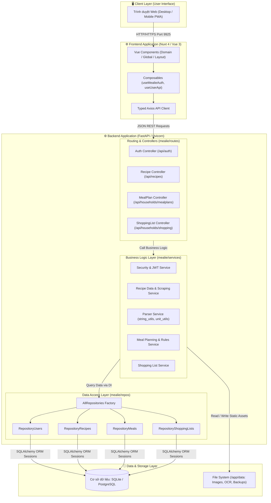
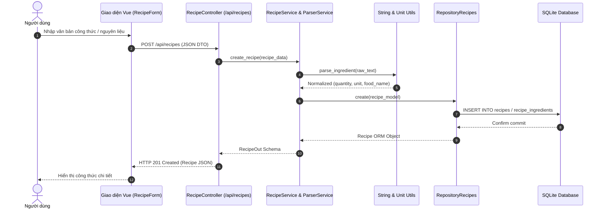
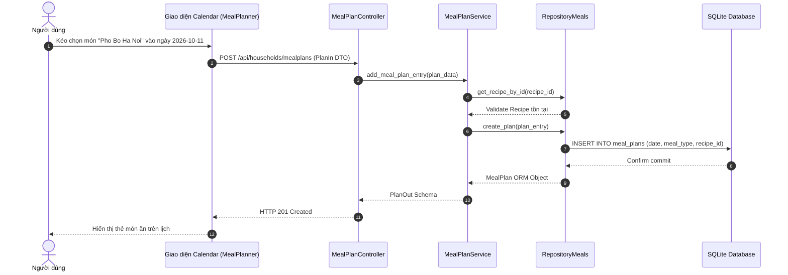
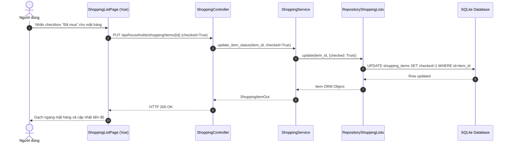

# BÁO CÁO CÔNG VIỆC GIỮA KỲ: PHÂN TÍCH HỆ THỐNG MEALIE & KẾ HOẠCH ÁP DỤNG KIỂM THỬ NÂNG CAO (PBT)

> **Môn học:** Kiểm thử phần mềm | **Học kỳ:** Giữa kỳ  
> **Thực hiện bởi:** Trần Ngọc Bảo Phước (MSSV: `2312719`)  
> **Nhóm thực hiện:** Nhóm 6  
> **Tổ hợp đề tài:** **Mealie (R02 - v3.28.0)** + **Property-Based Testing với Hypothesis (K01)**  
> **Kho lưu trữ GitHub:** [https://github.com/2312726-collab/KTPM-nhom6-R02-K01](https://github.com/2312726-collab/KTPM-nhom6-R02-K01)  
> **Nhánh phát triển cá nhân:** [`2312719-TranNgocBaoPhuoc`](https://github.com/2312726-collab/KTPM-nhom6-R02-K01/tree/2312719-TranNgocBaoPhuoc)

---

## 🎯 1. MỤC TIÊU TRỌNG TÂM CỦA GIỮA KỲ

Giai đoạn giữa kỳ tập trung vào việc hoàn thành **Phần 1: Phân tích hệ thống và thiết lập môi trường (System Analysis & Setup)** kết hợp với việc **Lập kế hoạch áp dụng kỹ thuật kiểm thử nâng cao cho giai đoạn tiếp theo**:

1. **Khảo sát và vận hành thực tế hệ thống mục tiêu:** Triển khai cài đặt thành công mã nguồn mở Mealie phiên bản cố định `v3.28.0` trên môi trường cá nhân qua Docker; vận hành thử nghiệm và thu thập bằng chứng 03 luồng nghiệp vụ cốt lõi với dữ liệu mẫu (seed data).
2. **Làm chủ kiến trúc hệ thống và xây dựng tài liệu On-boarding:** Phân tích mã nguồn hai tầng (FastAPI backend + Nuxt 4 frontend), mô hình hóa kiến trúc tổng thể bằng sơ đồ C4 Container và các sơ đồ luồng dữ liệu (Data Flow Diagrams), đồng thời chuẩn bị tài liệu On-boarding chi tiết đảm bảo tính tái lập 100% trên máy sạch.
3. **Hoạch định chiến lược kiểm thử tự động nâng cao (K01 - PBT):** Xây dựng nền tảng lý thuyết Property-Based Testing với thư viện Hypothesis, xác định phạm vi kiểm thử trọng tâm theo triết lý Ponytail vào module xử lý dữ liệu `mealie/services/parser_services/`, phân tích giả định - rủi ro và xác lập bộ tiêu chí đánh giá Pass/Fail rõ ràng.

---

## 📦 2. CÁC NỘI DUNG CỤ THỂ THỰC HIỆN VÀ NỘP (DELIVERABLES)

Nhóm đã hoàn thiện đầy đủ báo cáo, slide và sẵn sàng demo với 3 nội dung chính sau:

---

### a. Demo hệ thống chạy thành công trên máy tính

#### 1. Môi trường vận hành
- **Nền tảng triển khai:** Toàn bộ hệ thống Mealie được đóng gói và vận hành qua Docker & Docker Compose trên hệ điều hành Windows/Linux.
- **Phiên bản cố định (Pin Version):** Release Tag chính thức **`v3.28.0`** (Commit SHA: `0552eaa4a80031b8572849cca0ed95d07f1be001`) nhằm đảm bảo môi trường kiểm thử ổn định, tránh breaking changes giữa kỳ.
- **Cấu hình dịch vụ Docker:**
  - **Tên container:** `mealie`
  - **Cổng dịch vụ (Port Mapping):** `9925:9000` (truy cập Web UI tại `http://localhost:9925`, tránh xung đột các cổng mặc định 9000/8080).
  - **Cơ sở dữ liệu:** SQLite nhúng ổn định cho phiên bản demo độc lập.
  - **Persistent Volume:** `mealie-data:/app/data/` bảo toàn 100% dữ liệu công thức, lịch trình bữa ăn khi tái khởi động container.
  - **Biến môi trường cốt lõi:** `ALLOW_SIGNUP=true`, `TZ=Asia/Ho_Chi_Minh`, `BASE_URL=http://localhost:9925`.
- **Trạng thái thực tế:** Container khởi chạy mượt mà, Uvicorn server lắng nghe ổn định, Swagger API tài liệu hóa đầy đủ tại `http://localhost:9925/docs`.

#### 2. Thực thi và minh chứng 03 luồng nghiệp vụ cốt lõi với dữ liệu mẫu (Seed Data)

##### 🍲 Luồng 1: Quản lý Công thức nấu ăn (Recipe Management)
- **Mục tiêu:** Cho phép người dùng tạo mới, lưu trữ, chỉnh sửa và quản lý chi tiết công thức nấu ăn (tiêu đề, thời gian chế biến, khẩu phần, danh sách nguyên liệu và các bước hướng dẫn nấu ăn).
- **Thực thi trên hệ thống với dữ liệu mẫu:**
  - **Tên món ăn:** `"Pho Bo Ha Noi"` (slug: `pho-bo-ha-noi`).
  - **Mô tả:** *"Món phở bò truyền thống Hà Nội với nước dùng đậm đà hương vị quế, hồi, thảo quả, gừng nướng"*.
  - **Khẩu phần:** 4 bát (servings). **Thời gian chế biến:** 120 phút.
  - **Nguyên liệu mẫu:**
    - `500g Bánh phở tươi`
    - `400g Thịt bò bắp hoặc thăn thái mỏng`
    - `1kg Xương ống bò ninh nước dùng`
    - `Gia vị: Quế, hoa hồi, thảo quả, gừng nướng, hành tím, nước mắm`
  - **Hướng dẫn chế biến:** 3 bước chi tiết (Hầm xương lấy nước dùng, Chần bánh phở và xếp thịt bò tái, Chan nước dùng nóng và thưởng thức).
- **Kết quả minh chứng:** Công thức được lưu trữ thành công với ID định danh `94e3df6c-7053-4ae4-8efc-987e35ad8d64`, hiển thị trực quan trên giao diện Recipe Dashboard và phản hồi HTTP 200 từ REST API `/api/recipes/pho-bo-ha-noi`.

##### 📅 Luồng 2: Lập Kế hoạch Bữa ăn (Meal Planning)
- **Mục tiêu:** Hỗ trợ người dùng lên thực đơn theo ngày và theo loại bữa (bữa sáng, trưa, tối hoặc món phụ), gắn kết trực tiếp với công thức đã tạo trong hệ thống.
- **Thực thi trên hệ thống với dữ liệu mẫu:**
  - **Thời gian lập kế hoạch:** Ngày hiện tại (`2026-10-11`).
  - **Loại bữa ăn:** **Bữa tối (dinner)**.
  - **Gắn liên kết món ăn:** Công thức `"Pho Bo Ha Noi"` (Recipe ID: `94e3df6c-7053-4ae4-8efc-987e35ad8d64`).
  - **Ghi chú bổ sung:** *"Nấu phở bò phục vụ bữa tối sum họp gia đình"*.
- **Kết quả minh chứng:** Kế hoạch bữa ăn được tạo thành công với Meal Plan ID `1`. Giao diện Meal Planner Calendar hiển thị chính xác thẻ món ăn vào ô bữa tối của ngày đã chọn; đồng thời API `/api/households/mealplans` trả về dữ liệu lịch trình nhất quán.

##### 🛒 Luồng 3: Quản lý Danh sách Mua sắm (Shopping List Management)
- **Mục tiêu:** Tự động hoặc thủ công tổng hợp các mặt hàng/nguyên liệu cần mua ra chợ, quản lý định lượng và hỗ trợ đánh dấu trạng thái hoàn thành khi đi chợ.
- **Thực thi trên hệ thống với dữ liệu mẫu:**
  - **Tên danh sách:** `"Đi chợ cuối tuần"` (Shopping List ID: `1bda8992-a2bd-46e5-93cb-78274287d3ad`).
  - **Mặt hàng 1:** `"500g Bánh phở tươi"`.
  - **Mặt hàng 2:** `"400g Thịt bò thăn"`.
  - **Tương tác trực tiếp:** Người dùng nhấn chọn đánh dấu mặt hàng `"500g Bánh phở tươi"` thành **Đã mua (`checked = true`)**.
- **Kết quả minh chứng:** Trạng thái mặt hàng lập tức chuyển sang nhóm hoàn thành (gạch ngang tên), hệ thống cập nhật tức thì qua API `/api/households/shopping/items`, dữ liệu đồng bộ và lưu trữ bền vững.

---

### b. Trình bày Sơ đồ kiến trúc & Tài liệu On-boarding

#### 1. Phân tích mã nguồn và cây thư mục dự án
Hệ thống Mealie được tổ chức phân tách rõ ràng giữa Backend RESTful API và Frontend SPA:

```text
f:\KTPM\mealie
├── mealie/                     # [BACKEND] Lõi Python FastAPI (Repository - Service - Controller)
│   ├── alembic/                # Quản lý Database migrations tự động
│   ├── core/                   # Cấu hình hệ thống, bảo mật JWT, settings
│   ├── db/models/              # SQLAlchemy ORM Data Models (Recipe, User, MealPlan...)
│   ├── repos/                  # Data Access Layer (Repository Pattern, tự động scope theo household)
│   ├── routes/                 # API Controllers & Routers (auth, recipe, groups, households)
│   ├── schema/                 # Pydantic Schemas nghiêm ngặt (*In, *Out, *Create, *Update)
│   ├── services/               # Business Logic Layer (parser_services, recipe_service...)
│   └── app.py / main.py        # Điểm khởi chạy FastAPI backend application
├── frontend/                   # [FRONTEND] Mã nguồn Nuxt 4 + Vue 3 + TypeScript
│   ├── app/
│   │   ├── components/         # Giao diện Domain, Global, Layout
│   │   ├── composables/        # State management (useMealieAuth, useUserApi)
│   │   ├── lib/api/            # Typed API Clients tương tác Backend
│   │   └── pages/              # File-system routing của Nuxt
│   ├── package.json            # Quản lý thư viện phụ thuộc Frontend
│   └── nuxt.config.ts          # Cấu hình Nuxt 4 framework
├── docker-compose.yml          # Đóng gói triển khai container chuẩn v3.28.0 (Port 9925)
├── tests/                      # Bộ kiểm thử tự động của dự án (Unit, Integration, PBT)
├── pytest.ini                  # Cấu hình Pytest runner & Hypothesis markers
└── pyproject.toml              # Quản lý dependencies & metadata Backend (uv package manager)
```

##### Nhận diện các Module và Thư viện / Dependency chính:
- **Backend (Python 3.14 / 3.13):**
  - `FastAPI` & `Uvicorn`: Cung cấp Web Server và RESTful API bất đồng bộ (async/await), tự động sinh OpenAPI/Swagger.
  - `Pydantic v2`: Xác thực dữ liệu đầu vào/ra (Data Validation) và tự động chuyển đổi kiểu dữ liệu.
  - `SQLAlchemy` & `Alembic`: Ánh xạ quan hệ thực thể (ORM) và tự động đồng bộ lược đồ cơ sở dữ liệu.
  - `recipe-scrapers` & `BeautifulSoup4`: Bóc tách cấu trúc công thức nấu ăn từ trang web bất kỳ.
  - `ingredient-parser-nlp` & `pint`: Nhận diện, chuẩn hóa nguyên liệu và chuyển đổi đơn vị đo lường.
- **Frontend (Nuxt 4 + Vue 3 + TypeScript):**
  - `Nuxt 4` & `Vite`: Framework Single Page Application (SPA) tối ưu tốc độ build và routing.
  - `Vuetify`: Thư viện giao diện Material Design responsive.
  - `Axios`: HTTP client xử lý gửi yêu cầu kèm JWT token.
  - `Vue Composables`: Quản lý state tập trung mà không cần Vuex phức tạp.

#### 2. Sơ đồ kiến trúc hệ thống mức Container / Component (Mô hình C4)
Kiến trúc Mealie tuân thủ nghiêm ngặt mô hình **Repository - Service - Controller**, tách biệt giữa giao diện và xử lý dữ liệu:



#### 3. Sơ đồ luồng dữ liệu (Data Flow) chi tiết của 3 nghiệp vụ trọng tâm

##### 🔹 Data Flow 1: Nghiệp vụ Bóc tách & Quản lý Công thức nấu ăn (Recipe Management & Parsing)


##### 🔹 Data Flow 2: Nghiệp vụ Lập kế hoạch Bữa ăn (Meal Planning)


##### 🔹 Data Flow 3: Nghiệp vụ Quản lý Danh sách Mua sắm (Shopping List)


#### 4. Tài liệu On-boarding (Hướng dẫn dựng hệ thống từ máy sạch)
- **Tài liệu chi tiết:** Đã biên soạn tại [`Documents/Bao_cao_cong_viec_Phuoc/HUONG_DAN_KHOI_DONG.md`](file:///f:/KTPM/mealie/Documents/Bao_cao_cong_viec_Phuoc/HUONG_DAN_KHOI_DONG.md).
- **Yêu cầu môi trường tối thiểu:**
  - Docker Desktop (Windows/macOS) hoặc Docker Engine (Linux).
  - Cổng mạng `9925` trống.
- **Quy trình 3 bước dựng hệ thống độc lập:**
  1. *Bước 1:* Tải mã nguồn hoặc file `docker-compose.yml`.
  2. *Bước 2:* Chạy lệnh khởi động:
     ```bash
     docker compose up -d
     ```
  3. *Bước 3:* Truy cập trình duyệt tại `http://localhost:9925`, đăng nhập tài khoản quản trị ban đầu hoặc đăng ký tài khoản mới để trải nghiệm đầy đủ tính năng.

---

### c. Báo cáo kế hoạch áp dụng kỹ thuật kiểm thử nâng cao (K01 - Property-Based Testing)

#### 1. Cơ sở lý thuyết của Property-Based Testing (PBT) với Hypothesis
- **Bản chất của PBT:**
  - Khác biệt hoàn toàn với **Example-Based Testing** (chỉ kiểm tra một vài ca test cứng cố định do con người tự nghĩ ra), PBT kiểm thử tính đúng đắn của phần mềm dựa trên các **tính chất bất biến (Properties / Invariants)** cần được bảo toàn trên toàn bộ không gian đầu vào.
  - Sử dụng thư viện `Hypothesis` trong Python, hệ thống tự động sinh hàng trăm đến hàng ngàn ca kiểm thử ngẫu nhiên từ đơn giản đến cực đoan (fuzzing) để tìm kiếm ca vi phạm.
- **Quy trình 4 bước vận hành của Hypothesis:**
  $$\text{Generate Data} \longrightarrow \text{Execute Function} \longrightarrow \text{Check Invariants} \longrightarrow \text{Shrinking \& Report}$$
- **Ưu thế vượt trội:**
  - *Tự động phát hiện lỗi tiềm ẩn (Edge Cases):* Dễ dàng phát hiện các chuỗi Unicode dị biệt, phân số hiếm gặp, ký tự null, khoảng trắng bất thường mà lập trình viên thường bỏ sót.
  - *Cơ chế thu nhỏ lỗi (Shrinking):* Khi phát hiện 1 ca lỗi phức tạp (chuỗi 200 ký tự crash hệ thống), Hypothesis tự động cắt gọt, thu nhỏ dữ liệu về ví dụ ngắn nhất có thể gây lỗi (ví dụ chỉ còn 1 ký tự đặc biệt) giúp lập trình viên xác định nguyên nhân cốt lõi trong vài giây.
- **Giới hạn kỹ thuật:**
  - Thời gian thực thi lâu hơn unit test truyền thống nếu cấu hình số lượng test cases quá lớn.
  - Đòi hỏi tư duy trừu tượng hóa để tìm ra các tính chất toán học bất biến, không thể kiểm tra đơn thuần kiểu so sánh giá trị kỳ vọng cố định.

#### 2. Xác định phạm vi kiểm thử (Scope Boundary)
- **Khu vực mục tiêu được lựa chọn:** Module tiền xử lý chuỗi và bóc tách định lượng nguyên liệu:
  - `mealie/services/parser_services/parser_utils/string_utils.py`
  - `mealie/services/parser_services/parser_utils/unit_utils.py`
- **Lý do lựa chọn (Áp dụng triết lý Ponytail):**
  - **Tránh ôm đồm toàn bộ hệ thống đồ sộ:** Mealie có hàng trăm API và tầng giao diện Vue phức tạp; việc test API hay UI sẽ rất cồng kềnh, chậm chạp và dễ bị flaky test do phụ thuộc mạng/database.
  - **Tập trung vào "trái tim" dữ liệu:** Module `parser_services` là nơi xử lý toàn bộ dữ liệu văn bản đầu vào từ người dùng và website bên ngoài (Trust Boundary). Nếu module này bị crash hoặc lỗi tính toán, toàn bộ các tính năng Recipe, Shopping List và Meal Plan đều bị sai lệch.
  - **Hàm thuần túy (Pure Functions):** Các hàm xử lý chuỗi và phân số có tính toán học cao, không phụ thuộc database sống, cực kỳ phù hợp để áp dụng PBT đạt hiệu năng cao và độ tin cậy tuyệt đối.

#### 3. Giả định & Quản lý rủi ro kỹ thuật

| Thành phần | Giả định / Rủi ro kỹ thuật | Giải pháp khắc phục |
| :--- | :--- | :--- |
| **Môi trường chạy** | Giả định máy chấm bài có thể chưa cài đầy đủ dependencies nặng của Mealie server. | Thiết lập cơ chế nạp module thông minh (`importlib.util` / fallback) cho phép chạy bộ test PBT hoàn toàn độc lập, cô lập. |
| **Rủi ro Timeout** | Hypothesis sinh ca kiểm thử quá phức tạp gây chạy lâu hoặc treo runner. | Cấu hình tham số `deadline=None` và giới hạn kích thước chuỗi sinh ngẫu nhiên hợp lý (`max_size=500`). |
| **Rủi ro Flaky Test** | Test case chạy ngẫu nhiên có thể pass ở lần này nhưng fail ở lần khác. | Xây dựng 3 profiles cấu hình chuẩn: `dev` (100 examples), `ci` (300 examples), `thorough` (1000 examples); tự động lưu cache các counterexamples trong `.hypothesis/` để chạy lại luôn luôn tái hiện được. |

#### 4. Tiêu chí đánh giá hoàn thành (Pass/Fail Criteria) & Thiết kế Properties
Dự án xác lập tiêu chí hoàn thành với việc thiết kế và hiện thực tối thiểu **03 nhóm thuộc tính (Properties)** toán học cốt lõi:

##### 1️⃣ Property 1.1: Tính lũy đẳng (Idempotence)
- **Đặc tả:** Hàm chuẩn hóa khi áp dụng một lần hay áp dụng liên tiếp nhiều lần phải cho kết quả giống hệt nhau:
  $$f(f(s)) = f(s), \quad \forall s \in \text{String}$$
- **Hàm kiểm thử áp dụng:**
  - `test_remove_footnote_markers_idempotent`: Xóa dấu chú thích `*` ở cuối chuỗi.
  - `test_move_parens_to_end_idempotent`: Di chuyển ngoặc đơn bổ nghĩa về cuối chuỗi.
  - `test_convert_vulgar_fractions_idempotent`: Chuẩn hóa phân số unicode.

##### 2️⃣ Property 1.2: Tính bền bỉ và không sập ứng dụng (Crash-free / Robustness)
- **Đặc tả:** Với mọi chuỗi ký tự ngẫu nhiên bất kỳ (kể cả chuỗi rỗng, khoảng trắng, ký tự điều khiển, ký tự unicode lạ), hàm xử lý không bao giờ được phép ném ra Unhandled Exception (500 Server Error):
  $$\forall s \sim \text{st.text()}, \quad \text{Function}(s) \text{ terminates without crash}$$
- **Hàm kiểm thử áp dụng:**
  - `test_convert_vulgar_fractions_crash_free_and_robust`
  - `test_extract_quantity_crash_free_and_non_negative`

##### 3️⃣ Property 1.3: Tính hoàn chỉnh (Completeness) & Bảo toàn giá trị toán học
- **Đặc tả:**
  - *Tính hoàn chỉnh:* Sau khi chuẩn hóa, trong chuỗi kết quả tuyệt đối không còn sót lại bất kỳ ký tự phân số unicode nào trong từ điển 18 ký tự (`¼, ½, ¾, ⅐...`).
  - *Tính bảo toàn giá trị:* Khi bóc tách hỗn số dạng $W + \frac{N}{D}$, giá trị số học thực tế phải bảo toàn chính xác trong sai số $\epsilon \le 10^{-4}$.
- **Hàm kiểm thử áp dụng:**
  - `test_convert_vulgar_fractions_completeness`
  - `test_extract_quantity_mixed_fraction_accuracy`

##### 📊 Kết quả kiểm thử thực nghiệm (Pass 100%):
Toàn bộ **07 kịch bản PBT** được đóng gói tại [`tests/unit_tests/test_pbt_string_utils.py`](file:///f:/KTPM/mealie/tests/unit_tests/test_pbt_string_utils.py) đã được thực thi và xác nhận vượt qua **100% (7/7 Passed)** trên môi trường kiểm thử với test runner `pytest`.

---

## 📋 3. TỔNG KẾT VÀ BÀN GIAO SẢN PHẨM GIỮA KỲ

| STT | Tên sản phẩm / Deliverable | Đường dẫn trong Repository | Trạng thái |
| :---: | :--- | :--- | :---: |
| 1 | **Báo cáo phân tích hệ thống & kiến trúc** | `Documents/Bao_cao_cong_viec_Phuoc/PHAN_TICH_HE_THONG_VA_KIEN_TRUC.md` | **Hoàn thành** |
| 2 | **Tài liệu hướng dẫn On-boarding** | `Documents/Bao_cao_cong_viec_Phuoc/HUONG_DAN_KHOI_DONG.md` | **Hoàn thành** |
| 3 | **Cấu hình môi trường chạy Docker** | `docker-compose.yml` (v3.28.0, Port 9925) | **Hoàn thành** |
| 4 | **Test Harness & Cấu hình Pytest/Hypothesis** | `pytest.ini`, `tests/conftest.py` | **Hoàn thành** |
| 5 | **Mã nguồn kiểm thử tự động PBT Property 1** | `tests/unit_tests/test_pbt_string_utils.py` | **Hoàn thành** |
| 6 | **Tài liệu hướng dẫn tái lập kiểm thử 1-click** | `tests/README.md` | **Hoàn thành** |
| 7 | **Báo cáo tiến độ cá nhân & nhóm** | `Documents/Bao_cao_cong_viec_Phuoc/BAO_CAO_CONG_VIEC_PHUOC.md` | **Hoàn thành** |
