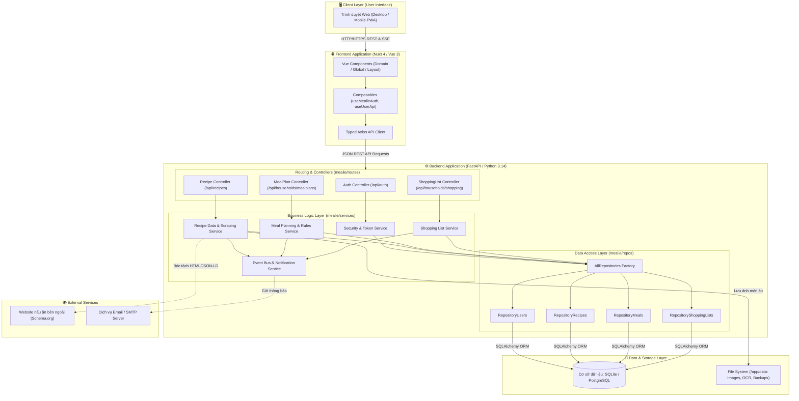
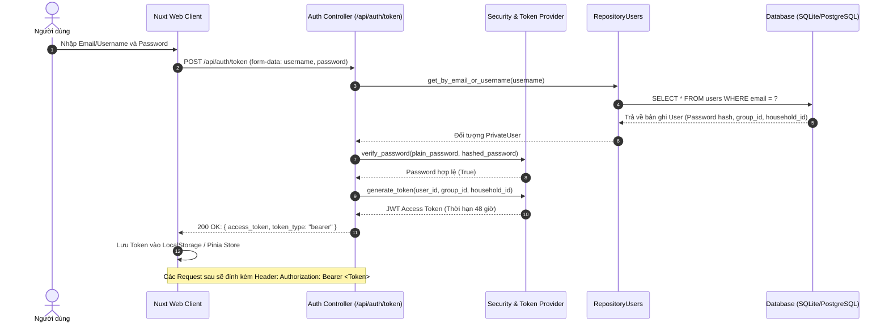
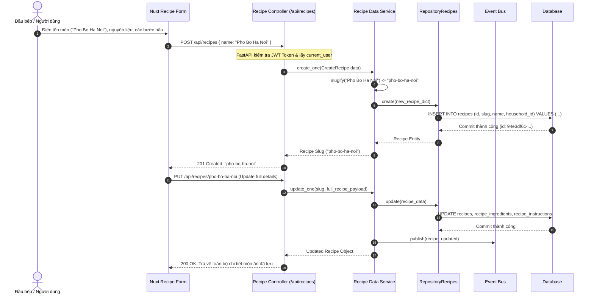
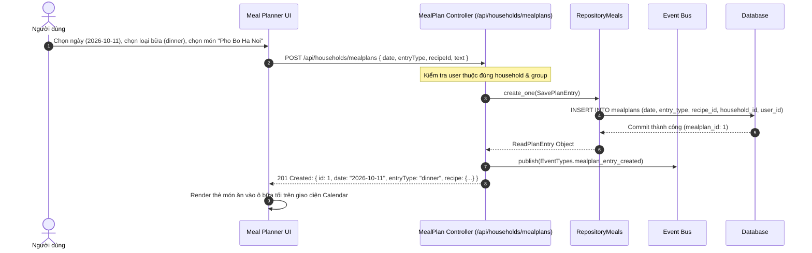
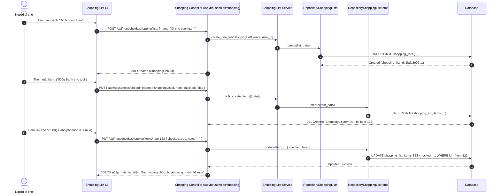

# PHÂN TÍCH HỆ THỐNG & SƠ ĐỒ KIẾN TRÚC MEALIE

---

## 1. PHÂN TÍCH MÃ NGUỒN VÀ CẤU TRÚC HỆ THỐNG

### 1.1. Tổng quan kiến trúc mã nguồn
Hệ thống **Mealie** được thiết kế theo mô hình phân tầng chặt chẽ (**Layered Architecture**) kết hợp mô hình **Repository - Service - Controller**, phân tách độc lập giữa tầng giao diện người dùng (Frontend SPA) và tầng xử lý nghiệp vụ/dịch vụ dữ liệu (Backend RESTful API).

```
f:\KTPM\mealie
├── mealie/                     # [BACKEND] Mã nguồn lõi Python FastAPI
│   ├── alembic/                # Database migrations (Alembic)
│   ├── core/                   # Cấu hình, bảo mật, jwt tokens, settings
│   ├── db/models/              # SQLAlchemy ORM Data Models
│   ├── repos/                  # Data Access Layer (Repository Pattern)
│   ├── routes/                 # API Controllers & Routers (FastAPI)
│   ├── schema/                 # Pydantic Schemas (In/Out/Create/Update)
│   ├── services/               # Business Logic Layer (Dịch vụ nghiệp vụ)
│   └── app.py / main.py        # Điểm khởi chạy ứng dụng backend
├── frontend/                   # [FRONTEND] Mã nguồn Nuxt 4 + Vue 3
│   ├── app/
│   │   ├── components/         # Giao diện Domain, Global, Layout
│   │   ├── composables/        # State Management, Auth, API Composables
│   │   ├── lib/api/            # Typed API Clients tương tác Backend
│   │   ├── pages/              # File-system routing (Nuxt Pages)
│   │   └── lang/               # Đa ngôn ngữ (i18n locales)
│   ├── package.json            # Quản lý dependencies Frontend
│   └── nuxt.config.ts          # Cấu hình Nuxt 4 framework
├── docker/                     # Cấu hình Dockerfile, entrypoint & dev compose
├── Taskfile.yml                # Tự động hóa các tác vụ (Build, Test, Lint, Migrate)
└── pyproject.toml              # Quản lý dependencies & metadata Backend (uv)
```

---

### 1.2. Nhận diện các Module và Dependency chính

#### A. Backend (Python 3.14 + FastAPI)
Quản lý tập trung qua `pyproject.toml` và `uv.lock`:

| Phân loại | Thư viện / Dependency chính | Vai trò kỹ thuật trong hệ thống |
| :--- | :--- | :--- |
| **Web Framework & API** | `fastapi==0.142.2`, `uvicorn[standard]==0.54.0` | Cung cấp RESTful API hiệu năng cao, dependency injection, xử lý bất đồng bộ (asyncio), tự động sinh Swagger/OpenAPI docs. |
| **Data Validation & DTO** | `pydantic==2.13.5`, `pydantic-settings==2.15.0` | Định nghĩa schemas, xác thực dữ liệu đầu vào/ra nghiêm ngặt (`*In`, `*Out`, `*Create`, `*Update`). |
| **Cơ sở dữ liệu & ORM** | `SQLAlchemy`, `alembic`, `psycopg2-binary` | Quản lý kết nối DB (SQLite / PostgreSQL), ánh xạ quan hệ thực thể (ORM), tự động chạy migration phiên bản CSDL. |
| **Bảo mật & Xác thực** | `bcrypt==5.0.0`, `pyjwt==2.15.1`, `authlib==1.8.0` | Mã hóa mật khẩu bảo mật cao, cấp phát và xác thực JSON Web Token (JWT), hỗ trợ OIDC & LDAP. |
| **Xử lý dữ liệu & Bóc tách** | `recipe-scrapers==15.12.0`, `beautifulsoup4`, `extruct` | Tự động phân tích và trích xuất công thức nấu ăn chuẩn cấu trúc schema.org từ đường link trang web bất kỳ. |
| **Xử lý ngôn ngữ tự nhiên** | `ingredient-parser-nlp==2.8.0`, `pint==0.26.1` | Chuẩn hóa, bóc tách nguyên liệu, định lượng và chuyển đổi đơn vị đo lường thông minh. |
| **Tối ưu hóa I/O** | `orjson==3.12.0`, `httpx==0.28.1` | Tối ưu tuần tự hóa JSON tốc độ cao, HTTP client bất đồng bộ cho tác vụ ngoại vi. |

#### B. Frontend (Nuxt 4 + Vue 3 + TypeScript)
Quản lý tập trung qua `frontend/package.json`:

| Phân loại | Thư viện / Dependency chính | Vai trò kỹ thuật trong hệ thống |
| :--- | :--- | :--- |
| **Framework & Engine** | `nuxt==4.4.6`, `vue==3.5.35`, `vite` | Xây dựng Single Page Application (SPA), routing tự động, Server-Sent Events (SSE), tối ưu bundling. |
| **Giao diện & Thành phần UI** | `vuetify==4.1.2`, `@mdi/js`, `vuetify-nuxt-module` | Thư viện Material Design UI responsive, bộ icon MDI, hỗ trợ Dark/Light theme. |
| **Quản lý trạng thái (State)** | Vue Composables, `@vueuse/core` | Quản lý trạng thái toàn cục (Auth, Household Context, Settings) không cần Vuex phức tạp. |
| **HTTP Client** | `axios==1.8.1` | Tương tác với FastAPI backend, gắn kèm JWT Bearer Token trong interceptors. |
| **Đa ngôn ngữ & Tiện ích** | `@nuxtjs/i18n`, `date-fns`, `fuse.js` | Hỗ trợ 35+ ngôn ngữ, định dạng ngày tháng theo locale, tìm kiếm mờ (fuzzy search) tại client. |

---

## 2. SƠ ĐỒ KIẾN TRÚC HỆ THỐNG

### 2.1. Sơ đồ kiến trúc mức Container / Component (C4 Model - Container Level)

Hệ thống được thiết kế theo cấu trúc mô-đun hóa với ranh giới phân tách rõ ràng giữa Client, Web Server, Controller, Service, Repository và Database:



---

## 3. PHÂN TÍCH & BIỂU DIỄN LUỒNG DỮ LIỆU (DATA FLOW) TRỌNG TÂM

Dưới đây là 04 luồng nghiệp vụ cốt lõi, phản ánh đầy đủ chu trình xử lý dữ liệu từ Client đến Database và là phạm vi trọng tâm cho công tác kiểm thử hệ thống.

---

### 3.1. Luồng 1: Xác thực & Đăng nhập người dùng (Authentication & Authorization)
*Mục tiêu*: Chứng thực danh tính người dùng bằng email/password, cấp phát JWT Access Token và thiết lập ngữ cảnh nhóm/hộ gia đình (Multi-tenancy context).



---

### 3.2. Luồng 2: Quản lý & Tạo mới Công thức nấu ăn (Recipe Management)
*Mục tiêu*: Tạo mới món ăn, tự động tạo slug duy nhất, lưu trữ nguyên liệu, thời gian, khẩu phần và hướng dẫn chế biến.



---

### 3.3. Luồng 3: Lập Kế hoạch Bữa ăn (Meal Planning Flow)
*Mục tiêu*: Lên lịch bữa ăn theo ngày, liên kết với công thức món ăn đã có trong hệ thống và hiển thị lên lịch trình gia đình.



---

### 3.4. Luồng 4: Quản lý & Cập nhật Danh sách Mua sắm (Shopping List & Item Checking)
*Mục tiêu*: Quản lý danh sách nguyên liệu cần mua, đồng bộ trạng thái tick hoàn thành (Checked) khi đi chợ.



---

## 4. ĐÁNH GIÁ VÀ ĐỊNH HƯỚNG PHẠM VI KIỂM THỬ (TEST SCOPE)

Từ kiến trúc và các luồng dữ liệu trên, phạm vi kiểm thử trọng tâm bao gồm:

1. **Kiểm thử tích hợp API (Integration Testing)**:
   - Xác thực JWT token, phân quyền dữ liệu theo nhóm hộ gia đình (Household Multi-tenancy Isolation).
   - Kiểm tra ràng buộc dữ liệu Pydantic schema cho payload đầu vào của Recipes, Mealplans, Shopping Lists.
2. **Kiểm thử logic nghiệp vụ (Unit / Service Testing)**:
   - Đảm bảo tính toán thời gian, chuẩn hóa tên đơn vị/nguyên liệu (`ingredient-parser-nlp`).
   - Kiểm tra logic tự sinh slug món ăn không trùng lặp (`python-slugify`).
3. **Kiểm thử luồng dữ liệu liên thông (End-to-End Testing)**:
   - Luồng liên kết khép kín: **Công thức nấu ăn** -> Đưa vào **Kế hoạch bữa ăn** -> Tự động sinh nguyên liệu vào **Danh sách mua sắm** -> Đánh dấu hoàn tất khi mua hàng.
