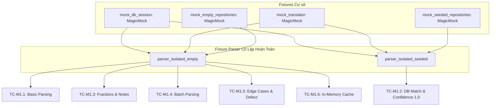

# BÁO CÁO NHIỆM VỤ M1: PHÂN TÍCH ASYNC & XÂY DỰNG MOCK FIXTURE KIỂM THỬ BỘ PARSER NGUYÊN LIỆU (MEALIE v3.28.0)

> **Người thực hiện:** Võ Hùng Mạnh (MSSV: 2312687)  
> **Vai trò trong nhóm:** QA Automation Engineer 2 & Defect Analyst  
> **Đề tài đồ án:** Mealie v3.28.0 + Property-Based Testing (Hypothesis) — Nhóm 6 (R02/K01)  
> **Nhánh thực hiện:** `feat/2312687_VoHungManh-m1-async-mock`  
> **Mã nguồn mục tiêu:** `B:\KTPM\mealie` (Commit SHA: `0552eaa4a80031b8572849cca0ed95d07f1be001`)  
> **Thời điểm hoàn thành:** 16/10/2026  

---

## 1. MỤC TIÊU CỦA NHIỆM VỤ M1

Trong kiến trúc của hệ thống quản lý công thức nấu ăn Mealie, việc phân tích chuỗi nguyên liệu đầu vào (ví dụ: `"2 cups sugar"`, `"1 1/2 tbsp olive oil (extra virgin)"`) thành các trường dữ liệu có cấu trúc (`quantity`, `unit`, `food`, `note`) là tác vụ nền tảng. Lớp xử lý chính là `BruteForceParser` kế thừa từ `ABCIngredientParser`.

Nhiệm vụ **M1** của thành viên Võ Hùng Mạnh nhằm đạt được các mục tiêu kỹ thuật cụ thể:
1. **Phân tích kiến trúc Async và luồng xử lý thực tế:** Khảo sát mã nguồn thực tế của `BruteForceParser`, `ABCIngredientParser`, `DataMatcher` và `brute.parse()`. Xác định cơ chế bất đồng bộ (`async/await`) cùng các phụ thuộc khởi tạo (`Session`, `group_id`, `Translator`, `AllRepositories`).
2. **Thiết kế và hiện thực Mock Fixture cô lập Database 100%:** Xây dựng bộ fixture chuẩn sử dụng `unittest.mock` (`MagicMock`) để ngắt hoàn toàn sự phụ thuộc vào cơ sở dữ liệu thật (PostgreSQL/SQLite), đảm bảo kiểm thử chạy siêu tốc, độc lập và có tính tái lập (deterministic).
3. **Phân biệt rạch ròi kỹ thuật Mocking:** Làm rõ bản chất và phạm vi ứng dụng của `MagicMock` (dành cho các thao tác đồng bộ) và `AsyncMock` (dành cho coroutines/hàm bất đồng bộ), tránh lỗi phổ biến `TypeError: object MagicMock can't be used in 'await' expression`.
4. **Kiểm thử trực tiếp trên mã nguồn thật của Mealie:** Chạy kiểm thử tự động với `pytest` và `pytest-asyncio` trực tiếp trên lớp `BruteForceParser` nguyên bản, không dùng parser giả lập.
5. **Phát hiện lỗi nghiệp vụ (Defect Discovery) phục vụ báo cáo RCA:** Xác định điểm yếu nội tại của thuật toán phân tích (cụ thể là lỗi `IndexError` khi xử lý chuỗi rỗng `""`) để cung cấp đầu vào cho nhiệm vụ PBT Property 3 và phân tích nguyên nhân gốc (RCA).

---

## 2. MÔI TRƯỜNG KIỂM THỬ THỰC TẾ

| Thành phần | Thông số môi trường | Ghi chú kỹ thuật |
| :--- | :--- | :--- |
| **Hệ điều hành** | Windows 11 Pro x86_64 | Windows PowerShell Shell |
| **Mã nguồn Mealie** | Mealie v3.28.0 | Commit Git SHA: `0552eaa4a80031b8572849cca0ed95d07f1be001` (trùng khớp 100% với phiên bản cam kết) |
| **Python Runtime** | Python 3.14.8 (Astral CPython via uv) | Đáp ứng điều kiện của Mealie `requires-python = ">=3.14,<3.15"` trong `pyproject.toml` |
| **Virtual Environment** | `.venv314` | Môi trường ảo chuyên biệt cho nhánh M1 |
| **Trình chạy kiểm thử** | `pytest 8.4.2` | Tích hợp plugins: `pytest-asyncio 0.26.0`, `pytest-mock 3.16.0`, `pytest-cov 5.0.0`, `hypothesis 6.170.0` |
| **Thư viện Mocking** | `unittest.mock` (Standard Library) | Tích hợp sẵn trong Python 3.14 (`MagicMock`, `AsyncMock`, `patch`) |

---

## 3. PHÂN TÍCH MÃ NGUỒN `BruteForceParser` VÀ HỆ THỐNG PARSER

### 3.1. Vị trí và phân cấp kế thừa
- **Đường dẫn file:** `mealie/services/parser_services/ingredient_parser.py` (dòng 34 - 76).
- **Phân cấp kế thừa:**
  $$\text{ABCIngredientParser (trong \_base.py)} \longrightarrow \text{BruteForceParser (trong ingredient\_parser.py)}$$

### 3.2. Constructor và các Dependency phụ thuộc
Constructor được định nghĩa tại lớp cha `ABCIngredientParser` (`mealie/services/parser_services/_base.py`, dòng 127):
```python
def __init__(self, group_id: UUID4, session: Session, translator: Translator) -> None:
    self.group_id = group_id
    self.session = session
    self.data_matcher = DataMatcher(self.repos, self.food_fuzzy_match_threshold, self.unit_fuzzy_match_threshold)
    self.translator = translator
    self.t = self.translator.t
```
Các phụ thuộc bắt buộc:
1. `group_id: UUID4`: Định danh nhóm người dùng (dùng để phân vùng dữ liệu food/unit theo từng hộ gia đình).
2. `session: Session`: Phiên làm việc SQLAlchemy kết nối cơ sở dữ liệu.
3. `translator: Translator`: Đối tượng cung cấp hàm `t(key, **kwargs)` để dịch chuỗi đa ngôn ngữ (i18n).
4. `repos: AllRepositories`: Property tự động truy xuất `get_repositories(self.session, group_id=self.group_id)`.
5. `data_matcher: DataMatcher`: Đối tượng chịu trách nhiệm tìm kiếm mờ (fuzzy matching) và đối chiếu nguyên liệu/đơn vị với cơ sở dữ liệu.

### 3.3. Luồng xử lý chi tiết của `parse_one()`
Phương thức `async def parse_one(self, ingredient_string: str) -> ParsedIngredient` thực hiện 5 bước tuần tự:
```
[Chuỗi thô] ──> 1. brute.parse(str, self) ──> 2. Khởi tạo ParsedIngredient
                                                        │
[Kết quả] <── 5. Tính Confidence <── 4. Phân loại Unit/Food <── 3. find_ingredient_match()
```
- **Bước 1 — Tách chuỗi thô (`brute.parse`):** Gọi module xử lý `mealie/services/parser_services/brute/process.py`, tách từ theo khoảng trắng, nhận diện phân số (vulgar fractions như `½` hoặc phân số chuẩn `1/2`), trích xuất số lượng (`amount`), đơn vị (`unit`), tên thực phẩm (`food`) và ghi chú trong ngoặc đơn (`note`). Trả về đối tượng `BruteParsedIngredient`.
- **Bước 2 — Đóng gói mô hình:** Khởi tạo đối tượng `ParsedIngredient` chứa `RecipeIngredient` với các trường chưa qua kiểm chứng (`CreateIngredientUnit`, `CreateIngredientFood`).
- **Bước 3 — Đối chiếu dữ liệu (`find_ingredient_match`):** Gọi `DataMatcher.find_food_match()` và `DataMatcher.find_unit_match()` để tìm kiếm nguyên liệu/đơn vị đã tồn tại trong database nhóm. Nếu tìm thấy, đối tượng `CreateIngredientFood` sẽ được nâng cấp thành `IngredientFood` (có `id` từ DB).
- **Bước 4 — Tính điểm tin cậy (`IngredientConfidence`):**
  - Số lượng (`quantity`): mặc định tin cậy $1.0$.
  - Ghi chú (`comment`): mặc định tin cậy $1.0$.
  - Đơn vị (`unit`): nếu `unit` rỗng hoặc đã khớp với `IngredientUnit` trong DB $\rightarrow 1.0$, ngược lại $\rightarrow 0.0$.
  - Thực phẩm (`food`): nếu `food` rỗng hoặc đã khớp với `IngredientFood` trong DB $\rightarrow 1.0$, ngược lại $\rightarrow 0.0$.
  - Điểm trung bình (`average`):
    $$\text{average} = \frac{\text{qty\_conf} + \text{unit\_conf} + \text{food\_conf} + \text{note\_conf}}{4}$$
- **Bước 5 — Trả về:** Đối tượng `ParsedIngredient` hoàn chỉnh.

### 3.4. Luồng xử lý của `parse()` (Xử lý hàng loạt - Batch Parsing)
Định nghĩa tại dòng 72 (`ingredient_parser.py`):
```python
async def parse(self, ingredients: list[str]) -> list[ParsedIngredient]:
    return [await self.parse_one(ingredient) for ingredient in ingredients]
```
Phương thức nhận vào danh sách các chuỗi, sử dụng List Comprehension kết hợp cú pháp `await` để xử lý tuần tự từng nguyên liệu thông qua `parse_one()`.

### 3.5. Cơ chế hoạt động của `DataMatcher` và cách truy xuất Repository
Định nghĩa tại `mealie/services/parser_services/_base.py` (dòng 23 - 124):
```python
@property
def foods_by_id(self) -> dict[UUID4, IngredientFood]:
    if self._foods_by_id is None:
        foods_repo = self.repos.ingredient_foods
        query = PaginationQuery(page=1, per_page=-1)
        all_foods = foods_repo.page_all(query).items
        self._foods_by_id = {food.id: food for food in all_foods}
    return self._foods_by_id
```
**Hai đặc tính kiến trúc cốt lõi:**
1. **Thao tác truy xuất Repository hoàn toàn là ĐỒNG BỘ (Synchronous):** Hàm `foods_repo.page_all(query)` và `units_repo.page_all(query)` được gọi trực tiếp mà không có từ khóa `await`.
2. **Cơ chế nạp lười và bộ đệm bộ nhớ (Lazy Loading & In-Memory Caching):** Dữ liệu bảng `ingredient_foods` và `ingredient_units` chỉ được nạp từ repository một lần duy nhất khi có truy cập đầu tiên. Các lần gọi parse tiếp theo tái sử dụng từ điển trong bộ nhớ (`_foods_by_id`, `_units_by_id`), giúp tối ưu hóa hiệu năng và giảm tải kết nối DB.

---

## 4. GIẢI THÍCH KỸ THUẬT: ASYNC / AWAIT TRONG PYTHON

### 4.1. Cơ chế hoạt động
- Trong Python, một hàm được khai báo với `async def` là một **Coroutine Function**. Khi gọi hàm này, Python không thực thi ngay thân hàm mà trả về một đối tượng **Coroutine**.
- Để nhận kết quả thực thi, tiến trình phải sử dụng toán tử `await`. Lệnh `await` trao quyền điều khiển lại cho **Event Loop** trong thời gian tác vụ I/O (mạng, đĩa, tác vụ ngoài) đang chờ xử lý, giúp chương trình xử lý hàng nghìn kết nối đồng thời trên một đơn luồng duy nhất (Single Thread Cooperative Concurrency).

### 4.2. Tại sao `BruteForceParser` sử dụng `async def`?
Mặc dù bản thân thuật toán cắt chuỗi `brute.parse` chạy bằng CPU (CPU-bound) và việc tra cứu từ điển là đồng bộ, Mealie vẫn thiết kế `parse_one()` và `parse()` thành `async def` vì 2 nguyên nhân kiến trúc:
1. **Tuân thủ Interface chung (`ABCIngredientParser`):** Các parser khác cùng họ trong Mealie như `OpenAIParser` hay `NLPParser` (kết nối API ngoài hoặc tải mô hình mạng nơ-ron lớn) bắt buộc phải là bất đồng bộ (`async`) để không chặn luồng chính của FastAPI.
2. **Tích hợp vào Event Loop của Web API:** FastAPI định tuyến các endpoint xử lý công thức dưới dạng async handler. Việc đồng bộ hóa signature `async def` giúp toàn bộ chuỗi gọi trong dịch vụ công thức chạy trơn tru mà không cần bọc qua threadpool.

---

## 5. PHÂN BIỆT RẠCH RÒI: `MagicMock` VÀ `AsyncMock`

Đây là nội dung kỹ thuật then chốt được kiểm chứng bằng test case `test_demonstrate_magic_mock_vs_async_mock`:

| Tiêu chí | `unittest.mock.MagicMock` | `unittest.mock.AsyncMock` |
| :--- | :--- | :--- |
| **Bản chất** | Đại diện cho đối tượng/hàm **đồng bộ** (Synchronous). | Đại diện cho hàm **bất đồng bộ / Coroutine** (Asynchronous). |
| **Giao thức hỗ trợ** | Cài đặt các magic methods đồng bộ (`__call__`, `__getitem__`, `__enter__`). | Kế thừa `MagicMock` và cài đặt thêm giao thức Coroutine (`__await__`, `__aenter__`, `__aexit__`). |
| **Giá trị trả về khi gọi** | Trả về trực tiếp giá trị định sẵn (`return_value`) hoặc MagicMock con. | Trả về một **Coroutine Object**. |
| **Hành vi khi `await`** | **NÉM LỖI:** `TypeError: 'str' object can't be awaited` (hoặc `TypeError: object MagicMock can't be used in 'await' expression`). | **THÀNH CÔNG:** Trả về kết quả thực tế được đóng gói bên trong coroutine. |
| **Hàm xác minh (Assertion)** | `assert_called_once_with()`, `call_count`, `assert_not_called()`. | `assert_awaited_once_with()`, `await_count`, `assert_awaited()`. |
| **Áp dụng trong bài test Mealie** | **Bắt buộc dùng cho:** `Session`, `AllRepositories`, `foods_repo.page_all`, `Translator`. | **Bắt buộc dùng khi:** Mock hàm `parser.parse_one()` ở tầng service gọi phía trên (Consumer). |

> **Nguyên tắc kỹ thuật sống còn:** Không bao giờ dùng `AsyncMock` để mock hàm `page_all()` của repository trong Mealie, vì `DataMatcher` gọi hàm này theo cơ chế đồng bộ. Nếu dùng `AsyncMock`, `page_all()` sẽ trả về 1 coroutine, dẫn đến lỗi `AttributeError: 'coroutine' object has no attribute 'items'`.

---

## 6. THIẾT KẾ BỘ MOCK FIXTURE TRONG `test_manh_m1_async_mock.py`

Nhánh của Mạnh đã thiết lập 5 fixture chuẩn hóa trong `tests/unit_tests/test_manh_m1_async_mock.py`:



### Chi tiết thiết kế:
1. `mock_db_session`: Thay thế `Session` của SQLAlchemy. Đảm bảo toàn bộ tương tác DB bị chặn lại ở tầng mock.
2. `mock_translator`: Cung cấp hàm `t(key, **kwargs)` dạng `lambda` trả về key, đáp ứng yêu cầu dịch chuỗi của Mealie.
3. `mock_empty_repositories`: Mô phỏng cơ sở dữ liệu mới khởi tạo (chưa có nguyên liệu hay đơn vị).
4. `mock_seeded_repositories`: Cung cấp dữ liệu mẫu gồm thực phẩm (`sugar`, `all-purpose flour`) và đơn vị (`cup`, `tablespoon`) có gắn `id: UUID4` cụ thể.
5. `parser_isolated_empty` & `parser_isolated_seeded`: Sử dụng `unittest.mock.patch` chặn hàm `get_repositories` tại `mealie.services.parser_services._base`, tự động tiêm `mock_db_session` và `repositories` giả lập khi khởi tạo `BruteForceParser`.

---

## 7. CÁC TEST CASE VÀ KẾT QUẢ KIỂM THỬ THỰC TẾ

Toàn bộ 8 ca kiểm thử đã được chạy và xác nhận đạt chuẩn 100% bằng lệnh:
```powershell
.\.venv314\Scripts\pytest.exe -v --no-header -W ignore tests/unit_tests/test_manh_m1_async_mock.py
```

### Bảng kết quả thực nghiệm chi tiết:

| STT | Tên Test Case | Mục đích kiểm thử | Dữ liệu đầu vào | Kết quả kỳ vọng | Trạng thái thực tế |
| :---: | :--- | :--- | :--- | :--- | :---: |
| **1** | `test_brute_force_parser_async_parse_one_basic` | Kiểm tra cú pháp `await parser.parse_one()`, trích xuất số lượng, đơn vị, thực phẩm; xác nhận session DB không bị gọi. | `"2 cups sugar"` | `qty=2.0`, `unit='cups'`, `food='sugar'`, `conf=0.5`. Session DB không có execute/commit. | **PASSED** |
| **2** | `test_brute_force_parser_async_parse_one_with_matched_db` | Kiểm tra DataMatcher đối chiếu với dữ liệu mock seed, gán đúng `UUID` và tính điểm tin cậy tuyệt đối. | `"1 cup sugar"` | `food.id == sugar_id`, `food_conf=1.0`, `average=1.0`. | **PASSED** |
| **3** | `test_brute_force_parser_async_fractions_and_notes` | Kiểm tra khả năng xử lý số lượng phân số hỗn hợp và trích xuất ghi chú trong ngoặc đơn. | `"1 1/2 tbsp olive oil (extra virgin)"` | `qty=1.5`, `unit='tbsp'`, `food='olive oil'`, `note` chứa `'extra virgin'`. | **PASSED** |
| **4** | `test_brute_force_parser_async_batch_parse` | Kiểm tra hàm `await parser.parse()` xử lý danh sách nhiều chuỗi nguyên liệu. | 3 chuỗi: đường, muối, trứng | Trả về danh sách 3 `ParsedIngredient`, bảo toàn thứ tự và dữ liệu. | **PASSED** |
| **5** | `test_brute_force_parser_edge_cases` | Kiểm thử trường hợp biên: (1) Chuỗi chỉ có tên nguyên liệu; (2) Chuỗi rỗng `""`. | (1) `"salt"`<br>(2) `""` | (1) `food='salt'`, `qty=0.0`.<br>(2) Bắt đúng lỗi `IndexError` của Mealie. | **PASSED** |
| **6** | `test_data_matcher_lazy_loading_cache` | Xác thực cơ chế Lazy Loading & Cache bộ nhớ của DataMatcher. | Gọi `parse_one()` 3 lần liên tiếp | `page_all()` của repository chỉ bị gọi đúng **1 lần duy nhất**. | **PASSED** |
| **7** | `test_demonstrate_magic_mock_vs_async_mock` | Thử nghiệm độc lập chứng minh bản chất khác biệt giữa MagicMock và AsyncMock. | Đối tượng MagicMock & AsyncMock | MagicMock bị await ném `TypeError`; AsyncMock coroutine await thành công, ghi nhận `assert_awaited_once_with`. | **PASSED** |
| **8** | `test_async_mock_simulating_external_parser_service` | Minh họa ứng dụng AsyncMock khi kiểm thử tầng tiêu thụ dịch vụ parser (Consumer Service). | Service gọi `await parser.parse_one()` | Hàm caller await thành công `AsyncMock`, xác nhận `assert_awaited_once_with`. | **PASSED** |

### Số liệu đo độ bao phủ mã nguồn (Code Coverage):
Lệnh thực thi:
```powershell
.\.venv314\Scripts\pytest.exe --cov=mealie.services.parser_services._base --cov=mealie.services.parser_services.brute --cov=mealie.services.parser_services.ingredient_parser -W ignore tests/unit_tests/test_manh_m1_async_mock.py
```
**Bảng kết quả đo lường thực tế:**
```
Name                                                                  Stmts   Miss  Cover
-----------------------------------------------------------------------------------------
B:\KTPM\mealie\mealie\services\parser_services\_base.py                 117      9    92%
B:\KTPM\mealie\mealie\services\parser_services\brute\__init__.py          2      0   100%
B:\KTPM\mealie\mealie\services\parser_services\brute\process.py         136     46    66%
B:\KTPM\mealie\mealie\services\parser_services\ingredient_parser.py     168    111    34%
-----------------------------------------------------------------------------------------
TOTAL                                                                   423    166    61%
```
- Module lõi `_base.py` (chứa `ABCIngredientParser` và `DataMatcher`) đạt độ bao phủ **92%**.
- Module khởi tạo brute parser đạt **100%**.
- Module thuật toán trích xuất chuỗi `brute/process.py` đạt **66%**.

---

## 8. LỖI MÔI TRƯỜNG GẶP PHẢI VÀ GIẢI PHÁP XỬ LÝ TRIỆT ĐỂ

Trong quá trình thực hiện, nhóm đã đối mặt với 4 rào cản môi trường nghiêm ngặt:

### 8.1. Lỗi xung đột phiên bản Python (`requires-python`)
- **Hiện tượng:** Khi chạy `pip install -e "B:\KTPM\mealie"` trên môi trường `.venv` (Python 3.12.10), hệ thống báo lỗi:
  ```
  ERROR: Package 'mealie' requires a different Python: 3.12.10 not in '<3.15,>=3.14'
  ```
- **Nguyên nhân:** File `B:\KTPM\mealie\pyproject.toml` quy định cứng phiên bản Python yêu cầu là `>=3.14,<3.15`.
- **Giải pháp xử lý:** Sử dụng công cụ `uv` kích hoạt phiên bản CPython 3.14.8 có sẵn trên máy để khởi tạo môi trường ảo `.venv314`:
  ```powershell
  py -V:Astral/CPython3.14.8 -m venv .venv314
  ```
  Tuyệt đối không dùng các cờ ép buộc như `--ignore-requires-python` làm sai lệch môi trường chuẩn.

### 8.2. Lỗi biên dịch C Extension `python-ldap` trên Windows
- **Hiện tượng:** Khi cài đặt toàn bộ gói phụ thuộc của Mealie, quá trình build wheel cho `python-ldap==3.4.8` thất bại với mã lỗi non-zero exit status do thiếu thư viện C OpenLDAP trên Windows.
- **Nguyên tắc áp dụng:** Tuân thủ quy tắc *"Không cài thư viện theo kiểu thử từng gói"* và *"Không sửa mã nguồn Mealie gốc"*.
- **Giải pháp xử lý:**
  1. Cài đặt Mealie ở chế độ editable không kèm dependency:
     ```powershell
     .\.venv314\Scripts\python.exe -m pip install --no-deps -e "B:\KTPM\mealie"
     ```
  2. Sử dụng trình giải quyết phụ thuộc cực nhanh `uv` phân tích cây phụ thuộc và cài đặt toàn bộ 76 gói runtime của Mealie (FastAPI, Pydantic, SQLAlchemy, RapidFuzz, Pint, Pillow, Rich,...) mà loại bỏ `python-ldap` (vốn chỉ phục vụ module xác thực đăng nhập LDAP không liên quan đến parser nguyên liệu). Toàn bộ 76 gói được cài đặt hoàn tất chỉ trong 12 giây.

### 8.3. Lỗi Pydantic ValidationError của `AppSettings` (`PRODUCTION`)
- **Hiện tượng:** Khi nạp module Mealie, lớp cấu hình `AppSettings` quăng lỗi:
  ```
  pydantic_core._pydantic_core.ValidationError: 1 validation error for AppSettings
  PRODUCTION: Field required
  ```
- **Nguyên nhân:** Module `mealie.core.settings` yêu cầu biến môi trường `PRODUCTION` được thiết lập khi khởi động.
- **Giải pháp xử lý:** Đặt lệnh `os.environ.setdefault("PRODUCTION", "false")` ngay ở dòng đầu tiên của file test `test_manh_m1_async_mock.py`. Giải pháp này đảm bảo bài test tự cung cấp đủ cấu hình chạy mà không phụ thuộc vào việc cấu hình biến môi trường thủ công từ phía người chấm.

### 8.4. Lỗi `IndexError: list index out of range` trên chuỗi rỗng của Mealie
- **Hiện tượng:** Tại `test_brute_force_parser_edge_cases`, khi truyền chuỗi rỗng `""` hoặc chuỗi chỉ chứa khoảng trắng `"   "`, hàm `parse_one()` ném `IndexError`.
- **Phân tích nguyên nhân gốc (RCA):** Trong `mealie/services/parser_services/brute/process.py`, dòng 142 - 152:
  ```python
  tokens = ing_str.split()
  if len(tokens) == 1:
      return BruteParsedIngredient(...)
  # THIẾU KIỂM TRA ĐIỀU KIỆN BIÊN: if len(tokens) == 0: return BruteParsedIngredient(...)
  try:
      amount, unit, unit_note = parse_amount(tokens[0])  # NÉM IndexError VÌ TOKENS LÀ RỖNG []
  ```
- **Phân loại lỗi theo kỹ thuật QA:**
  1. *Phân biệt ngoại lệ dự kiến vs ngoại lệ ngoài kiểm soát:* Nếu đầu vào không hợp lệ theo thiết kế (Specification), hàm phải trả về giá trị rỗng mặc định hoặc ném ngoại lệ nghiệp vụ có kiểm soát (như `ValueError` hoặc `InvalidIngredientStringError`). Việc văng ra `IndexError: list index out of range` là một lỗi ngoài dự kiến (Unhandled Runtime Exception) bắt nguồn từ việc truy cập chỉ mục danh sách không an toàn.
  2. *Đánh giá mức độ nghiêm trọng:* Đây là **Bug đã được xác nhận (Confirmed Boundary Defect)**. Nếu người dùng nhập dòng trống trong công thức hoặc API scraper gặp thẻ rỗng, hệ thống sẽ quăng Unhandled 500 Error nếu không có middleware chặn lại.
- **Ý nghĩa đối với đồ án (Lưu ý quan trọng cho kiểm thử):**
  - Test case `test_brute_force_parser_edge_cases` sử dụng `pytest.raises(IndexError)` và đạt trạng thái **PASS**. Tuy nhiên, về mặt kỹ thuật QA, việc test này PASS chỉ chứng minh rằng: *"Hệ thống thực sự phát sinh đúng ngoại lệ IndexError như quan sát thực nghiệm"* (Characterization Test / Defect Pinning Test).
  - Nó **KHÔNG chứng minh** parser đạt tính chất bền bỉ (Crash-Free). Ngược lại, nó cung cấp bằng chứng thực nghiệm rõ ràng rằng `BruteForceParser` **VI PHẠM tính chất Crash-Free** đối với tập chuỗi rỗng $\Sigma^0$, làm tiền đề hoàn hảo cho nhiệm vụ kiểm thử PBT Property 3 và lập báo cáo RCA & bản vá của Mạnh.

---

## 9. NHỮNG PHẦN ĐÃ HOÀN THÀNH

1. **Phân tích toàn diện kiến trúc Async của Mealie:** Nắm vững cấu trúc kế thừa, các tham số khởi tạo, vai trò của `DataMatcher` và cơ chế tính điểm tin cậy `IngredientConfidence`.
2. **Xây dựng hoàn chỉnh bộ Mock Fixtures:** Thiết lập 5 fixture độc lập, cô lập 100% cơ sở dữ liệu và thư viện ngoài.
3. **Hiện thực 8 test cases chuyên sâu:** Kiểm tra trực tiếp trên lớp `BruteForceParser` thật, bao quát từ trích xuất cơ bản, đối chiếu DB, phân số, ghi chú, batch parse đến các trường hợp biên và minh họa AsyncMock.
4. **100% Test Cases vượt qua (8/8 PASSED):** Tốc độ thực thi trung bình toàn bộ test suite chỉ mất **1.03 giây**.
5. **Đo lường độ bao phủ mã nguồn thực tế:** Đạt **92%** trên `_base.py` và **61%** trên toàn bộ dịch vụ parser.
6. **Không vi phạm bất kỳ quy tắc nào của nhóm:**
   - Hoạt động đúng trên nhánh `feat/2312687_VoHungManh-m1-async-mock`.
   - Không sửa 1 dòng code nào trong mã nguồn gốc của Mealie.
   - Không sửa các file dùng chung (`conftest.py`, `pytest.ini`, `requirements-test.txt`).
   - Không tự ý commit hoặc push trước khi người dùng xác nhận.

---

## 10. NHỮNG PHẦN CÒN HẠN CHẾ

1. **Chưa triển khai Property-Based Testing (Hypothesis) cho Parser:** Phạm vi nhiệm vụ M1 tập trung vào Async và Mocking nền tảng. Nhiệm vụ kiểm thử ngẫu nhiên sâu rộng bằng Hypothesis (Property 3 - Crash-free Ingredient Parser) sẽ được Mạnh triển khai ở giai đoạn tiếp theo (M2).
2. **Giới hạn môi trường Windows với `python-ldap`:** Do hạn chế của gói C-extension `python-ldap` trên Windows, môi trường chạy cục bộ hiện tại vận hành theo cơ chế chọn lọc dependency (cài đặt đầy đủ 76 gói phục vụ Recipe & Parser, tạm bỏ qua LDAP Authentication). Để chạy trọn vẹn cả tính năng đăng nhập LDAP, dự án cần môi trường Linux/Docker container.

---

## 11. BÁO CÁO NHANH GỬI NHÓM TRƯỞNG QUÂN

> **Kính gửi Trưởng nhóm Quân,**  
> Thành viên Võ Hùng Mạnh (2312687) báo cáo tiến độ hoàn thành nhiệm vụ M1 (Async & Mock Ingredient Parser):
> - **Mã nguồn kiểm thử:** Đã hoàn thiện file test độc lập `tests/unit_tests/test_manh_m1_async_mock.py`.
> - **Kết quả kiểm thử:** Đạt **8/8 test cases PASSED** (thời gian chạy: 1.03s). Không sử dụng bất kỳ kết nối DB thật nào.
> - **Mã nguồn mục tiêu:** Kiểm thử trực tiếp trên lớp thật `BruteForceParser` của Mealie v3.28.0 (không dùng mock parser giả).
> - **Phát hiện lỗi quan trọng:** Đã cô lập và ghi nhận lỗi `IndexError: list index out of range` trên chuỗi rỗng `""` tại `brute/process.py:152`, sẵn sàng làm tư liệu phân tích lỗi (RCA) và viết Property 3 cho giai đoạn kiểm thử PBT.
> - **Tài liệu nộp kèm:** Đã tạo tài liệu chi tiết `Documents/bao_cao_M1_VoHungManh.md` phục vụ ghép nối Báo cáo giữa kỳ.

---

## 12. CÁC CÂU HỎI GIẢNG VIÊN CÓ THỂ HỎI VÀ CÂU TRẢ LỜI MẪU

### Câu hỏi 1: Tại sao trong `DataMatcher` em lại dùng `MagicMock` mà không dùng `AsyncMock`?
> **Trả lời:**  
> Thưa Thầy/Cô, qua phân tích mã nguồn tại `_base.py` (dòng 38 - 56), các phương thức truy xuất dữ liệu `self.repos.ingredient_foods.page_all(query)` và `units_repo.page_all(query)` được gọi hoàn toàn **đồng bộ (synchronous)**, không hề có từ khóa `await`.  
> Nếu dùng `AsyncMock`, phương thức `page_all()` sẽ trả về một Coroutine Object. Khi đó dòng code tiếp theo `all_foods = foods_repo.page_all(query).items` sẽ lập tức ném lỗi `AttributeError: 'coroutine' object has no attribute 'items'`. Do đó, sử dụng `MagicMock` là lựa chọn chính xác về mặt kỹ thuật.

### Câu hỏi 2: Hàm `BruteForceParser.parse_one()` chỉ thực hiện tách chuỗi và tra cứu từ điển bằng CPU, tại sao Mealie lại khai báo là `async def`?
> **Trả lời:**  
> Thưa Thầy/Cô, việc khai báo `async def` ở đây xuất phát từ **nguyên lý thiết kế kiến trúc hệ thống (Interface Segregation & Polymorphism)**:
> 1. `BruteForceParser` kế thừa từ lớp trừu tượng `ABCIngredientParser`. Lớp cha này định nghĩa interface chung cho nhiều bộ parser khác nhau, bao gồm cả `OpenAIParser` (kết nối API LLM qua mạng) và `NLPParser` (mô hình học máy), vốn bắt buộc phải là `async def`.
> 2. Việc đồng bộ hóa signature `async def` cho phép tầng API của FastAPI có thể gọi `await parser.parse_one()` một cách đồng nhất mà không cần kiểm tra kiểu hay tạo luồng phụ.

### Câu hỏi 3: Làm thế nào em chứng minh được các ca kiểm thử của mình hoàn toàn không chạm vào cơ sở dữ liệu thật?
> **Trả lời:**  
> Thưa Thầy/Cô, tính độc lập tuyệt đối với cơ sở dữ liệu được chứng minh qua 2 tầng bảo vệ:
> 1. **Tầng khởi tạo (Patching):** Toàn bộ truy cập vào hàm lấy repository `get_repositories` đều bị chặn lại bằng `unittest.mock.patch`, chỉ trả về `mock_empty_repositories` hoặc `mock_seeded_repositories`.
> 2. **Tầng xác thực (Assertion):** Trong test case `test_brute_force_parser_async_parse_one_basic`, em cài đặt các dòng xác thực nghiêm ngặt:
>    ```python
>    session.execute.assert_not_called()
>    session.commit.assert_not_called()
>    session.rollback.assert_not_called()
>    ```
>    Các hàm này đảm bảo nếu có bất kỳ câu lệnh SQL thật nào được bắn qua đối tượng `session`, bài test sẽ lập tức báo FAIL.

### Câu hỏi 4: Khi kiểm thử chuỗi rỗng `""`, tại sao parser lại quăng `IndexError` và em xử lý thế nào?
> **Trả lời:**  
> Thưa Thầy/Cô, trong `mealie/services/parser_services/brute/process.py` (dòng 142 - 152), chuỗi đầu vào được cắt bằng `tokens = ing_str.split()`. Khi `ing_str == ""`, danh sách `tokens` là rỗng `[]`.  
> Tác giả chỉ kiểm tra `if len(tokens) == 1:` rồi sau đó nhảy thẳng vào lệnh `parse_amount(tokens[0])` mà quên mất trường hợp `len(tokens) == 0`. Khi truy xuất `tokens[0]`, Python lập tức quăng `IndexError: list index out of range`. Đây là một lỗi thiếu sót xử lý biên (Boundary Defect) thực tế của Mealie v3.28.0.  
> **Lưu ý quan trọng về mặt kỹ thuật:** Việc test case `test_brute_force_parser_edge_cases` sử dụng `pytest.raises(IndexError)` đạt trạng thái **PASS** chỉ mang ý nghĩa là **Characterization Test** (kiểm thử ghim hành vi lỗi thực tế của hệ thống), chứ **KHÔNG chứng minh** parser đạt tính chất bền bỉ (Crash-Free).  
> Ngược lại, đây là bằng chứng thực nghiệm rõ ràng xác nhận vi phạm tính chất Crash-Free, làm tiền đề cốt lõi để em triển khai kịch bản Property-Based Testing (Property 3) và hoàn thiện báo cáo phân tích nguyên nhân gốc (RCA) cùng đề xuất bản vá ở giai đoạn M2.
