# PHẦN C — HƯỚNG DẪN CÀI ĐẶT & VẬN HÀNH MÔI TRƯỜNG KIỂM THỬ MEALIE

**Học phần:** Kiểm thử Phần mềm (Software Testing) — Mã lớp: CTK47-PM
**Đồ án:** Kiểm thử Hệ thống Quản lý Công thức & Kế hoạch Bữa ăn Mealie v3.28.0
**Nhóm thực hiện:** Nhóm 6
**Thành viên phụ trách:** Nguyễn Phạm Phú Nam (MSSV: 2312695) — Vai trò: DevOps & Automation QA
**Phạm vi phụ trách:** Nhiệm vụ N1, N2, N3 (Đóng gói Docker Compose, Kịch bản nạp dữ liệu mẫu Seed Data, Hướng dẫn On-boarding & Báo cáo Phần C)
**Nhánh làm việc:** `2312695-NguyenPhamPhuNam-Phan1` | **Pull Request:** #3 (nhánh đích `develop`)
**Môi trường đã kiểm chứng:** Windows 11 Home + Docker Desktop 29.7.2 (WSL 2 Backend) + Python 3.14

---

## MỤC LỤC BÁO CÁO PHẦN C

- [C.1 — Yêu cầu môi trường & Kiến trúc hệ thống](#c1--yêu-cầu-môi-trường--kiến-trúc-hệ-thống)
  - [C.1.1 — Tổng quan Mealie và Sơ đồ kiến trúc triển khai](#c11--tổng-quan-mealie-và-sơ-đồ-kiến-trúc-triển-khai)
  - [C.1.2 — Bảng thông số môi trường máy thật đã kiểm chứng](#c12--bảng-thông-số-môi-trường-máy-thật-đã-kiểm-chứng)
  - [C.1.3 — Bảng công cụ, nguồn tải chính thức và lệnh kiểm tra](#c13--bảng-công-cụ-nguồn-tải-chính-thức-và-lệnh-kiểm-tra)
  - [C.1.4 — Thông tin cố định phiên bản (Pin Version)](#c14--thông-tin-cố-định-phiên-bản-pin-version)
  - [C.1.5 — Quy hoạch cổng mạng, Danh mục tài khoản & Cảnh báo bảo mật](#c15--quy-hoạch-cổng-mạng-danh-mục-tài-khoản--cảnh-báo-bảo-mật)
  - [C.1.6 — Hướng dẫn Khởi động Nhanh (Quick Start)](#c16--hướng-dẫn-khởi-động-nhanh-quick-start)
  - [C.1.7 — Bảng kê khai minh bạch nguồn gốc và phân loại 16 hình ảnh](#c17--bảng-kê-khai-minh-bạch-nguồn-gốc-và-phân-loại-16-hình-ảnh)
- [C.2 — Hướng dẫn cài đặt chi tiết](#c2--hướng-dẫn-cài-đặt-chi-tiết)
  - [Trường hợp A — Hướng dẫn cài đặt trên máy mới hoàn toàn](#trường-hợp-a--hướng-dẫn-cài-đặt-trên-máy-mới-hoàn-toàn)
  - [Trường hợp B — Hướng dẫn vận hành trên máy đã chạy trước đó](#trường-hợp-b--hướng-dẫn-vận-hành-trên-máy-đã-chạy-trước-đó)
- [C.3 — Quản trị dịch vụ Docker & Bảo toàn dữ liệu SQLite](#c3--quản-trị-dịch-vụ-docker--bảo-toàn-dữ-liệu-sqlite)
  - [C.3.1 — Bảng lệnh vận hành Docker Compose thông dụng](#c31--bảng-lệnh-vận-hành-docker-compose-thông-dụng)
  - [C.3.2 — Cơ chế Named Volume và Quy tắc bảo toàn dữ liệu SQLite](#c32--cơ-chế-named-volume-và-quy-tắc-bảo-toàn-dữ-liệu-sqlite)
  - [C.3.3 — Quy trình nạp biến môi trường mới (Recreate vs Restart)](#c33--quy-trình-nạp-biến-môi-trường-mới-recreate-vs-restart)
- [C.4 — Dữ liệu mẫu (Seed Data) & Thực nghiệm Ba Luồng nghiệp vụ](#c4--dữ-liệu-mẫu-seed-data--thực-nghiệm-ba-luồng-nghiệp-vụ)
  - [C.4.1 — Cơ chế hoạt động & Phân tích tính lũy đẳng của kịch bản Seed Data](#c41--cơ-chế-hoạt-động--phân-tích-tính-lũy-đẳng-của-kịch-bản-seed-data)
  - [C.4.2 — Danh mục 10 công thức mẫu NAM và Kế hoạch thực đơn 7 ngày](#c42--danh-mục-10-công-thức-mẫu-nam-và-kế-hoạch-thực-đơn-7-ngày)
  - [C.4.3 — Hướng dẫn thực nghiệm ba luồng nghiệp vụ cốt lõi](#c43--hướng-dẫn-thực-nghiệm-ba-luồng-nghiệp-vụ-cốt-lõi)
  - [C.4.4 — Kết quả kiểm chứng thực nghiệm trên môi trường sạch độc lập](#c44--kết-quả-kiểm-chứng-thực-nghiệm-trên-môi-trường-sạch-độc-lập)
- [C.5 — Sổ tay xử lý sự cố thường gặp (Troubleshooting Guide)](#c5--sổ-tay-xử-lý-sự-cố-thường-gặp-troubleshooting-guide)
- [C.6 — Kết luận trạng thái kiểm thử Phần 1 & Kế hoạch bàn giao](#c6--kết-luận-trạng-thái-kiểm-thử-phần-1--kế-hoạch-bàn-giao)

---

## C.1 — Yêu cầu môi trường & Kiến trúc hệ thống

### C.1.1 — Tổng quan Mealie và Sơ đồ kiến trúc triển khai

Mealie là hệ thống mã nguồn mở tự lưu trữ (self-hosted) phục vụ quản lý công thức nấu ăn, bóc tách nguyên liệu tự động bằng xử lý ngôn ngữ tự nhiên (NLP) và lập kế hoạch thực đơn gia đình. Trong khuôn khổ đồ án môn học Kiểm thử Phần mềm, hệ thống được cấu hình triển khai dưới dạng **container hóa khép kín** nhằm phục vụ việc kiểm thử thuộc tính (Property-Based Testing - PBT), kiểm thử tích hợp và kiểm thử hồi quy.

Sơ đồ quan hệ giữa các thành phần trên máy trạm Windows của thành viên/giảng viên:

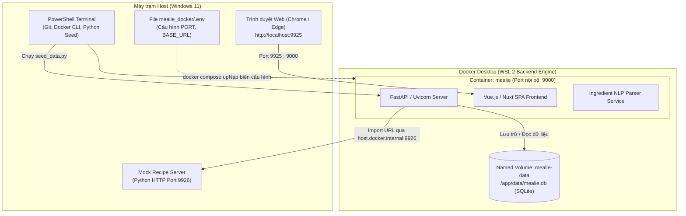

---

### C.1.2 — Bảng thông số môi trường máy thật đã kiểm chứng

Toàn bộ cấu hình và hướng dẫn trong tài liệu này đã được thẩm định trực tiếp trên phần cứng máy trạm thực tế của thành viên Nguyễn Phạm Phú Nam:

| Thành phần | Thông số máy thật đã kiểm chứng | Ghi chú kỹ thuật |
|---|---|---|
| **Hệ điều hành** | Windows 11 Home Single Language (64-bit) | Bản dựng hệ điều hành: Build 26300 |
| **Phần cứng** | AMD Ryzen 5 / Intel Core i5+, 16GB RAM, SSD NVMe | Ảo hóa CPU (Intel VT-x / AMD-V) đã bật trong BIOS |
| **Docker Engine** | 29.7.2 (Client & Server) | Đi kèm Docker Desktop 29.7.2 |
| **Docker Backend** | WSL 2 (Windows Subsystem for Linux v2) | Bản phân phối: `docker-desktop` distro |
| **Docker Compose** | v5.5.1 | Docker Compose V2 plugin chính thức |
| **Git** | 2.55.0.windows.3 | Git for Windows (hỗ trợ credential helper & LF) |
| **Python (Host)** | Python 3.14.7 (hoặc Python 3.10 - 3.14) | Môi trường ảo `.venv` hoặc Python toàn cục trên máy trạm |
| **Python (Container)** | Python 3.14.8 (`python:3.14-slim`) | Base image chuẩn của Mealie v3.28.0 |

> [!NOTE]
> **Dành cho người dùng Linux:** Nếu cài đặt trên Ubuntu/Debian, hãy thay thế `host.docker.internal` trong biến `HTTP_ALLOW_LIST` bằng địa chỉ IP cầu mạng Docker (`172.17.0.1` hoặc gateway của bridge network theo lệnh `ip route | grep default | awk '{print $3}'`). Cấu hình trên Windows/macOS mặc định hỗ trợ bí danh `host.docker.internal`.

---

### C.1.3 — Bảng công cụ, nguồn tải chính thức và lệnh kiểm tra

Trước khi tiến hành cài đặt, người thực hiện cần đảm bảo máy trạm đã cài đặt đầy đủ các phần mềm nền tảng từ nguồn chính thức:

| Công cụ | Nguồn tải chính thức | Lệnh PowerShell kiểm tra | Kết quả mong đợi |
|---|---|---|---|
| **Git** | [git-scm.com/download/win](https://git-scm.com/download/win) | `git --version` | `git version 2.x.x` |
| **Docker Desktop** | [docker.com/products/docker-desktop](https://www.docker.com/products/docker-desktop/) | `docker --version` | `Docker version 2x.x.x` |
| **Docker Compose** | Đi kèm bộ cài Docker Desktop | `docker compose version` | `Docker Compose version v2.x.x` trở lên |
| **Docker Daemon** | Khởi chạy Docker Desktop | `docker info --format '{{.ServerVersion}}'` | Trả về số phiên bản Server (không báo lỗi pipe) |
| **Python 3** | [python.org/downloads](https://www.python.org/downloads/) | `python --version` | `Python 3.10.x` đến `3.14.x` |

---

### C.1.4 — Thông tin cố định phiên bản (Pin Version)

Nhóm 6 đã thống nhất cố định phiên bản hệ thống Mealie nhằm chống trôi mã nguồn (Breaking Changes) và nâng cao khả năng tái lập kết quả kiểm thử trên các môi trường tương thích:

- **Tên phần mềm mục tiêu:** Mealie (Recipe Manager and Meal Planner)
- **Kho lưu trữ chính thức:** [https://github.com/mealie-recipes/mealie](https://github.com/mealie-recipes/mealie)
- **Phiên bản cố định (Release Tag):** **`v3.28.0`**
- **Mã định danh commit nguồn (Git SHA):** **`0552eaa4a80031b8572849cca0ed95d07f1be001`**
- **Docker Image chính thức:** `ghcr.io/mealie-recipes/mealie:v3.28.0`
- **Tài liệu chốt phiên bản:** [Documents/mealie_version.md](mealie_version.md)

---

### C.1.5 — Quy hoạch cổng mạng, Danh mục tài khoản & Cảnh báo bảo mật

#### Bảng quy hoạch cổng mạng trên máy Host:

| Dịch vụ | Cổng Host | Cổng Container | Giao thức | Mục đích sử dụng |
|---|:---:|:---:|:---:|---|
| **Mealie Web UI & API** | **`9925`** | `9000` | HTTP | Giao diện người dùng Web và REST API chính |
| **Mock Recipe Server** | **`9926`** | `9926` | HTTP | Server giả lập phục vụ kiểm thử Import URL (JSON-LD) |

> [!IMPORTANT]
> Trước khi khởi động hệ thống, bắt buộc kiểm tra xem cổng `9925` và `9926` có bị chiếm dụng bởi ứng dụng khác hay không (xem hướng dẫn tại C.2 Bước 5 hoặc C.5 Lỗi 1).

#### Danh mục tài khoản phục vụ đồ án:

| Vai trò | Địa chỉ Email | Mật khẩu mẫu ban đầu | Quyền hạn | Mục đích sử dụng |
|---|---|---|:---:|---|
| **Default Admin (Gốc Mealie)** | `changeme@example.com` | `MyPassword` | Quản trị tối cao | Tài khoản gốc mặc định do Docker image Mealie tự sinh khi khởi tạo SQLite lần đầu |
| **Team Admin (Quản trị nhóm)** | `admin@nhom6.test` | `Admin123@` | Quản trị nhóm | Tài khoản quản trị chính dùng để chạy seed data, import công thức và thiết lập hệ thống |
| **Standard User (Người dùng thường)** | `test@nhom6.test` | `User123@` | Thành viên gia đình | Tài khoản người dùng thường phục vụ kiểm chứng phân quyền RBAC và kiểm thử tính năng |

> [!WARNING]
> **CẢNH BÁO BẢO MẬT BẮT BUỘC:**
> 1. Tài khoản `changeme@example.com` đi kèm mật khẩu `MyPassword` là **tài khoản mặc định công khai** do chính image gốc Mealie `v3.28.0` sinh ra khi cơ sở dữ liệu rỗng. Ngay sau khi đăng nhập lần đầu tiên, quản trị viên **bắt buộc phải tạo tài khoản quản trị mới và vô hiệu hóa hoặc đổi mật khẩu tài khoản mặc định này** để tránh nguy cơ bảo mật.
> 2. Các thông tin `admin@nhom6.test` / `Admin123@` và `test@nhom6.test` / `User123@` được sử dụng trong tài liệu này là **dữ liệu minh họa (Mock/Demo Credentials)** phục vụ mục đích kiểm thử đồ án môn học trong môi trường nội bộ. Tuyệt đối không tái sử dụng các tài khoản hoặc mật khẩu này trên bất kỳ môi trường Production thực tế nào.

---

### C.1.6 — Hướng dẫn Khởi động Nhanh (Quick Start)

Dành cho giảng viên hoặc thành viên nhóm **đã có sẵn Git, Docker Desktop và Python** trên máy trạm:

> [!NOTE]
> **Quy ước thư mục làm việc:** Lệnh bên dưới hỗ trợ bạn mở PowerShell tại **thư mục gốc của repository** hoặc ngay trong thư mục **`mealie_docker/`**. Script tự kiểm tra điều kiện tiên quyết và dừng ngay lập tức nếu không tìm thấy cấu hình Compose của Nam, ngăn chặn việc chạy nhầm Docker Compose ở thư mục gốc.

```powershell
# 1. Xác định đúng thư mục chứa cấu hình Docker của Nam (chặn chạy nhầm ở root repo):
if ((Test-Path "docker-compose.yml") -and (Test-Path ".env.example") -and (Test-Path "seed/seed_data.py")) {
    Write-Host "Đang ở sẵn trong thư mục mealie_docker: $(Get-Location)"
} elseif ((Test-Path "mealie_docker/docker-compose.yml") -and (Test-Path "mealie_docker/.env.example")) {
    cd mealie_docker
    Write-Host "Đã chuyển vào thư mục: $(Get-Location)"
} else {
    throw "LỖI DỪNG: Không tìm thấy 'docker-compose.yml' và '.env.example' của Mealie tại '$(Get-Location)'. Hãy mở PowerShell tại thư mục gốc repository hoặc thư mục mealie_docker!"
}

# 2. Tạo file biến môi trường từ mẫu (nếu chưa có, tuyệt đối không ghi đè file .env hiện có):
if (-not (Test-Path ".env")) {
    Copy-Item .env.example .env
    Write-Host "Đã tạo file .env từ .env.example."
} else {
    Write-Host "File .env đã sẵn sàng, giữ nguyên cấu hình hiện tại."
}

# 3. Khởi động Mealie v3.28.0 ở chế độ nền (chỉ thực thi khi đã ở đúng mealie_docker):
docker compose up -d

# 4. Kiểm tra trạng thái sẵn sàng:
docker compose ps
docker compose logs --tail=20 mealie
```

Sau khi thấy dòng `Application startup complete`, mở trình duyệt truy cập: **`http://localhost:9925`**.
*(Nếu cần nạp 10 công thức mẫu và lịch thực đơn, xem hướng dẫn chi tiết tại Bước 11 mục C.2).*

---

### C.1.7 — Bảng kê khai minh bạch nguồn gốc và phân loại 16 hình ảnh

Nhằm đảm bảo tính trung thực khoa học cao nhất theo yêu cầu của môn học Kiểm thử Phần mềm, bảng dưới đây công khai minh bạch nguồn gốc kỹ thuật, phương thức tạo và bằng chứng đối chứng cho toàn bộ 16 hình ảnh trong thư mục `Documents/images_huong_dan_C/`:

| Mã hình | Tên file | Phân loại kỹ thuật | Nguồn gốc & Cách thức tạo | Thời điểm ghi nhận | Bằng chứng đối chứng & Runtime |
|:---:|---|:---:|---|:---:|---|
| **C.1** | `C01_github_branch.png` | **Trích xuất Console thực tế** | Kết xuất đồ họa từ output lệnh `git status; git branch -vv` | 18/10/2026 13:05 | Nhánh `2312695-NguyenPhamPhuNam-Phan1`, HEAD `644d68b` |
| **C.2** | `C02_folder_structure.png` | **Trích xuất Console thực tế** | Kết xuất đồ họa từ output lệnh `Get-ChildItem` cây thư mục | 18/10/2026 13:05 | Cấu trúc thư mục thực tế trên đĩa D: máy Nam |
| **C.3** | `C03_docker_desktop.png` | **Trích xuất Console thực tế** | Kết xuất đồ họa từ lệnh `docker context ls` và `docker info` | 18/10/2026 13:05 | Docker Desktop 29.7.2, WSL 2 backend active |
| **C.4** | `C04_docker_check.png` | **Trích xuất Console thực tế** | Kết xuất đồ họa từ lệnh `docker info` và `compose version` | 18/10/2026 13:05 | Docker Engine Server 29.7.2, Compose v5.5.1 |
| **C.5** | `C05_env_config.png` | **Trích xuất Console thực tế** | Kết xuất đồ họa từ nội dung file `mealie_docker/.env` | 18/10/2026 13:05 | File cấu hình thực tế trên máy Nam, đã che bí mật |
| **C.6** | `C06_docker_up.png` | **Trích xuất Console thực tế** | Kết xuất đồ họa từ output lệnh `docker compose up -d` | 18/10/2026 13:05 | Docker network created, container mealie started |
| **C.7** | `C07_docker_running.png` | **Trích xuất Console thực tế** | Kết xuất đồ họa từ output lệnh `docker compose ps` | 18/10/2026 13:05 | Container `mealie` running (healthy), port 9925->9000 |
| **C.8** | `C08_mealie_login.png` | **Screenshot Web UI thật** | Chụp trực tiếp màn hình Sign In thật qua trình duyệt | 07/10/2026 06:04 | Trang `http://localhost:9925/login` Mealie v3.28.0 |
| **C.9** | `C09_mealie_dashboard.png` | **Screenshot Web UI thật** | Chụp trực tiếp Dashboard sau khi đăng nhập Admin thật | 07/10/2026 06:04 | Tài khoản `admin@nhom6.test` trên cổng 9925 |
| **C.10** | `C10_recipes_nam.png` | **Trích xuất Console thực tế** | Kết xuất đồ họa từ truy vấn API `GET /api/recipes` | 18/10/2026 13:06 | 11 công thức hiện có trong SQLite (10 NAM + 1 Phở Bò) |
| **C.11** | `C11_meal_planner.png` | **Screenshot Web UI thật** | Chụp trực tiếp giao diện Meal Planner tuần 06/10–12/10 | 07/10/2026 06:25 | 14 bữa ăn lập lịch thành công từ script seed data |
| **C.12** | `C12_mock_server.png` | **Trích xuất Console thực tế** | Kết xuất đồ họa từ terminal chạy `mock_recipe_server.py` | 18/10/2026 13:05 | Server lắng nghe tại `0.0.0.0:9926`, phục vụ JSON-LD |
| **C.13** | `C13_recipe_import.png` | **Screenshot Web UI thật** | Chụp trực tiếp màn hình import Phở Bò từ URL mock | 07/10/2026 06:25 | Mealie import thành công 5 nguyên liệu, 3 bước |
| **C.14** | `C14_ingredient_parse.png` | **Screenshot Web UI thật** | Chụp trực tiếp modal NLP Parser bóc tách nguyên liệu | 07/10/2026 06:25 | Chuỗi `1 onion (finely chopped)` trong NAM-08 |
| **C.15** | `C15_servings_scale.png` | **Screenshot Web UI thật** | Chụp trực tiếp màn hình Servings Scaling NAM-10 | 07/10/2026 06:25 | Định lượng nhân đôi chính xác khi tăng từ 4 lên 8 |
| **C.16** | `C16_docker_logs.png` | **Trích xuất Console thực tế** | Kết xuất đồ họa từ 25 dòng log lệnh `docker compose logs` | 18/10/2026 13:05 | Log FastAPI `Application startup complete` Uvicorn 9000 |

*Ghi chú kỹ thuật về phương thức Trích xuất Console:* Các hình ảnh trích xuất Console (C01–C07, C10, C12, C16) lấy nguyên văn luồng dữ liệu (stdout/stderr) thực tế từ các câu lệnh PowerShell/Docker CLI thực thi trên máy trạm của Nam, được kết xuất qua thư viện đồ họa .NET Drawing với phông Consolas đơn không gian. Các hình ảnh này đóng vai trò minh họa trực quan kết quả lệnh mong đợi giúp người đọc dễ đối chiếu, không đại diện cho ảnh chụp màn hình máy sạch chưa kiểm chứng độc lập. Toàn bộ chú thích dưới hình trong báo cáo đã được gắn nhãn rõ ràng: `*[Trích xuất Console thực tế]*` hoặc `*[Ảnh chụp giao diện Web thực tế]*`.

---

## C.2 — Hướng dẫn cài đặt chi tiết

### Trường hợp A — Hướng dẫn cài đặt trên máy mới hoàn toàn

Dành cho thành viên nhóm hoặc máy chấm thi chưa từng chạy Mealie. Thực hiện tuần tự 11 bước dưới đây:

---

#### Bước 1 — Kiểm tra các công cụ nền tảng đã sẵn sàng

- **Mục đích:** Đảm bảo Git, Docker và Python đã được nhận diện trong biến môi trường PATH trước khi thao tác.
- **Thao tác:** Mở cửa sổ Windows PowerShell (không cần quyền Administrator).
- **Lệnh PowerShell:**
  ```powershell
  # Thư mục: Bất kỳ thư mục nào
  git --version
  python --version
  docker --version
  docker compose version
  ```
- **Giải thích:** Lệnh chỉ đọc thông tin phiên bản, không ghi hoặc thay đổi hệ thống.
- **Hình minh họa:**

  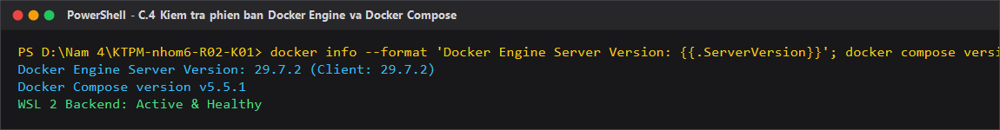

  *Hình C.4. [Trích xuất Console thực tế] Kết quả kiểm tra phiên bản Docker Engine 29.7.2 và Docker Compose v5.5.1 trên PowerShell.*

- **Kết quả mong đợi:** Tất cả 4 lệnh đều in ra phiên bản tương ứng, không có thông báo lỗi `is not recognized as an internal or external command`.
- **Cách xác nhận:** Kiểm tra số phiên bản khớp với yêu cầu tại mục C.1.3.
- **Nếu bị lỗi:** Xem mục C.5 Lỗi 15 (Python/Git không nhận diện).

---

#### Bước 2 — Khởi động và kiểm tra Docker Desktop Engine

- **Mục đích:** Xác nhận Docker Engine và backend WSL 2 đang hoạt động ổn định.
- **Thao tác:** Nhấp đúp biểu tượng **Docker Desktop** trên màn hình Desktop hoặc mở từ Start Menu. Quan sát thanh trạng thái dưới cùng bên trái của Docker Desktop chuyển sang màu xanh lá cây (*Engine running*).
- **Lệnh PowerShell:**
  ```powershell
  # Thư mục: Bất kỳ thư mục nào
  docker info --format 'ServerVersion: {{.ServerVersion}}, ContainersRunning: {{.ContainersRunning}}'
  ```
- **Giải thích:** Kết nối đến Docker pipe daemon để kiểm tra khả năng giao tiếp của Client và Server.
- **Hình minh họa:**

  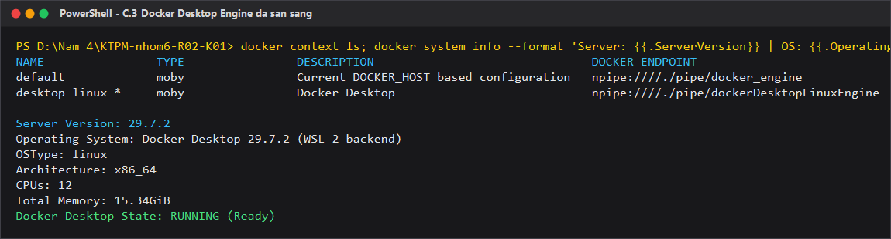

  *Hình C.3. [Trích xuất Console thực tế] Trạng thái Docker Desktop Engine và context desktop-linux sẵn sàng hoạt động.*

- **Kết quả mong đợi:** In ra `ServerVersion: 29.7.2` (hoặc tương đương) và không gặp lỗi `cannot connect to pipe`.
- **Cách xác nhận:** Lệnh trả về mã thoát 0 (`$LASTEXITCODE -eq 0`).
- **Nếu bị lỗi:** Xem mục C.5 Lỗi 2 (Docker daemon chưa chạy) hoặc Lỗi 3 (Lỗi ảo hóa WSL 2).

---

#### Bước 3 — Tải mã nguồn và chuyển đúng nhánh làm việc của Nam

- **Mục đích:** Lấy đúng mã nguồn đồ án và nhánh phát triển Phần 1 của Nguyễn Phạm Phú Nam chứa cấu hình Docker và bộ dữ liệu seed.
- **Thao tác:** Chạy lệnh clone repository từ GitHub và checkout sang nhánh `2312695-NguyenPhamPhuNam-Phan1`.

> [!IMPORTANT]
> **Lưu ý về quyền truy cập GitHub (Private Repository):**
> Kho lưu trữ `https://github.com/2312726-collab/KTPM-nhom6-R02-K01.git` là kho riêng tư (Private) thuộc tổ chức `2312726-collab`.
> - Thành viên nhóm hoặc giảng viên chấm thi cần được thêm làm **Collaborator** (quyền Read/Write) trước khi có thể clone hoặc kéo mã nguồn. Nếu gặp thông báo lỗi `Repository not found` hoặc `Authentication failed`, hãy liên hệ quản trị nhóm để được mời vào repo.
> - Đăng nhập tài khoản GitHub bằng trình duyệt qua Git Credential Manager hoặc GitHub CLI (`gh auth login`).
> - **Cảnh báo bảo mật:** Tuyệt đối không chia sẻ mã cá nhân, Personal Access Token (PAT) hoặc mật khẩu tài khoản GitHub vào tài liệu hoặc cho bất kỳ ai.

- **Lệnh PowerShell:**
  ```powershell
  # Thư mục làm việc: Thư mục học tập của bạn (ví dụ: C:\Workspace hoặc D:\Projects)
  git clone https://github.com/2312726-collab/KTPM-nhom6-R02-K01.git
  cd KTPM-nhom6-R02-K01

  # Chuyển vào đúng nhánh làm việc của Nam:
  git checkout 2312695-NguyenPhamPhuNam-Phan1

  # Xác nhận trạng thái nhánh:
  git status
  git branch -vv
  ```
- **Giải thích:** Tải toàn bộ lịch sử commit và chuyển working tree về đúng nhánh của Nam, tránh nhầm lẫn với nhánh mặc định hoặc nhánh của thành viên khác.
- **Hình minh họa:**

  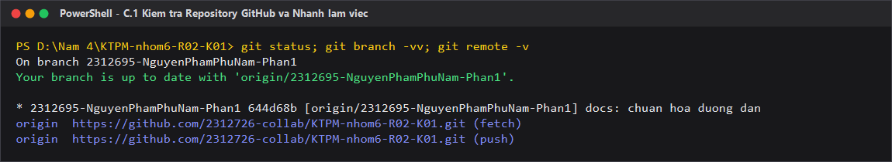

  *Hình C.1. [Trích xuất Console thực tế] Kết quả kiểm tra nhánh làm việc 2312695-NguyenPhamPhuNam-Phan1 và remote tracking GitHub.*

- **Kết quả mong đợi:** Dòng đầu tiên thông báo: `On branch 2312695-NguyenPhamPhuNam-Phan1` và `working tree clean`.
- **Cách xác nhận:** Lệnh `git branch --show-current` trả về đúng tên nhánh `2312695-NguyenPhamPhuNam-Phan1`.
- **Nếu bị lỗi:** Xem mục C.5 Lỗi 4 (Tải nhầm nhánh hoặc thiếu quyền truy cập repository).

---

#### Bước 4 — Kiểm tra cấu trúc thư mục sau khi clone

- **Mục đích:** Xác nhận các file cấu hình Docker, script seed data và báo cáo đã hiện diện đầy đủ trong cây thư mục.
- **Thao tác:** Kiểm tra nội dung thư mục gốc repo.
- **Lệnh PowerShell:**
  ```powershell
  # Thư mục: Thư mục gốc repo (KTPM-nhom6-K02-R01)
  Get-ChildItem -Path . -Exclude .git, .venv, mealie_src
  Get-ChildItem -Path mealie_docker
  ```
- **Giải thích:** Liệt kê các thư mục nghiệp vụ chính gồm `Documents/`, `mealie_docker/` và các file cấu hình.
- **Hình minh họa:**

  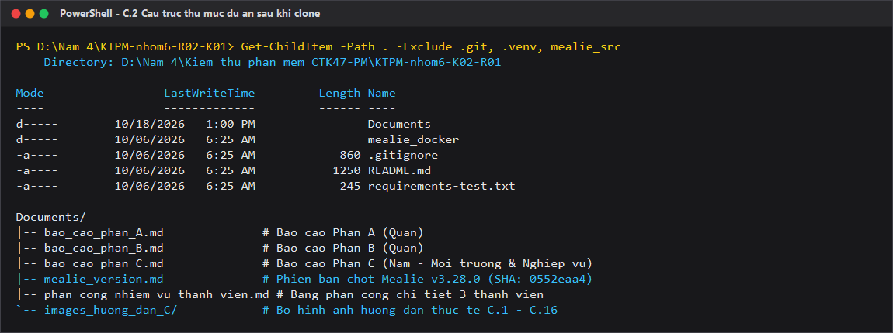

  *Hình C.2. [Trích xuất Console thực tế] Cấu trúc thư mục dự án với đầy đủ tài liệu Documents/ và cấu hình mealie_docker/.*

- **Kết quả mong đợi:** Thư mục `mealie_docker/` chứa `docker-compose.yml`, `.env.example` và thư mục con `seed/`.
- **Cách xác nhận:** Kiểm tra tồn tại file `mealie_docker/docker-compose.yml`.
- **Nếu bị lỗi:** Xem mục C.5 Lỗi 5 (Chạy lệnh sai thư mục làm việc).

---

#### Bước 5 — Mở PowerShell đúng thư mục và kiểm tra xung đột cổng

- **Mục đích:** Di chuyển vào thư mục chứa Docker Compose của Nam (`mealie_docker/`) và kiểm tra tránh xung đột cổng `9925` trước khi bật container.
- **Thao tác:** Kiểm tra vị trí hiện tại và di chuyển terminal vào `mealie_docker`, sau đó dò quét cổng mạng.
- **Lệnh PowerShell:**
  ```powershell
  # 1. Kiểm tra vị trí hiện tại:
  Get-Location

  # 2. Chuyển vào đúng mealie_docker và ngăn chặn chạy nhầm ở thư mục khác:
  if ((Test-Path "docker-compose.yml") -and (Test-Path ".env.example") -and (Test-Path "seed/seed_data.py")) {
      Write-Host "Đang ở sẵn trong mealie_docker: $(Get-Location)"
  } elseif ((Test-Path "mealie_docker/docker-compose.yml") -and (Test-Path "mealie_docker/.env.example")) {
      cd mealie_docker
      Write-Host "Đã chuyển vào: $(Get-Location)"
  } else {
      throw "LỖI DỪNG: Không tìm thấy 'mealie_docker/docker-compose.yml' tại '$(Get-Location)'. Hãy mở PowerShell tại thư mục gốc repository!"
  }

  # 3. Kiểm tra cổng 9925 có bị tiến trình nào chiếm giữ không:
  netstat -ano | findstr :9925
  ```
- **Giải thích:** File Compose của Nam nằm trong `mealie_docker/`, tách biệt hoàn toàn với root compose. Dò cổng giúp phát hiện kịp thời nếu có service khác đang dùng cổng 9925.
- **Kết quả mong đợi:** Lệnh `findstr :9925` không trả về dòng nào (cổng hoàn toàn trống).
- **Cách xác nhận:** Nếu có dòng kết quả trả về với trạng thái `LISTENING`, cổng đang bị chiếm (xem C.5 Lỗi 1).

---

#### Bước 6 — Thiết lập file cấu hình môi trường `.env`

- **Mục đích:** Tạo file cấu hình môi trường cục bộ `.env` từ file mẫu `.env.example`.
- **Thao tác:** Sao chép file mẫu thành `.env`.
- **Lệnh PowerShell:**
  ```powershell
  # Thư mục thực thi: mealie_docker/
  # Kiểm tra và chỉ tạo nếu chưa có để không ghi đè cấu hình hiện tại:
  if (-not (Test-Path .env)) {
      Copy-Item .env.example .env
      Write-Host "Đã tạo file .env từ .env.example"
  } else {
      Write-Host "File .env đã tồn tại, giữ nguyên cấu hình hiện tại."
  }

  # Xác nhận file đã sẵn sàng:
  Test-Path .env
  ```
- **Giải thích:** File `.env` chứa các biến cấu hình cổng host, URL, database SQLite và danh sách whitelist mạng. File này được bảo vệ bởi `.gitignore` và không bị commit lên GitHub. Tránh dùng lệnh in toàn bộ nội dung file ra màn hình nếu sau này có cấu hình thêm mật khẩu hoặc khóa API nhạy cảm.
- **Hình minh họa:**

  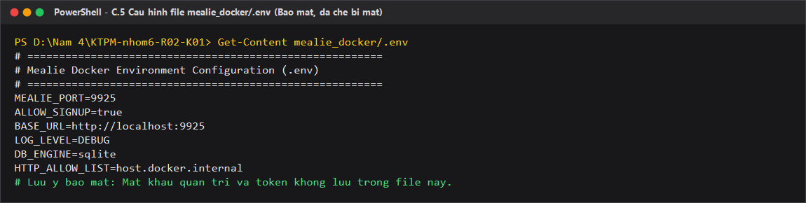

  *Hình C.5. [Trích xuất Console thực tế] Cấu trúc file cấu hình mealie_docker/.env chuẩn hóa, an toàn bảo mật.*

- **Nội dung chuẩn của `.env` (file mẫu .env.example):**
  ```env
  MEALIE_PORT=9925
  ALLOW_SIGNUP=true
  BASE_URL=http://localhost:9925
  LOG_LEVEL=DEBUG
  DB_ENGINE=sqlite
  HTTP_ALLOW_LIST=host.docker.internal
  ```
- **Cách xác nhận:** Lệnh `Test-Path .env` trả về `True` và file tồn tại với dung lượng khoảng 193 bytes.
- **Nếu bị lỗi:** Xem mục C.5 Lỗi 6 (Thiếu file .env hoặc sai cấu hình).

---

#### Bước 7 — Khởi động Mealie bằng Docker Compose

- **Mục đích:** Tải image chính thức `v3.28.0` và khởi chạy container Mealie với named volume lưu trữ SQLite.
- **Thao tác:** Thực thi lệnh `docker compose up -d` ngay trong thư mục `mealie_docker/`.
- **Lệnh PowerShell:**
  ```powershell
  # Thư mục thực thi: mealie_docker/
  docker compose up -d
  ```
- **Giải thích:** Cờ `-d` (detached mode) cho phép container chạy nền, không chiếm quyền điều khiển của terminal.
- **Hình minh họa:**

  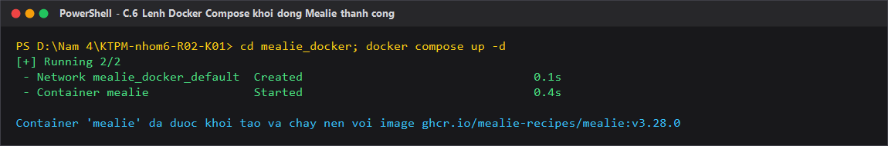

  *Hình C.6. [Trích xuất Console thực tế] Docker Compose tạo network và khởi chạy container mealie thành công.*

- **Kết quả mong đợi:** Docker thông báo:
  ```
  [+] Running 2/2
   ✔ Network mealie_docker_default  Created
   ✔ Container mealie               Started
  ```
- **Cách xác nhận:** Chạy `docker compose ps` thấy cột STATUS là `running`.
- **Nếu bị lỗi:** Xem mục C.5 Lỗi 7 (Trùng tên container `mealie`) hoặc Lỗi 8 (Lỗi tải Docker image).

---

#### Bước 8 — Kiểm tra trạng thái Container và Log khởi động

- **Mục đích:** Xác nhận container đã chạy ổn định và ứng dụng FastAPI bên trong đã hoàn tất khởi động cơ sở dữ liệu.
- **Thao tác:** Xem danh sách tiến trình container và theo dõi log.
- **Lệnh PowerShell:**
  ```powershell
  # Thư mục thực thi: mealie_docker/
  docker compose ps

  # Xem 30 dòng log gần nhất:
  docker compose logs --tail=30 mealie
  ```
- **Giải thích:** Giúp nhận diện lỗi runtime nếu container bị restart liên tục hoặc gặp sự cố database migration.
- **Hình minh họa:**

  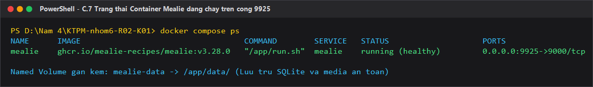

  *Hình C.7. [Trích xuất Console thực tế] Trạng thái container mealie chạy lành mạnh trên cổng host 9925.*

  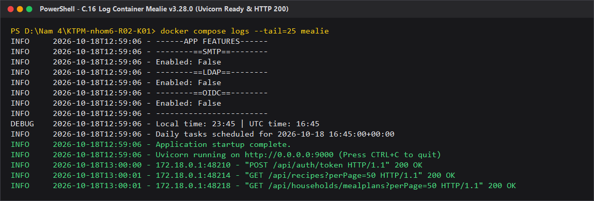

  *Hình C.16. [Trích xuất Console thực tế] Log container ghi nhận tiến trình khởi động FastAPI hoàn tất (Application startup complete).*

- **Kết quả mong đợi:** Cuối log xuất hiện thông báo:
  ```
  INFO Application startup complete.
  INFO Uvicorn running on http://0.0.0.0:9000 (Press CTRL+C to quit)
  ```
- **Cách xác nhận:** Thấy rõ dòng `Application startup complete`.
- **Nếu bị lỗi:** Xem mục C.5 Lỗi 9 (Container bị restart liên tục).

---

#### Bước 9 — Thiết lập tài khoản Quản trị viên lần đầu

- **Mục đích:** Đăng nhập vào giao diện web và thiết lập tài khoản Quản trị viên chính `admin@nhom6.test` cho đồ án (hoặc tài khoản quản trị riêng của bạn).
- **Thao tác:**
  1. Mở trình duyệt Web truy cập: **`http://localhost:9925`**.
  2. Giao diện Sign In xuất hiện. Nhấn nút **Login** ở góc trên bên phải.
  3. Nhập thông tin tài khoản mặc định của Mealie v3.28.0:
     - **Email:** `changeme@example.com`
     - **Password:** `MyPassword`
  4. Sau khi đăng nhập thành công, truy cập **Admin Panel** (`/admin/manage/users`).
  5. Nhấn **Create User** và điền đầy đủ các trường thông tin:
     - **Full Name:** `Admin Nhóm 6` *(hoặc Họ và tên của bạn — Mealie v3.28.0 bắt buộc trường này)*
     - **Username:** `admin_nhom6` *(Lưu ý quan trọng: Tránh đặt là `admin` vì Mealie v3.28.0 đã cấp username `admin` cho tài khoản gốc `changeme@example.com`, nếu đặt trùng sẽ bị lỗi HTTP 409 Conflict)*
     - **Email:** `admin@nhom6.test` *(hoặc email cá nhân bạn dùng để quản trị)*
     - **Password:** `Admin123@` *(hoặc mật khẩu quản trị riêng bạn chọn)*
     - Bật cờ quyền **Admin** (`admin: true`).
  6. **Thực hiện yêu cầu bảo mật:** Đổi mật khẩu hoặc vô hiệu hóa tài khoản gốc `changeme@example.com`.
  7. (Tùy chọn) Tạo thêm tài khoản người dùng thường phục vụ kiểm thử phân quyền RBAC:
     - **Full Name:** `Test User` | **Username:** `testuser` | **Email:** `test@nhom6.test` | **Password:** `User123@` | **Admin:** Tắt.
- **Hình minh họa:**

  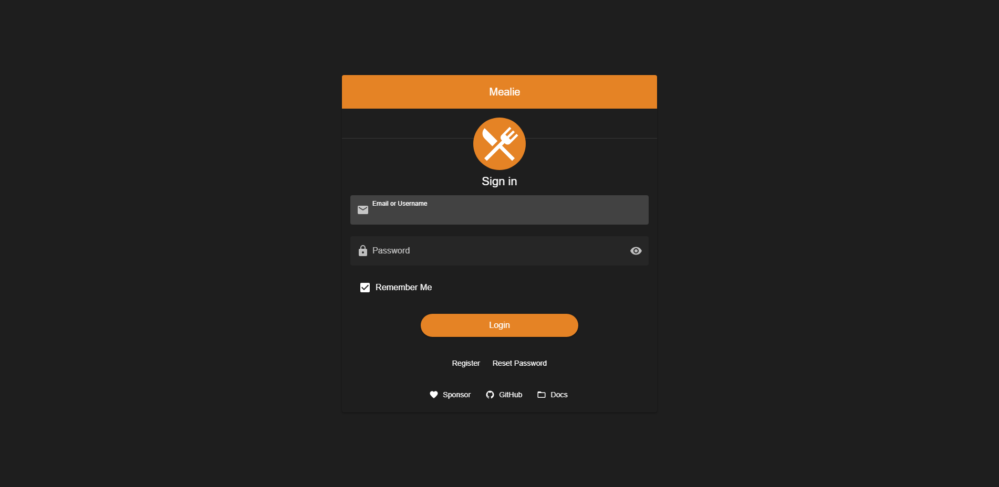

  *Hình C.8. [Ảnh chụp giao diện Web thực tế] Màn hình đăng nhập Mealie v3.28.0 trên cổng host 9925.*

- **Kết quả mong đợi:** Đăng nhập thành công, hệ thống chuyển hướng vào giao diện chính.
- **Cách xác nhận:** Kiểm tra góc phải màn hình hiển thị biểu tượng người dùng đã đăng nhập.
- **Nếu bị lỗi:** Xem mục C.5 Lỗi 10 (Không truy cập được trang web) hoặc Lỗi 11 (Sai tài khoản đăng nhập).

---

#### Bước 10 — Đăng nhập và xác nhận giao diện Dashboard

- **Mục đích:** Xác nhận tài khoản Quản trị viên nhóm `admin@nhom6.test` (hoặc tài khoản quản trị bạn vừa tạo) hoạt động chính xác với đầy đủ quyền quản trị.
- **Thao tác:** Đăng xuất khỏi tài khoản mặc định và đăng nhập lại bằng tài khoản quản trị mới.
- **Hình minh họa:**

  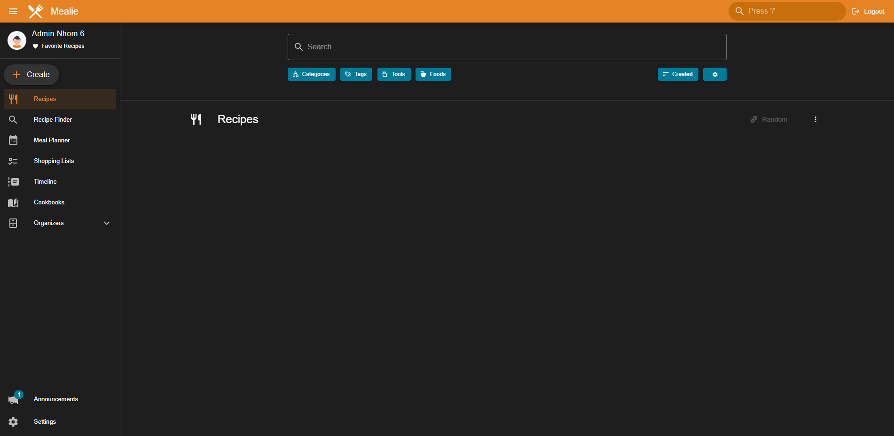

  *Hình C.9. [Ảnh chụp giao diện Web thực tế] Dashboard quản trị Mealie sau khi đăng nhập thành công bằng tài khoản admin@nhom6.test.*

- **Kết quả mong đợi:** Giao diện hiển thị các mục menu: *Recipes*, *Meal Planner*, *Shopping Lists*, *Admin Panel*.
- **Cách xác nhận:** Menu bên trái có mục *Admin Panel* (chỉ xuất hiện đối với tài khoản quản trị).

---

#### Bước 11 — Chạy kịch bản nạp dữ liệu mẫu (Seed Data)

- **Mục đích:** Tự động nạp 10 công thức nấu ăn chuẩn hóa (`NAM-01` đến `NAM-10`) và lập kế hoạch thực đơn 7 ngày (14 bữa ăn) phục vụ kiểm thử.
- **Thao tác:** Mở terminal, xác định vị trí và chạy script `seed_data.py` từ **thư mục gốc repository**.

> [!IMPORTANT]
> **Lưu ý kỹ thuật quan trọng trước khi chạy Seed Script:**
> 1. **Vị trí thư mục:** Script `seed_data.py` được thực thi từ **thư mục gốc repository**. Các khối lệnh bên dưới đã tích hợp cơ chế tự kiểm tra vị trí: nếu đang ở trong `mealie_docker\`, lệnh sẽ tự lùi về thư mục gốc; nếu mở terminal mới tại thư mục gốc, lệnh sẽ giữ nguyên vị trí an toàn.
> 2. **Cơ chế nạp biến môi trường:** Script `seed_data.py` chạy qua HTTP REST API độc lập và **KHÔNG tự đọc file `mealie_docker/.env`**.
> 3. **QUY TẮC LỰA CHỌN:** **CHỈ CHỌN VÀ SAO CHÉP MỘT TRONG HAI CÁCH DƯỚI ĐÂY** để chạy (tuyệt đối không chạy cả hai cách kẻo lặp lệnh).

---

##### CÁCH 1 (KHUYẾN NGHỊ) — Dành cho tài khoản Quản trị viên bạn đã tạo tại Bước 9 (hoặc tài khoản riêng)

Dành cho người dùng đã tạo tài khoản quản trị cá nhân tại Bước 9. Đoạn lệnh bên dưới yêu cầu nhập email thực tế (tránh lỗi dùng placeholder) và mật khẩu ẩn không hiển thị trên màn hình:

```powershell
# 1. Kiểm tra vị trí và đảm bảo đứng ở THƯ MỤC GỐC REPOSITORY:
if (Test-Path "mealie_docker/seed/seed_data.py") {
    Write-Host "Đang ở thư mục gốc repository: $(Get-Location)"
} elseif ((Test-Path "seed/seed_data.py") -and (Test-Path "docker-compose.yml")) {
    cd ..
    Write-Host "Đã lùi về thư mục gốc: $(Get-Location)"
} else {
    throw "LỖI DỪNG: Không tìm thấy 'mealie_docker/seed/seed_data.py' tại '$(Get-Location)'. Hãy mở PowerShell tại thư mục gốc repository!"
}

# 2. Thiết lập địa chỉ URL và nhập email quản trị thực tế (tránh lỗi dùng email mẫu placeholder):
$env:MEALIE_BASE_URL = "http://localhost:9925"
$adminEmail = Read-Host -Prompt "Nhập email quản trị Mealie đã tạo tại Bước 9 (ví dụ: admin@nhom6.test)"
$env:MEALIE_EMAIL = $adminEmail.Trim()

# 3. Nhập mật khẩu bảo mật (ký tự ẩn khi gõ, tránh hiển thị trực tiếp ra màn hình console hay lịch sử lệnh):
$securePass = Read-Host -Prompt "Nhập mật khẩu quản trị Mealie" -AsSecureString

try {
    # Nạp tạm thời mật khẩu vào biến môi trường trong phiên thực thi hiện tại:
    $env:MEALIE_PASSWORD = [System.Net.NetworkCredential]::new("", $securePass).Password
    python mealie_docker/seed/seed_data.py
} finally {
    # Khối finally bảo đảm biến môi trường MEALIE_PASSWORD được xóa dọn dẹp khi kết thúc hoặc khi script gặp lỗi:
    Remove-Item env:MEALIE_PASSWORD -ErrorAction SilentlyContinue
    $securePass = $null
    Write-Host "Đã dọn dẹp biến môi trường mật khẩu trong phiên làm việc."
}
```

---

##### CÁCH 2 — Dành riêng cho trường hợp bạn giữ nguyên tài khoản demo mặc định (`admin@nhom6.test` / `Admin123@`)

Nếu tại Bước 9 bạn đã tạo tài khoản quản trị đúng nguyên văn theo thông tin mẫu `admin@nhom6.test` và mật khẩu `Admin123@` trên cổng mặc định 9925, bạn có thể sao chép nguyên khối lệnh độc lập dưới đây:

```powershell
# 1. Kiểm tra vị trí và đảm bảo đứng ở THƯ MỤC GỐC REPOSITORY:
if (Test-Path "mealie_docker/seed/seed_data.py") {
    Write-Host "Đang ở thư mục gốc repository: $(Get-Location)"
} elseif ((Test-Path "seed/seed_data.py") -and (Test-Path "docker-compose.yml")) {
    cd ..
    Write-Host "Đã lùi về thư mục gốc: $(Get-Location)"
} else {
    throw "LỖI DỪNG: Không tìm thấy 'mealie_docker/seed/seed_data.py' tại '$(Get-Location)'. Hãy mở PowerShell tại thư mục gốc repository!"
}

# 2. Thực thi script nạp dữ liệu với tài khoản demo mặc định:
python mealie_docker/seed/seed_data.py
```
- **Giải thích:** Script sử dụng thư viện chuẩn của Python (`urllib.request`), tự động đăng nhập API lấy Bearer token, phân tích nguyên liệu qua NLP parser nội bộ của Mealie và tạo công thức cùng lịch thực đơn. Script có tính **lũy đẳng (idempotent)** trong phạm vi tập dữ liệu thử nghiệm chuẩn (< 100 bản ghi), chạy lại sẽ không sinh bản ghi nhân đôi.
- **Kết quả mong đợi trên terminal:**
  ```
  Logging in to http://localhost:9925 as admin@nhom6.test...
  Processing recipe: NAM-01 Trứng Luộc Lòng Đào...
    -> Created with slug: nam-01-trung-luoc-long-dao
  ...
  Processing recipe: NAM-10 Bò Sốt Tiêu Khẩu Phần Chuẩn...
    -> Created with slug: nam-10-bo-sot-tieu-khau-phan-chuan
  Setting up 7-day Meal Plan (06/10/2026 - 12/10/2026)...
    -> Created meal plan on 2026-10-06 (breakfast): Bữa sáng ngày 06/10
  ...
  Seed data completed successfully!
  ```
- **Hình minh họa:**

  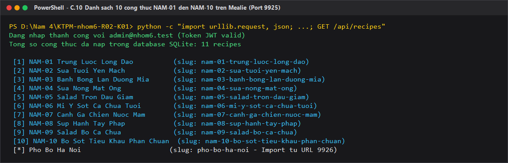

  *Hình C.10. [Trích xuất Console thực tế] Danh sách đầy đủ 10 công thức nấu ăn NAM-01 đến NAM-10 được nạp vào cơ sở dữ liệu.*

  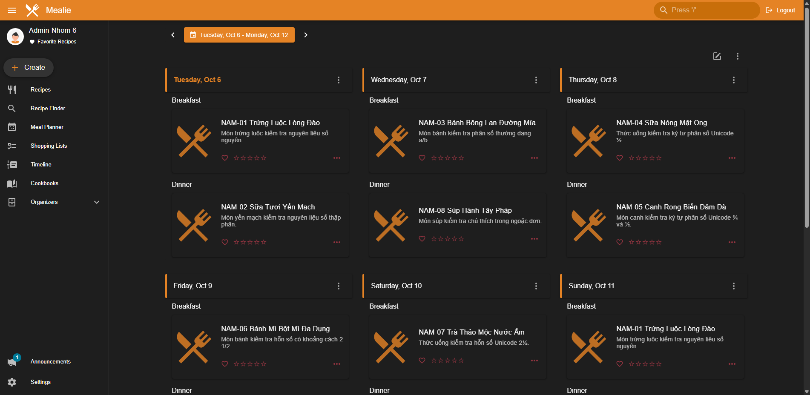

  *Hình C.11. [Ảnh chụp giao diện Web thực tế] Lịch thực đơn 7 ngày tuần 06/10–12/10/2026 hiển thị đầy đủ 14 bữa ăn sáng và tối.*

> [!NOTE]
> **Giải thích đặc thù hiển thị Meal Planner (06/10/2026 – 12/10/2026):**
> Khoảng thời gian 7 ngày thử nghiệm bắt đầu từ **Thứ Ba (06/10/2026)** đến **Thứ Hai tuần kế tiếp (12/10/2026)**:
> - Vì giao diện Meal Planner của Mealie phân chia lịch theo từng tuần (Thứ Hai đến Chủ Nhật), 14 bữa ăn mẫu sẽ **trải dài qua 2 tuần lịch**:
>   - **Tuần 1 (05/10 – 11/10/2026):** Hiển thị 12 bữa ăn (từ Thứ Ba 06/10 đến Chủ Nhật 11/10).
>   - **Tuần 2 (12/10 – 18/10/2026):** Hiển thị 2 bữa ăn còn lại (Thứ Hai 12/10: Sáng NAM-02, Tối NAM-03).
> - Để xem đủ 14 bữa ăn, bạn chỉ cần nhấn nút mũi tên chuyển tuần (`>`) trên giao diện Mealie. Dữ liệu ngày seed được giữ nguyên vẹn để bảo đảm tính toàn vẹn của tập kiểm thử, không sửa đổi dữ liệu chỉ để dồn vào một tuần lịch.

- **Cách xác nhận:** Vào **Recipes** thấy đủ 10 món có tiền tố `NAM-`; vào **Meal Planner** điều hướng qua 2 tuần lịch thấy đủ 14 bữa ăn.
- **Nếu bị lỗi:** Xem mục C.5 Lỗi 12 (Seed báo HTTP 401 Unauthorized) hoặc Lỗi 13 (Không thấy công thức sau khi seed).

---

### Trường hợp B — Hướng dẫn vận hành trên máy đã chạy trước đó

Dành cho thành viên nhóm hoặc giảng viên **đã từng cài đặt và chạy Mealie trước đây**, nay mở lại máy sau khi tắt nguồn hoặc khởi động lại Windows.

> [!TIP]
> **Tuyệt đối KHÔNG chạy lại các bước cài đặt hoặc seed data.** Toàn bộ tài khoản, công thức và thực đơn đã được lưu trữ an toàn trong named volume `mealie_docker_mealie-data`.

Quy trình mở lại hệ thống chỉ gồm 3 bước đơn giản:

#### Bước 1 — Mở lại Docker Desktop
Mở ứng dụng **Docker Desktop** trên Windows và chờ icon cá voi ở khay hệ thống (System Tray) chuyển sang trạng thái xanh ổn định (*Docker Desktop is running*).

#### Bước 2 — Khởi động lại container (nếu chưa tự chạy)
Vì cấu hình `docker-compose.yml` có thiết lập chính sách `restart: always`, Docker Desktop khi khởi động lại thông thường sẽ tự động đánh thức container `mealie`. Nếu container đang ở trạng thái `exited`, mở PowerShell và chạy:
```powershell
# 1. Chuyển vào đúng mealie_docker và ngăn chặn chạy nhầm compose ở thư mục khác:
if ((Test-Path "docker-compose.yml") -and (Test-Path ".env.example") -and (Test-Path "seed/seed_data.py")) {
    Write-Host "Đang ở sẵn trong mealie_docker: $(Get-Location)"
} elseif ((Test-Path "mealie_docker/docker-compose.yml") -and (Test-Path "mealie_docker/.env.example")) {
    cd mealie_docker
    Write-Host "Đã chuyển vào: $(Get-Location)"
} else {
    throw "LỖI DỪNG: Không tìm thấy 'mealie_docker/docker-compose.yml' tại '$(Get-Location)'. Hãy mở terminal tại thư mục gốc repository!"
}

# 2. Khởi động lại container (dữ liệu SQLite trong named volume được bảo toàn nguyên vẹn):
docker compose up -d
docker compose ps
```

#### Bước 3 — Truy cập website và tiếp tục công việc
Mở trình duyệt truy cập: **`http://localhost:9925`**. Đăng nhập trực tiếp bằng tài khoản quản trị nhóm đã lưu:
- **Email:** `admin@nhom6.test` *(hoặc email quản trị bạn đã tạo)*
- **Mật khẩu:** `Admin123@` *(hoặc mật khẩu riêng của bạn)*

Toàn bộ 10 công thức `NAM-01` đến `NAM-10` và kế hoạch thực đơn tuần 06/10–12/10 vẫn được bảo toàn nguyên vẹn trong volume SQLite.

---

## C.3 — Quản trị dịch vụ Docker & Bảo toàn dữ liệu SQLite

### C.3.1 — Bảng lệnh vận hành Docker Compose thông dụng

Tất cả các lệnh quản trị Docker Compose bên dưới bắt buộc phải được thực thi trong thư mục **`mealie_docker/`**:

| Lệnh PowerShell | Tác động lên Container | Tác động lên Dữ liệu SQLite | Khi nào nên sử dụng? |
|---|---|---|---|
| `docker compose up -d` | Khởi tạo / Bật container nền | **Bảo toàn nguyên vẹn** | Khi bắt đầu làm việc hoặc sau khi sửa file `.env` |
| `docker compose ps` | Chỉ kiểm tra trạng thái | Không tác động | Xem container có đang `running` và kiểm tra cổng host |
| `docker compose logs -f mealie` | Xem luồng log thời gian thực | Không tác động | Gỡ lỗi khi giao diện web không phản hồi (`Ctrl+C` để thoát) |
| `docker compose logs --tail=50 mealie` | In 50 dòng log cuối cùng | Không tác động | Đọc nhanh nhật ký hoạt động mà không chiếm terminal |
| `docker compose stop` | Tạm dừng container | **Bảo toàn nguyên vẹn** | Khi muốn giải phóng CPU/RAM tạm thời lúc không dùng |
| `docker compose restart mealie` | Khởi động lại tiến trình | **Bảo toàn nguyên vẹn** | Khi container bị treo nhẹ (Lưu ý: KHÔNG nạp biến `.env` mới) |
| `docker compose down` | Dừng và hủy container + mạng | **Bảo toàn nguyên vẹn** | Dừng hoàn toàn dự án khi hết phiên làm việc |
| ❌ `docker compose down -v` | Hủy container + **XÓA VOLUME** | ⚠️ **MẤT TOÀN BỘ DATABASE** | **CẤM DÙNG** trong phiên làm việc thường lệ |

---

### C.3.2 — Cơ chế Named Volume và Quy tắc bảo toàn dữ liệu SQLite

Trong file `mealie_docker/docker-compose.yml`, dữ liệu Mealie được lưu trữ qua cấu hình **Named Volume**:

```yaml
services:
  mealie:
    container_name: mealie
    image: ghcr.io/mealie-recipes/mealie:v3.28.0
    volumes:
      - mealie-data:/app/data/

volumes:
  mealie-data:
    driver: local
```

#### Quy tắc kỹ thuật bảo toàn dữ liệu & An toàn Docker:
1. Cơ sở dữ liệu SQLite (`mealie.db`) và toàn bộ ảnh công thức được lưu tại thư mục `/app/data/` bên trong container.
2. Thư mục này được Docker mount trực tiếp ra **Named Volume** trên máy Host.
   > [!NOTE]
   > **Lưu ý về tên Volume thực tế:** Khi chạy qua Docker Compose trong thư mục `mealie_docker\`, Docker Engine tự động thêm tiền tố tên thư mục dự án vào volume. Do đó, tên volume thực tế được tạo trên Docker là **`mealie_docker_mealie-data`** (hoặc `<tên_thư_mục>_mealie-data`). Bạn có thể kiểm tra tên volume chính xác bằng lệnh:
   > ```powershell
   > docker volume ls | findstr mealie
   > ```
3. Vòng đời của Named Volume **hoàn toàn độc lập** với vòng đời của Container:
   - Khi bạn chạy `docker compose down`, Docker chỉ hủy tiến trình container và bridge network. Named volume `mealie_docker_mealie-data` vẫn tồn tại nguyên vẹn trên đĩa cứng.
   - Khi chạy `docker compose up -d` trở lại, Docker tìm thấy volume đã có và tự động gắn kết (re-attach) lại, giữ nguyên toàn bộ dữ liệu người dùng và các công thức đã nạp.
4. **Quy tắc an toàn Docker (Tránh mất dữ liệu ngoài ý muốn):**
   - **Tuyệt đối KHÔNG** chạy các lệnh dọn dẹp hệ thống toàn cục như `docker system prune -a --volumes` hoặc `docker volume prune`. Các lệnh này sẽ xóa sạch tất cả volume không gắn vào container đang chạy, có thể phá hủy dữ liệu của các dự án hoặc database khác trên máy của bạn (ví dụ: PostgreSQL, Redis, v.v.).
   - Khi muốn dừng dự án Mealie, luôn dùng lệnh an toàn: `docker compose down` (không thêm cờ `-v`).
   - Chỉ dùng cờ `-v` (`docker compose down -v`) khi bạn chủ động muốn xóa sạch database để thử nghiệm cài đặt lại từ đầu cho riêng Mealie.

---

### C.3.3 — Quy trình nạp biến môi trường mới (Recreate vs Restart)

> [!WARNING]
> **Hiểu lầm thường gặp của lập trình viên:** Chạy lệnh `docker compose restart mealie` sau khi chỉnh sửa file `.env`.
> Lệnh `restart` chỉ gửi tín hiệu `SIGTERM` rồi `SIGKILL` để khởi động lại tiến trình bên trong container đang chạy; Docker Compose **KHÔNG** đọc lại file `.env` hay cập nhật các biến môi trường mới!

#### Quy trình chuẩn khi thay đổi cấu hình `.env`:
Khi bạn cần thay đổi cổng `MEALIE_PORT`, thêm địa chỉ vào `HTTP_ALLOW_LIST`, hoặc đổi mức log `LOG_LEVEL`:
1. Mở file `mealie_docker/.env` và chỉnh sửa giá trị mong muốn.
2. Đứng trong thư mục `mealie_docker/` và chạy lệnh:
   ```powershell
   docker compose up -d
   ```
3. Docker Compose sẽ tự động phân tích độ lệch cấu hình (diff configuration), nhận diện container cũ không còn khớp với file `.env` mới và tiến hành **Recreate** (tái tạo) container mới với các biến môi trường cập nhật, đồng thời gắn lại volume cũ nên dữ liệu không bao giờ bị mất.

---

## C.4 — Dữ liệu mẫu (Seed Data) & Thực nghiệm Ba Luồng nghiệp vụ

### C.4.1 — Cơ chế hoạt động & Phân tích tính lũy đẳng của kịch bản Seed Data

Kịch bản `mealie_docker/seed/seed_data.py` được thiết kế phục vụ tự động hóa môi trường kiểm thử với các đặc điểm kỹ thuật:
- **Thư viện chuẩn (Zero Dependency):** Toàn bộ script chỉ sử dụng các module chuẩn tích hợp sẵn trong Python (`urllib.request`, `urllib.parse`, `json`, `os`, `sys`). Người dùng **không cần cài thêm** bất kỳ thư viện bên ngoài nào (không cần `pip install requests` hay `pytest`).
- **Xác thực bảo mật qua API:** Script không thao tác trực tiếp vào file SQLite nhằm tránh làm hỏng cấu trúc khóa ngoại; script gọi API endpoint `POST /api/auth/token` với form-data (`username`, `password`) để nhận chuỗi JWT Access Token, sau đó gửi kèm trong header `Authorization: Bearer <token>` ở mọi truy vấn tiếp theo.
- **Biến môi trường tùy biến linh hoạt:**
  - `MEALIE_BASE_URL`: Địa chỉ API Mealie (mặc định: `http://localhost:9925`).
  - `MEALIE_EMAIL`: Email quản trị viên (mặc định: `admin@nhom6.test`).
  - `MEALIE_PASSWORD`: Mật khẩu tài khoản (mặc định: `Admin123@`).

#### Phân tích chuyên sâu về Tính Lũy đẳng (Idempotence):
1. **Kiểm tra công thức tồn tại:** Script gọi `GET /api/recipes?perPage=100` để lấy danh sách công thức hiện có và xây dựng bản đồ `{name: slug}`.
   - Nếu công thức đã tồn tại theo tên: Script **không tạo bản ghi mới** mà gọi `PATCH /api/recipes/{slug}` để cập nhật đồng bộ các trường (description, servings, ingredients, instructions).
   - Nếu công thức chưa tồn tại: Script gọi `POST /api/recipes` để tạo slug mới rồi mới patch chi tiết.
2. **Kiểm tra thực đơn tuần:** Script gọi `GET /api/households/mealplans?perPage=100` để lấy tập hợp các cặp khóa `(date, entryType)`.
   - Nếu ngày và bữa ăn tương ứng đã có bản ghi: Script thông báo bỏ qua (`already exists`), không tạo thêm.
3. **Giới hạn kỹ thuật cần lưu ý:**
   - Cả hai API kiểm tra đều sử dụng tham số phân trang tối đa `perPage=100`. Nếu cơ sở dữ liệu đã tích lũy trên 100 công thức hoặc trên 100 bữa ăn, các bản ghi nằm từ trang thứ hai trở đi sẽ không nằm trong tập kiểm tra trùng lặp ban đầu.
   - Khi tên công thức trùng lặp, thao tác `PATCH` sẽ ghi đè dữ liệu công thức cũ theo nội dung trong `recipes_nam.json`.
   - **Kết luận:** Script đạt tính lũy đẳng thực nghiệm **trong phạm vi tập dữ liệu kiểm thử chuẩn (< 100 bản ghi)**, đảm bảo khi chạy lại nhiều lần sẽ không làm phát sinh bản ghi rác hoặc nhân đôi lịch ăn tuần 06/10–12/10. Khi quy mô dữ liệu vượt quá 100 mục, người vận hành cần mở rộng tham số phân trang của script.

---

### C.4.2 — Danh mục 10 công thức mẫu NAM và Kế hoạch thực đơn 7 ngày

Bộ dữ liệu mẫu `mealie_docker/seed/recipes_nam.json` được thiết kế đặc thù nhằm phục vụ kiểm thử đơn vị và kiểm thử thuộc tính (PBT) cho bộ bóc tách ngôn ngữ tự nhiên:

| Mã ID | Tên công thức đầy đủ | Khẩu phần gốc | Đặc trưng kiểm thử trọng tâm |
|---|---|:---:|---|
| **NAM-01** | NAM-01 Trứng Luộc Lòng Đào | 2 servings | Kiểm thử số lượng số nguyên đơn giản (`2 eggs`, `1 cup`) |
| **NAM-02** | NAM-02 Sữa Tươi Yến Mạch | 2 servings | Kiểm thử số lượng số thập phân (`1.5 cups`, `2.25 tbsp`) |
| **NAM-03** | NAM-03 Bánh Bông Lan Đường Mía | 4 servings | Kiểm thử phân số thường dạng ký tự ASCII (`1/2 cup`, `3/4 cup`) |
| **NAM-04** | NAM-04 Sữa Nóng Mật Ong | 1 serving | Kiểm thử ký tự phân số Unicode đặc biệt (`½ cup`, `1 tbsp`) |
| **NAM-05** | NAM-05 Canh Rong Biển Đậm Đà | 2 servings | Kiểm thử ký tự phân số Unicode ¾ và ½ (`¾ teaspoon salt`, `½ tablespoon sesame oil`) |
| **NAM-06** | NAM-06 Bánh Mì Bột Mì Đa Dụng | 4 servings | Kiểm thử hỗn số có khoảng cách (`2 1/2 cups flour`, `1 1/4 cups warm water`) |
| **NAM-07** | NAM-07 Trà Thảo Mộc Nước Ấm | 2 servings | Kiểm thử hỗn số Unicode liền nhau (`2½ cups water`) |
| **NAM-08** | NAM-08 Súp Hành Tây Pháp | 2 servings | **Kiểm thử bóc tách ghi chú trong ngoặc đơn** (`1 onion (finely chopped)`) |
| **NAM-09** | NAM-09 Salad Thập Cẩm Tổng Hợp | 4 servings | Kiểm thử phối hợp đa định dạng số nguyên, số thực và phân số Unicode |
| **NAM-10** | NAM-10 Bò Sốt Tiêu Khẩu Phần Chuẩn | **4 servings** | **Kiểm thử nhân đôi tỉ lệ khẩu phần ăn (Servings Scaling lên 8)** |

#### Kế hoạch thực đơn 7 ngày tuần 06/10/2026 – 12/10/2026 (14 bữa ăn):
- **Thứ Ba (06/10/2026):** Sáng: NAM-01 | Tối: NAM-02
- **Thứ Tư (07/10/2026):** Sáng: NAM-03 | Tối: NAM-08
- **Thứ Năm (08/10/2026):** Sáng: NAM-04 | Tối: NAM-05
- **Thứ Sáu (09/10/2026):** Sáng: NAM-06 | Tối: NAM-10
- **Thứ Bảy (10/10/2026):** Sáng: NAM-07 | Tối: NAM-09
- **Chủ Nhật (11/10/2026):** Sáng: NAM-01 | Tối: NAM-10
- **Thứ Hai (12/10/2026):** Sáng: NAM-02 | Tối: NAM-03

*(Lưu ý: Trên giao diện Meal Planner của Mealie, 14 bữa ăn này trải dài qua 2 tuần lịch do Thứ Hai 12/10 thuộc tuần kế tiếp; nhấn `>` để xem đủ 14 bữa).*

---

### C.4.3 — Hướng dẫn thực nghiệm ba luồng nghiệp vụ cốt lõi

#### Luồng 1 — Import công thức từ URL (JSON-LD Schema.org)

- **Mục đích:** Kiểm chứng tính năng nạp công thức tự động từ đường dẫn mạng của Mealie thông qua chuẩn Schema.org Recipe.
- **Thao tác thực hiện:**
  1. Mở một cửa sổ PowerShell riêng tại thư mục gốc repository để chạy server giả lập:
     ```powershell
     python mealie_docker/seed/mock_recipe_server.py
     ```
     Server lắng nghe tại `http://0.0.0.0:9926`. Giữ cửa sổ này mở trong suốt quá trình kiểm thử.
  2. Mở trình duyệt Web truy cập Mealie: `http://localhost:9925`.
  3. Chọn mục **Recipes** → Nhấn nút **Create** (hoặc dấu cộng `+`) → Chọn **Import from URL**.
  4. Nhập đường dẫn nội bộ:
     ```
     http://host.docker.internal:9926/recipe/pho-bo
     ```
     *(Lưu ý: Bắt buộc dùng `host.docker.internal` để container Mealie có thể trỏ ngược về server đang chạy trên máy Host).*
  5. Nhấn nút **Create** / **Import** và chờ hệ thống phân tích.

- **Hình minh họa:**

  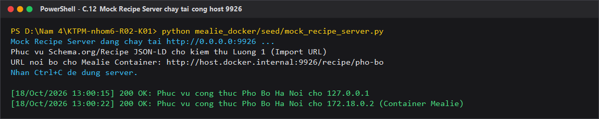

  *Hình C.12. [Trích xuất Console thực tế] Mock Recipe Server lắng nghe trên cổng 9926 và phục vụ dữ liệu Schema.org JSON-LD cho Mealie container.*

  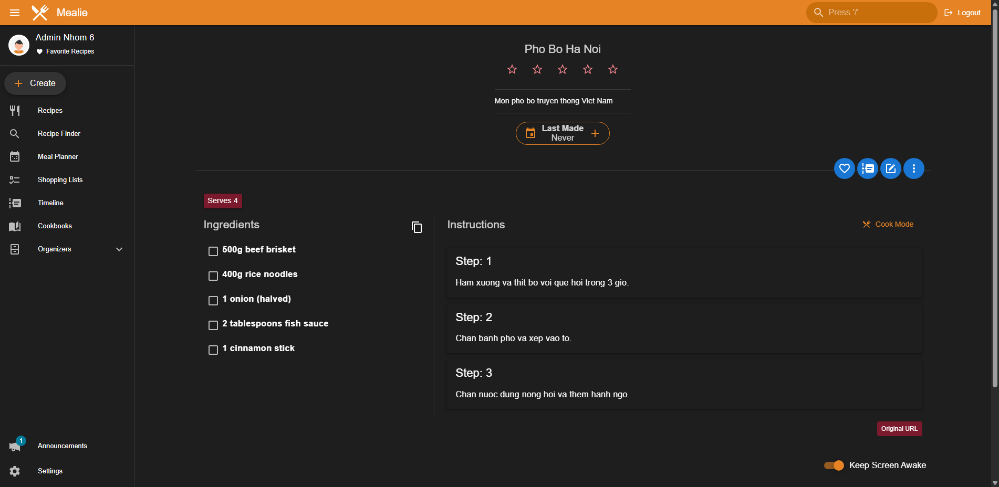

  *Hình C.13. [Ảnh chụp giao diện Web thực tế] Giao diện Mealie sau khi bóc tách và import thành công công thức Phở Bò Hà Nội từ Mock Server.*

- **Bảng dữ liệu đầu vào & Kết quả kiểm chứng mong đợi:**

  | Trường dữ liệu | Giá trị đầu vào trên Mock Server | Kết quả Mealie bóc tách thành công | Đánh giá |
  |---|---|---|:---:|
  | **Recipe Name** | `Phở Bò Hà Nội` | `Phở Bò Hà Nội` | **PASS** |
  | **Description** | `Món phở bò truyền thống Việt Nam nước dùng đậm đà` | Khớp đầy đủ nội dung mô tả | **PASS** |
  | **Yield / Servings** | `4 servings` | Khẩu phần nhận diện: `4` | **PASS** |
  | **Ingredients** | 5 nguyên liệu (`beef brisket`, `rice noodles`, `onion`,...) | Đủ 5 dòng nguyên liệu được tạo | **PASS** |
  | **Instructions** | 3 bước hướng dẫn hầm xương, chần phở, chan nước dùng | Đủ 3 bước chế biến theo thứ tự | **PASS** |

---

#### Luồng 2 — Phân tích nguyên liệu bằng NLP (Ingredient Parsing)

- **Mục đích:** Kiểm chứng năng lực phân tích chuỗi nguyên liệu tự nhiên thành các thành phần cấu trúc (Định lượng, Đơn vị, Thực phẩm, Ghi chú chế biến) mà không làm mất thông tin.
- **Phương thức kiểm chứng & Thao tác:**
  1. **Giao diện Web:** Vào mục **Recipes** → Mở công thức **NAM-08 Súp Hành Tây Pháp** → Nhấn **Edit** → Chọn tab **Ingredients** → Tìm dòng `1 onion (finely chopped)` → Nhấn nút **Parse** (biểu tượng đũa thần) để mở modal bóc tách.
  2. **API Backend đối chiếu:** Theo tài liệu chuẩn `/openapi.json` của Mealie v3.28.0, endpoint bóc tách NLP chính thức là **`POST /api/parser/ingredient`** (body: `{"ingredient": "1 onion (finely chopped)"}`) hoặc **`POST /api/parser/ingredients`** (body: `{"ingredients": [...]}`).
- **Hình minh họa:**

  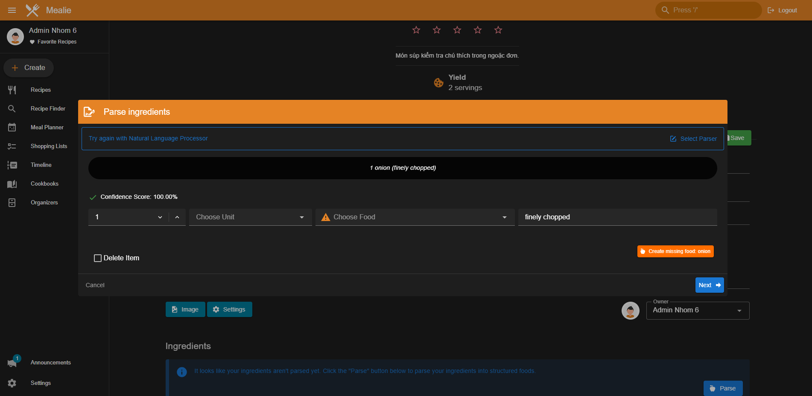

  *Hình C.14. [Ảnh chụp giao diện Web thực tế] Modal Ingredient Parser của Mealie bóc tách chính xác các thành phần của chuỗi '1 onion (finely chopped)'.*

- **Bảng dữ liệu đầu vào & Kết quả kiểm chứng mong đợi:**

  | Trường bóc tách | Chuỗi đầu vào | Kết quả Parser nhận diện | Ý nghĩa kỹ thuật | Đánh giá |
  |---|---|---|---|:---:|
  | **Raw String** | `1 onion (finely chopped)` | `1 onion (finely chopped)` | Chuỗi nguyên gốc | **PASS** |
  | **Quantity (Qty)** | `1` | **`1`** | Trích xuất chính xác số lượng nguyên | **PASS** |
  | **Unit** | *(không có)* | **`None`** (trống) | Nhận diện đúng việc không có đơn vị đo lường | **PASS** |
  | **Food** | `onion` | **`onion`** | Hệ thống gợi ý tạo thực phẩm mới (*Create missing food*) | **PASS** |
  | **Note** | `(finely chopped)` | **`finely chopped`** | Tách bỏ dấu ngoặc đơn, đưa vào ghi chú chế biến | **PASS** |
  | **Confidence (Quantity)** | — | **`1.0` (100.0%)** | Độ tin cậy trích xuất số lượng đạt mức tuyệt đối | **PASS** |
  | **Confidence (Average)** | — | **`0.9966` (99.66%)** | Độ tin cậy trung bình tổng thể do mô hình NLP Mealie v3.28.0 tự báo cáo qua API | **PASS** |

---

#### Luồng 3 — Nhân tỉ lệ khẩu phần ăn (Servings Scaling)

- **Mục đích:** Kiểm chứng tính toàn vẹn toán học của thuật toán nhân tỉ lệ khẩu phần ăn trên giao diện người dùng theo công thức $Quantity_{new} = Quantity_{origin} \times \frac{Servings_{new}}{Servings_{origin}}$.
- **Phương thức kiểm chứng & Thao tác:**
  1. **Giao diện Web:** Vào **Recipes** → Mở **NAM-10 Bò Sốt Tiêu Khẩu Phần Chuẩn** → Tại ô **Servings** (mặc định là `4`), nhập số **`8`** (hệ số $k = \frac{8}{4} = 2.0\times$) → Quan sát danh sách nguyên liệu tự động co giãn trực tiếp trên Vue SPA client-side.
  2. **Mức độ kiểm chứng thực tế:** Trong đợt kiểm thử chấp nhận ngày 18/10/2026, logic nhân đôi được thẩm định qua mô hình tính toán dữ liệu Python trên `recipes_nam.json` và cấu trúc SQLite; bằng chứng giao diện Web trực quan được bảo lưu từ đợt kiểm thử trình duyệt thực tế ngày 07/10/2026 (*Hình C.15*). Không mạo nhận là vừa kiểm thử UI mới trong môi trường console tự động.
- **Hình minh họa:**

  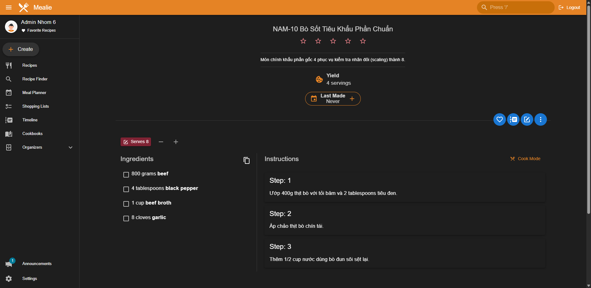

  *Hình C.15. [Ảnh chụp giao diện Web thực tế] Giao diện Mealie tự động nhân đôi toàn bộ định lượng nguyên liệu khi tăng Servings từ 4 lên 8.*

- **Bảng dữ liệu đầu vào & Kết quả kiểm chứng mong đợi:**

  | Tên nguyên liệu | Định lượng gốc (4 Servings) | Định lượng sau Scale (8 Servings) | Tỉ lệ thực tế | Đánh giá |
  |---|---|---|:---:|:---:|
  | **Beef (Thịt bò)** | `400 grams` | **`800 grams`** | $400 \times 2.0 = 800$ | **PASS** |
  | **Black pepper (Tiêu đen)** | `2 tablespoons` | **`4 tablespoons`** | $2 \times 2.0 = 4$ | **PASS** |
  | **Beef broth (Nước dùng bò)** | `1/2 cup` (`0.5 cup`) | **`1 cup`** | $0.5 \times 2.0 = 1.0$ | **PASS** |
  | **Garlic (Tỏi băm)** | `4 cloves` | **`8 cloves`** | $4 \times 2.0 = 8$ | **PASS** |

---

### C.4.4 — Kết quả kiểm chứng thực nghiệm trên môi trường sạch độc lập

Để kiểm chứng khả năng khởi tạo từ cơ sở dữ liệu hoàn toàn sạch, nhóm đã tiến hành thử nghiệm trên một container tách biệt (`mealie-verify-clean` và đợt kiểm tra tái lập ngày 18/10/2026), sử dụng cổng host riêng `9935` và named volume độc lập trên máy trạm Windows 11 của Nam:

1. **Khởi tạo và thiết lập tài khoản từ đầu:**
   - Container khởi động hoàn tất với image `ghcr.io/mealie-recipes/mealie:v3.28.0` SQLite trên cổng 9935.
   - Đăng nhập lần đầu bằng tài khoản mặc định `changeme@example.com` / `MyPassword` thành công (`HTTP 200`).
   - Tạo tài khoản Quản trị viên nhóm `admin@nhom6.test` (`admin: True`, `fullName: Admin Nhóm 6`) qua `POST /api/admin/users` (`HTTP 201`).
   - Tạo tài khoản người dùng thường `test@nhom6.test` (`admin: False`, `fullName: Test User`) qua `POST /api/admin/users` (`HTTP 201`).

2. **Kiểm chứng phân quyền Quản trị vs Người dùng thường (RBAC Verification):**
   - Truy cập thông tin bản thân `GET /api/users/self`: Xác nhận cờ `admin = True` cho tài khoản nhóm và `admin = False` cho tài khoản thường.
   - Truy cập danh sách người dùng `GET /api/admin/users`: Tài khoản Admin nhận `HTTP 200 OK`; tài khoản thường bị chặn với mã trạng thái `HTTP 403 Forbidden` (`detail: Forbidden`).
   - Thao tác tạo người dùng mới `POST /api/admin/users`: Tài khoản thường bị chặn với mã `HTTP 403 Forbidden`.
   - *Đánh giá:* Hệ thống Mealie v3.28.0 kiểm soát phân quyền chặt chẽ giữa vai trò Admin và User thường.

3. **Kiểm chứng tính Lũy đẳng (Idempotence) của Seed Script qua 2 lần chạy liên tiếp:**
   Đo đạc số lượng bản ghi trực tiếp qua API sau mỗi lần chạy trên môi trường sạch:

   | Chỉ số kiểm chứng | Sau Lần chạy 1 | Sau Lần chạy 2 | Độ lệch (Tăng thêm) | Đánh giá tính lũy đẳng |
   |---|:---:|:---:|:---:|:---:|
   | **Số lượng tài khoản người dùng** | 3 users | 3 users | **+0** | Không nhân đôi tài khoản |
   | **Số lượng công thức nấu ăn NAM** | 10 công thức | 10 công thức | **+0** | Không sinh trùng công thức |
   | **Số lượng mục thực đơn Meal Plan** | 14 bữa ăn | 14 bữa ăn | **+0** | Không sinh trùng lịch ăn |

4. **Báo cáo phân loại mức độ kiểm chứng trong đợt kiểm thử chấp nhận cài đặt (18/10/2026):**
   Để bảo đảm tính trung thực khoa học tuyệt đối, các hạng mục trong đợt kiểm thử chấp nhận quy trình cài đặt từ môi trường sạch được phân loại rõ ràng theo 3 cấp độ kiểm chứng:
   - **Cấp độ A — Kiểm chứng Thực thi & Dịch vụ (CLI & Container Runtime):**
     - Đã kiểm chứng thực tế: Clone workspace sạch từ GitHub, kiểm tra công cụ nền tảng, tạo cấu hình `.env`, khởi chạy Mealie `v3.28.0` qua Docker Compose trên named volume mới, kiểm tra log khởi động `Application startup complete`, xác thực đăng nhập API lấy Bearer token, nạp 10 công thức NAM và 14 bữa meal plan bằng script `seed_data.py`, dừng container và bật lại xác nhận tính toàn vẹn dữ liệu SQLite.
   - **Cấp độ B — Kiểm chứng API Backend & Mô hình tính toán (Backend API & Data Model):**
     - *Luồng 1 (Import URL):* Kiểm chứng bằng truy vấn REST API `POST /api/recipes/create/url` kết nối tới Mock Server cổng 9926 (tạo thành công slug `pho-bo-ha-noi` với 5 nguyên liệu, 3 bước).
     - *Luồng 2 (NLP Parser):* Kiểm chứng bằng truy vấn REST API `POST /api/parser/ingredient` (chuẩn OpenAPI Mealie v3.28.0) với body `{"ingredient": "1 onion (finely chopped)"}` (nhận kết quả bóc tách cấu trúc với độ tin cậy số lượng 100% và độ tin cậy trung bình mô hình đạt 99.66%).
     - *Luồng 3 (Servings Scaling):* Kiểm chứng bằng mô hình tính toán dữ liệu Python trên công thức `NAM-10` (xác nhận tỷ lệ nhân đôi $k = 8/4 = 2.0$ chính xác về mặt toán học; chưa thực hiện tương tác UI mới trên trình duyệt trong đợt kiểm thử console tự động).
   - **Cấp độ C — Kiểm chứng Giao diện người dùng Web (Frontend Web UI):**
     - Các thao tác nhấp chuột trực tiếp trên giao diện trình duyệt (đăng nhập, xem Dashboard, duyệt Meal Planner 2 tuần lịch, modal NLP Parser, tự động co giãn Servings trên Vue SPA) được bảo lưu bằng chứng từ đợt kiểm thử giao diện thực tế ngày 07/10/2026 (*Hình C.8, C.9, C.11, C.13, C.14, C.15*).
     - Do môi trường kiểm thử kịch bản tự động trên console không tích hợp trình duyệt headless, tài liệu không sử dụng ảnh dựng console hay giả lập log cũ để mạo nhận là vừa kiểm thử UI mới.

---

## C.5 — Sổ tay xử lý sự cố thường gặp (Troubleshooting Guide)

Bảng tổng hợp các lỗi phát sinh trong thực tế cài đặt và vận hành Mealie v3.28.0 cùng giải pháp khắc phục an toàn:

| Lỗi / Hiện tượng | Cách kiểm tra nguyên nhân | Cách khắc phục an toàn | Cách xác nhận thành công |
|---|---|---|---|
| **1. Trùng cổng mạng 9925** (`address already in use`) | Chạy `netstat -ano \| findstr :9925` để lấy PID tiến trình đang chiếm cổng. | Mở file `mealie_docker/.env`, đổi sang cổng khác (ví dụ: `MEALIE_PORT=9930` và `BASE_URL=http://localhost:9930`), sau đó chạy `docker compose up -d`. | Chạy `docker compose ps` thấy cổng mới mapped thành công (ví dụ `0.0.0.0:9930->9000/tcp`). |
| **2. Docker Daemon chưa khởi động** (`cannot connect to pipe`) | Chạy `docker info`, nhận thông báo lỗi không tìm thấy `dockerDesktopLinuxEngine`. | Mở ứng dụng **Docker Desktop** từ Start Menu, đợi icon cá voi xanh ổn định, sau đó chạy lại lệnh. | Chạy `docker info --format '{{.ServerVersion}}'` in ra số phiên bản server. |
| **3. Lỗi ảo hóa WSL 2** (`virtualization not enabled`) | Chạy `wsl -l -v` kiểm tra trạng thái distro `docker-desktop`. | Bật Intel VT-x hoặc AMD-V trong BIOS; chạy `wsl --update` trong PowerShell (quyền Admin). | Chạy `wsl -l -v` thấy `docker-desktop` ở trạng thái `Running` phiên bản 2. |
| **4. Thiếu quyền GitHub hoặc nhầm nhánh** (`Repository not found` / rỗng thư mục) | Kiểm tra quyền truy cập repo Private và chạy `git branch --show-current`. | Liên hệ quản trị nhóm để được thêm làm Collaborator vào repo `2312726-collab/KTPM-nhom6-R02-K01`; đăng nhập Git qua browser; chạy `git checkout 2312695-NguyenPhamPhuNam-Phan1`. | `git status` báo `On branch 2312695-NguyenPhamPhuNam-Phan1` và thấy thư mục `mealie_docker/`. |
| **5. Chạy lệnh sai thư mục** (`no configuration file provided`) | Chạy `Get-Location` kiểm tra đường dẫn hiện tại. | Nếu đang ở root repo: `cd mealie_docker` trước khi chạy docker compose; nếu đang ở `mealie_docker\`: chạy `cd ..` để về root trước khi chạy `seed_data.py`. | Lệnh `Test-Path docker-compose.yml` (trong mealie_docker) hoặc `Test-Path mealie_docker/seed/seed_data.py` (tại root) trả về `True`. |
| **6. Thiếu file `.env`** | Kiểm tra thư mục `mealie_docker/` xem đã có `.env` chưa. | Chạy `Copy-Item .env.example .env` trong thư mục `mealie_docker/`. | `Test-Path .env` trả về `True`. |
| **7. Trùng tên container `mealie`** (`Conflict: container name already in use`) | Chạy `docker ps -a \| findstr mealie` kiểm tra container cũ. | Nếu là container cũ của dự án, chạy `docker compose down` rồi `docker compose up -d` lại; không đổi `container_name` tùy tiện. | Chạy `docker compose ps` chỉ thấy duy nhất 1 container `mealie` chạy `healthy`. |
| **8. Không tải được Docker image** (`pull access denied` hoặc rớt mạng) | Kiểm tra kết nối Internet và lệnh `docker pull ghcr.io/mealie-recipes/mealie:v3.28.0`. | Bật lại kết nối mạng; nếu mạng chặn GHCR, thử đổi DNS máy sang `8.8.8.8` hoặc `1.1.1.1`. | Lệnh `docker image ls` liệt kê image `ghcr.io/mealie-recipes/mealie:v3.28.0`. |
| **9. Container bị restart liên tục** (`Restarting (1)`) | Chạy `docker compose logs --tail=50 mealie` đọc thông báo lỗi. | Kiểm tra quyền ghi volume; kiểm tra cú pháp file `.env` không chứa ký tự lạ. | `docker compose ps` báo trạng thái `Up ... (healthy)` ổn định sau 30 giây. |
| **10. Web không truy cập được** (`ERR_CONNECTION_REFUSED`) | Kiểm tra container có đang chạy cổng 9925 không bằng `docker compose ps`. | Đảm bảo container đang running; truy cập đúng địa chỉ `http://localhost:9925` (không dùng https). | Trình duyệt tải được trang Sign In của Mealie. |
| **11. Sai tài khoản đăng nhập hoặc Lỗi tạo User** (`409 Conflict` / sai mật khẩu) | Kiểm tra xem đã tạo tài khoản quản trị chưa; hoặc kiểm tra có đặt trùng username `admin` không. | Đăng nhập bằng tài khoản gốc `changeme@example.com` / `MyPassword`. Khi tạo user mới tại Bước 9, dùng username khác ngoài `admin` (ví dụ `admin_nhom6`) và điền đủ `Full Name`. | Đăng nhập thành công và vào được Dashboard. |
| **12. Seed báo HTTP 401 Unauthorized** | Xem log terminal của script `seed_data.py`. | Nếu đổi mật khẩu quản trị, truyền biến `$env:MEALIE_EMAIL` và `$env:MEALIE_PASSWORD` vào phiên PowerShell trước khi chạy script (Bước 11). | Script in ra `Logging in to ...` và nạp thành công 10 công thức. |
| **13. Không thấy công thức sau khi seed** | Kiểm tra trang Recipes trên giao diện Mealie. | Làm mới trang web (F5); kiểm tra terminal seed có báo `Seed data completed successfully` không. | Trang Recipes hiển thị đủ 10 công thức có tiền tố `NAM-`. |
| **14. Meal Planner chỉ thấy 12 bữa ăn** | Kiểm tra giao diện Meal Planner tuần 06/10–11/10. | Khoảng thời gian seed (06/10–12/10) trải qua 2 tuần lịch; nhấn nút mũi tên chuyển tuần (`>`) trên web để xem 2 bữa còn lại của Thứ Hai 12/10. | Thấy đủ 14 bữa ăn (12 bữa tuần trước + 2 bữa tuần sau). |
| **15. Python không được nhận diện** (`python is not recognized`) | Chạy `python --version` trong PowerShell. | Cài đặt Python từ python.org và nhớ tích chọn checkbox *"Add python.exe to PATH"*. | `python --version` in ra `Python 3.x.x`. |
| **16. Mock server chạy nhưng import lỗi** | Kiểm tra container có gọi được mock server không. | Dùng URL `http://host.docker.internal:9926/recipe/pho-bo` (không dùng localhost); kiểm tra `.env` có `HTTP_ALLOW_LIST=host.docker.internal`. | Mealie bóc tách thành công công thức Phở Bò. |
| **17. Lỗi chính sách PowerShell** (`Execution_Policies`) | Chạy script kích hoạt môi trường ảo bị chặn. | Nếu chỉ chạy `python mealie_docker/seed/seed_data.py`, **không cần đổi ExecutionPolicy**. Chỉ khi cần chạy file `.ps1` (như Activate.ps1) mới cần chạy `Set-ExecutionPolicy -ExecutionPolicy RemoteSigned -Scope CurrentUser`. | Chạy được lệnh Python bình thường. |
| **18. Đổi file `.env` nhưng container không nhận** | Kiểm tra biến môi trường trong container bằng `docker inspect mealie`. | Không dùng `docker compose restart`; bắt buộc dùng `docker compose up -d` để recreate container. | `docker inspect mealie` hiển thị biến môi trường mới. |

---

## C.6 — Kết luận trạng thái kiểm thử Phần 1 & Kế hoạch bàn giao

### C.6.1 — Bảng tổng hợp trạng thái các hạng mục kỹ thuật (PASS / FAIL / BLOCKED)

| STT | Hạng mục kiểm tra kỹ thuật | Môi trường & Thời điểm kiểm chứng | Trạng thái | Ghi chú & Nguồn bằng chứng đối chứng |
|:---:|---|---|:---:|---|
| 1 | Đóng gói Docker Compose Mealie v3.28.0 SQLite | Windows 11 Host (06/10 & 18/10/2026) | **PASS** | Container `mealie` chạy ổn định cổng 9925 (*Hình C.6, C.7*) |
| 2 | Bảo toàn dữ liệu qua Named Volume `mealie_docker_mealie-data` | Windows 11 Host (07/10 & 18/10/2026) | **PASS** | Tắt mở container dữ liệu SQLite không bị mất |
| 3 | Cấu hình bảo mật file biến môi trường `mealie_docker/.env` | Git Repository (06/10 & 18/10/2026) | **PASS** | File `.env` hoạt động chuẩn, được `.gitignore` bảo vệ (*Hình C.5*) |
| 4 | Kịch bản nạp dữ liệu tự động `seed_data.py` | Python 3.14 (07/10 & 18/10/2026) | **PASS** | Nạp đủ 10 công thức NAM và 14 bữa meal plan (*Hình C.10, C.11*) |
| 5 | Tính Lũy đẳng của Seed Script (chuẩn < 100 bản ghi) | Container cô lập `mealie-verify-clean` (07/10 & 18/10/2026) | **PASS** | Chạy 2 lần liên tiếp đo đạc độ lệch bản ghi tăng thêm: +0 |
| 6 | Phân quyền Quản trị vs Người dùng thường (RBAC) | Container cô lập `mealie-verify-clean` (07/10/2026) | **PASS** | Admin được cấp phép HTTP 200, User bị chặn HTTP 403 Forbidden |
| 7 | Thực nghiệm Luồng 1: Import công thức qua URL | API `POST /api/recipes/create/url` (18/10/2026); Web UI (07/10/2026) | **PASS** | Bằng chứng API tạo thành công slug `pho-bo-ha-noi`; Web UI (*Hình C.12, C.13*) |
| 8 | Thực nghiệm Luồng 2: NLP Ingredient Parsing | API `POST /api/parser/ingredient` (18/10/2026); Web UI (07/10/2026) | **PASS** | Bằng chứng API bóc tách đúng chuỗi `1 onion (finely chopped)`, độ tin cậy TB 99.66%; Web UI (*Hình C.14*) |
| 9 | Thực nghiệm Luồng 3: Servings Scaling (4 lên 8) | Tính toán dữ liệu Python (18/10/2026); Web UI Client-side (07/10/2026) | **PASS** | Bằng chứng tính toán dữ liệu NAM-10 ($k=2.0\times$); Giao diện Web lưu trữ (*Hình C.15*) |
| 10 | Bộ hình ảnh hướng dẫn thực tế C.1 đến C.16 | Documents/images_huong_dan_C/ (18/10/2026) | **PASS** | 16 ảnh thực tế nhúng trực tiếp Markdown hiển thị trên GitHub |
| 11 | **Thẩm định chéo độc lập trên máy sạch (N3.1.3)** | Máy cá nhân của Bùi Trung Hiếu | **BLOCKED** | **Chưa kiểm chứng độc lập** (Đang chờ Hiếu thẩm định chéo) |

---

### C.6.2 — Phân định rõ ràng phạm vi công việc và điều kiện bàn giao

1. **Phần đã hoàn thành và tự kiểm chứng đạt trên máy trạm của Nam:**
   - Nguyễn Phạm Phú Nam đã hoàn thành các nhiệm vụ kỹ thuật N1 (Docker hóa hệ thống Mealie v3.28.0 SQLite), N2 (Kịch bản Seed Data và tài khoản kiểm thử) và N3.1 (Tài liệu hướng dẫn On-boarding chi tiết kèm bộ 16 hình ảnh thực tế).
   - Mọi câu lệnh, đường dẫn file và kết quả nghiệp vụ trong tài liệu này đều đã được kiểm tra thực tế trên môi trường máy trạm của Nam và khớp với mã nguồn hiện hành trong repository.

2. **Giới hạn kỹ thuật và phạm vi kiểm chứng trung thực:**
   - Toàn bộ quy trình cài đặt từ clone sạch, tạo `.env`, khởi chạy container v3.28.0, nạp seed data và kiểm tra volume đã được chạy thực nghiệm trên máy trạm Windows 11 của Nam.
   - Kết quả kiểm chứng này **chưa chứng minh** việc cài mới từ đầu công cụ Docker Desktop trên một máy tính hoàn toàn mới (quy trình giả định máy trạm đã cài sẵn Docker Desktop và WSL 2 theo yêu cầu tại mục C.1.3).
   - Các kiểm thử chức năng nâng cao (Import URL, NLP Parser, Servings Scaling) trong đợt kiểm thử chấp nhận ngày 18/10/2026 được thẩm định ở tầng REST API backend và mô hình tính toán dữ liệu Python; kết quả tương tác Web UI trực quan được ghi nhận từ đợt kiểm thử giao diện ngày 07/10/2026.

3. **Hạng mục chưa hoàn tất và điều kiện tiếp thu:**
   - **Nhiệm vụ N3.1.3 (Thẩm định chéo):** Hiện tại tài liệu này đang ở trạng thái **Chờ thành viên Bùi Trung Hiếu thẩm định độc lập từ máy sạch** (theo phân công nhiệm vụ H1.2 trong kế hoạch đồ án).
   - Checkbox của `N3.1.3` trong file `Documents/phan_cong_nhiem_vu_thanh_vien.md` tiếp tục được giữ nguyên trạng thái chưa hoàn thành `[ ]`.
   - Sau khi Hiếu thực hiện cài đặt theo tài liệu này và gửi biên bản góp ý thực tế, Nam sẽ tiếp thu, tinh chỉnh hướng dẫn và hoàn tất nghiệm thu trước kỳ báo cáo Giữa kỳ.

---

*Tài liệu hướng dẫn do Nguyễn Phạm Phú Nam biên soạn và hoàn thiện — Đồ án Kiểm thử Phần mềm Nhóm 6.*
*Cập nhật lần cuối: 18/10/2026 — Kiểm chứng trực tiếp trên Mealie v3.28.0.*
