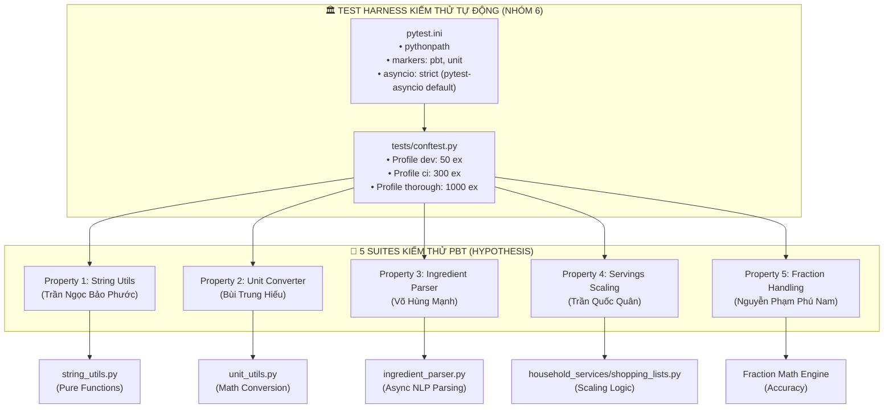

# PHẦN F: MÃ NGUỒN KIỂM THỬ TỰ ĐỘNG, CẤU HÌNH TEST HARNESS VÀ HƯỚNG DẪN TÁI LẬP
## BÁO CÁO ĐỒ ÁN MÔN HỌC KIỂM THỬ PHẦN MỀM — NHÓM 6
* **Học phần:** Kiểm thử phần mềm — Trường Đại học Đà Lạt
* **Giảng viên hướng dẫn:** ThS. Nguyễn Thế Lâm
* **Tổ hợp đề tài:** **Mealie (R02 - v3.28.0)** + **Property-Based Testing với Hypothesis (K01)**
* **Sinh viên phụ trách chính Phần F:** **Trần Ngọc Bảo Phước** (MSSV: `2312719`)
* **Vai trò trong nhóm:** **QA Automation Engineer 1 — Test Harness & String Engine Verification**
* **Kho lưu trữ GitHub:** [https://github.com/2312726-collab/KTPM-nhom6-R02-K01](https://github.com/2312726-collab/KTPM-nhom6-R02-K01)
* **Phiên bản hệ thống mục tiêu:** Release Tag **`v3.28.0`** (Commit SHA: `0552eaa4a80031b8572849cca0ed95d07f1be001`)

---

## 📑 MỤC LỤC BÁO CÁO PHẦN F

1. [F.1. TỔNG QUAN KIẾN TRÚC TEST HARNESS & BỘ KIỂM THỬ TỰ ĐỘNG](#f1-tổng-quan-kiến-trúc-test-harness--bộ-kiểm-thử-tự-động)
   - 1.1. Triết lý thiết kế Test Harness theo nguyên lý Ponytail
   - 1.2. Cấu trúc thư mục kiểm thử và vai trò của từng tệp tin
   - 1.3. Ma trận phân công 5 kịch bản PBT của Nhóm 6
2. [F.2. HẠ TẦNG CẤU HÌNH TEST HARNESS (PYTEST & HYPOTHESIS)](#f2-hạ-tầng-cấu-hình-test-harness-pytest--hypothesis)
   - 2.1. Phân tích chi tiết tệp cấu hình `pytest.ini`
   - 2.2. Chiến lược phân tầng đa cấu hình (Multi-profile) trong `tests/conftest.py`
   - 2.3. Cơ chế kiểm soát bộ nhớ đệm `.hypothesis/` chống Flaky Test
3. [F.3. ĐẶC TẢ KỸ THUẬT & MÃ NGUỒN BỘ KIỂM THỬ PROPERTY 1](#f3-đặc-tả-kỹ-thuật--mã-nguồn-bộ-kiểm-thử-property-1)
   - 3.1. Import module Mealie theo tên package chuẩn
   - 3.2. Property 1.1: Tính lũy đẳng (Idempotence) khi xóa dấu chú thích
   - 3.3. Property 1.2: Tính lũy đẳng (Idempotence) khi di chuyển ngoặc bổ nghĩa
   - 3.4. Property 1.3: Tính bền bỉ (Crash-free) & Hoàn chỉnh (Completeness) với phân số Unicode
   - 3.5. Danh mục Edge Cases cho Property 1
   - 3.6. Các kịch bản trong `test_pbt_string_utils.py`
4. [F.4. HƯỚNG DẪN THỰC THI & TÁI LẬP 1-CLICK (REPRODUCIBILITY GUIDE)](#f4-hướng-dẫn-thực-thi--tái-lập-1-click-reproducibility-guide)
   - 4.1. Thiết lập môi trường sạch và cài đặt Dependencies
   - 4.2. Danh mục lệnh thực thi kiểm thử 1-click
   - 4.3. Lệnh tích hợp đo lường độ bao phủ mã nguồn (Code Coverage)
   - 4.4. Hướng dẫn đọc hiểu nhật ký kết quả Hypothesis (Pass / Fail / Shrink)
5. [F.5. KẾT QUẢ THỰC NGHIỆM & BẰNG CHỨNG XÁC NHẬN TÁI LẬP](#f5-kết-quả-thực-nghiệm--bằng-chứng-xác-nhận-tái-lập)
   - 5.1. Log thực thi trực tiếp trên hệ thống (Pass 100%)
   - 5.2. Kết quả đo lường độ bao phủ (Code Coverage Report)
   - 5.3. Biên bản thẩm định chéo (Cross-validation) từ môi trường sạch
6. [F.6. TỔNG KẾT ĐÓNG GÓP VÀ LIÊN KẾT BÁO CÁO TOÀN DỰ ÁN](#f6-tổng-kết-đóng-góp-và-liên-kết-báo-cáo-toàn-dự-án)

---

## 🏗️ F.1. TỔNG QUAN KIẾN TRÚC TEST HARNESS & BỘ KIỂM THỬ TỰ ĐỘNG

### 1.1. Triết lý thiết kế Test Harness theo nguyên lý Ponytail
Trong các hệ thống mã nguồn mở quy mô công nghiệp như **Mealie**, mã nguồn bao gồm hàng trăm API endpoints, tầng giao diện Vue 3 phức tạp và tương tác cơ sở dữ liệu phân tán. Việc cố gắng kiểm thử toàn bộ hệ thống từ đầu đến cuối (End-to-End Testing) bằng kỹ thuật sinh dữ liệu ngẫu nhiên Property-Based Testing (PBT) sẽ nhanh chóng gặp phải bẫy nghẽn cổ chai:
* Tốc độ thực thi chậm do độ trễ mạng và I/O đĩa.
* Trạng thái cơ sở dữ liệu bị bẩn (Dirty Database State) giữa các ca test.
* Hiện tượng kiểm thử chập chờn (Flaky Tests) do xung đột tài nguyên ngoài tầm kiểm soát.

Do đó, bộ khung kiểm thử (**Test Harness**) của Nhóm 6 được kiến trúc chặt chẽ theo **Triết lý Ponytail**:
1. **Thu hẹp phạm vi vào Ranh giới Tin cậy (Trust Boundary):** Tập trung tuyệt đối vào module tiếp nhận và xử lý dữ liệu thô từ thế giới bên ngoài là `mealie/services/parser_services/`.
2. **Kiểm thử các Hàm Thuần túy (Pure Functions):** Ưu tiên các thuật toán biến đổi chuỗi và tính toán số học độc lập trong `string_utils.py` và `unit_utils.py`. Các hàm này không có tác dụng phụ (No Side-effects), nhận dữ liệu đầu vào và trả về kết quả trong thời gian microsecond ($\mu s$), cho phép test runner sinh và thực thi hàng chục ngàn ca kiểm thử trong vài giây.
3. **Cô lập theo đúng phạm vi:** Các test PBT cho hàm thuần như String Utils không cần khởi tạo database; cấu hình dùng chung không khai báo fixture mock cho các thành viên khác.



---

### 1.2. Cấu trúc thư mục kiểm thử và vai trò của từng tệp tin

Toàn bộ hạ tầng và mã nguồn kiểm thử được bố trí chuẩn mực trong thư mục `tests/` cùng các tệp cấu hình ở thư mục gốc:

```text
mealie/
├── pytest.ini                            # [GỐC] Cấu hình runner, PYTHONPATH & markers
├── requirements-test.txt                # [GỐC] Khai báo danh mục thư viện kiểm thử cần cài đặt
├── .hypothesis/                          # [GỐC] Bộ nhớ đệm lưu trữ các phản ví dụ đã phát hiện
├── tests/
│   ├── __init__.py                      # Đánh dấu package Python cho bộ test
│   ├── conftest.py                      # Cấu hình 3 Profiles Hypothesis dùng chung
│   ├── README.md                        # Hướng dẫn thực thi 1-click cho người chấm thi độc lập
│   └── unit_tests/
│       ├── __init__.py                  # Đánh dấu package cho unit tests
│       ├── test_pbt_string_utils.py     # [PROPERTY 1] Bộ test PBT chuỗi (Trần Ngọc Bảo Phước)
│       ├── test_pbt_unit_converter.py   # [PROPERTY 2] Bộ test PBT đơn vị (Bùi Trung Hiếu)
│       ├── test_pbt_ingredient_parser.py# [PROPERTY 3] Bộ test PBT parser async (Võ Hùng Mạnh)
│       ├── test_pbt_scaling.py          # [PROPERTY 4] Bộ test PBT scaling (Trần Quốc Quân)
│       └── test_pbt_fraction.py         # [PROPERTY 5] Bộ test PBT phân số (Nguyễn Phạm Phú Nam)
└── Documents/
    ├── bao_cao_phan_F.md                # Báo cáo chuyên sâu Phần F (Tệp hiện tại)
    └── assets/                          # Hình ảnh minh chứng kết quả chạy test và coverage
```

#### Bảng vai trò kỹ thuật của từng tệp tin:
| Tệp tin | Người khởi tạo / Phụ trách | Vai trò kỹ thuật trong Test Harness |
| :--- | :--- | :--- |
| `pytest.ini` | **Trần Ngọc Bảo Phước** | Thiết lập quy chuẩn nhận diện test runner, tự động nạp `mealie_src` vào `PYTHONPATH` và đăng ký marker `@pytest.mark.pbt`. Pytest-asyncio giữ chế độ mặc định `strict`; file không cấu hình `asyncio_mode = auto`. |
| `tests/conftest.py` | **Trần Ngọc Bảo Phước** | Khởi tạo 3 Profiles `dev`, `ci`, `thorough` của Hypothesis; không khai báo mock fixtures. |
| `tests/README.md` | **Trần Ngọc Bảo Phước** | Hướng dẫn cô đọng dành cho giảng viên/người chấm thi có thể copy lệnh chạy ngay lập tức mà không cần cấu hình phức tạp. |
| `tests/unit_tests/test_pbt_string_utils.py` | **Trần Ngọc Bảo Phước** | Chứa 4 kịch bản PBT cho `string_utils.py`, gồm test characterization `XFAIL` cho lỗi đã biết của `move_parens_to_end`. |

---

### 1.3. Ma trận phân công 5 kịch bản PBT của Nhóm 6

Nhằm đảm bảo tính công bằng và cân bằng tuyệt đối giữa các thành viên, cả 5 thành viên Nhóm 6 đều tự tay lập trình đúng 01 kịch bản kiểm thử PBT độc lập:

| Kịch bản | Tính chất bất biến (Invariant) | File mã nguồn kiểm thử | Thành viên phụ trách |
| :---: | :--- | :--- | :--- |
| **Property 1** | **Tính lũy đẳng (Idempotence) & Hoàn chỉnh của String Utils** | `tests/unit_tests/test_pbt_string_utils.py` | **Trần Ngọc Bảo Phước** |
| **Property 2** | **Tính bảo toàn hai chiều (Round-trip) của Unit Converter** | `tests/unit_tests/test_pbt_unit_converter.py` | Bùi Trung Hiếu |
| **Property 3** | **Tính bền bỉ (Crash-free) của Async Ingredient Parser** | `tests/unit_tests/test_pbt_ingredient_parser.py` | Võ Hùng Mạnh |
| **Property 4** | **Tính đơn điệu (Monotonicity) & Nghịch đảo khi Scale Servings** | `tests/unit_tests/test_pbt_scaling.py` | Trần Quốc Quân |
| **Property 5** | **Tính bảo toàn số học khi chuẩn hóa Phân số (Fractions)** | `tests/unit_tests/test_pbt_fraction.py` | Nguyễn Phạm Phú Nam |

---

## ⚙️ F.2. HẠ TẦNG CẤU HÌNH TEST HARNESS (PYTEST & HYPOTHESIS)

### 2.1. Phân tích chi tiết tệp cấu hình `pytest.ini`

Tệp [`pytest.ini`](file:///f:/THUC_HANH/KTPM/mealie/pytest.ini) đóng vai trò trung tâm điều phối toàn bộ hành vi của `pytest`. Nội dung cấu hình đã được tối ưu hóa như sau:

```ini
# ==============================================================================
# CẤU HÌNH PYTEST CHO ĐỒ ÁN KIỂM THỬ PHẦN MỀM — NHÓM 6
# ==============================================================================

[pytest]
# Thư mục chứa các file test tự động
testpaths = tests

# Mẫu tên file, class, function kiểm thử chuẩn
python_files = test_*.py
python_classes = Test*
python_functions = test_*

# Bổ sung thư mục gốc và mã nguồn Mealie vào PYTHONPATH để import module
pythonpath = . mealie_src

# Tùy chọn mặc định khi chạy lệnh pytest
# -v: hiển thị chi tiết từng test
# -ra: tóm tắt lý do các test pass/fail/skip ở cuối
# --tb=short: rút gọn traceback lỗi để dễ quan sát phản ví dụ
# --strict-markers: báo lỗi nếu lập trình viên dùng marker chưa khai báo
addopts = -v --tb=short --strict-markers -ra

# Định nghĩa các marker phân loại test case chuẩn mực
markers =
    pbt: Kịch bản kiểm thử Property-Based Testing sử dụng Hypothesis
    unit: Kiểm thử đơn vị (Unit Test) thông thường
    integration: Kiểm thử tích hợp (Integration Test)
    slow: Các test case chạy lâu cần cờ riêng
```

#### Phân tích các thông số then chốt:
1. `pythonpath = . mealie_src`: Giải quyết dứt điểm vấn đề `ModuleNotFoundError` khi các module con của Mealie gọi chéo nhau mà không cần người dùng phải tự gõ lệnh `$env:PYTHONPATH` trên terminal.
2. `pytest-asyncio` ở chế độ mặc định `strict`: các test bất đồng bộ cần được đánh dấu theo cấu hình plugin; `pytest.ini` không bật chế độ `auto`.
3. `--strict-markers`: Buộc các thành viên trong nhóm phải tuân thủ chuẩn marker đã đăng ký (`pbt`, `unit`), ngăn chặn lỗi gõ sai chính tả marker.

---

### 2.2. Chiến lược phân tầng đa cấu hình (Multi-profile) trong `tests/conftest.py`

Một trong những thách thức lớn nhất khi áp dụng Property-Based Testing trong môi trường học thuật và doanh nghiệp là sự đánh đổi giữa **Thời gian phản hồi** (Feedback Loop) và **Độ phủ vét cạn** (Exhaustive Testing).

Trong tệp [`tests/conftest.py`](file:///f:/THUC_HANH/KTPM/mealie/tests/conftest.py), Phước đã thiết kế **03 Profiles Hypothesis** được đăng ký thông qua hàm `settings.register_profile`:

```python
from hypothesis import Verbosity, settings

# ==============================================================================
# CẤU HÌNH CÁC PROFILE HYPOTHESIS DÙNG CHUNG CHO CẢ 5 THÀNH VIÊN
# ==============================================================================

# 1. Profile 'dev': Chạy nhanh khi lập trình viên đang code và debug cục bộ
settings.register_profile(
    "dev",
    max_examples=50,  # Sinh 50 ví dụ kiểm thử cho mỗi test function
    deadline=None,  # Tắt deadline để tránh lỗi timeout do tải máy biến động
    verbosity=Verbosity.normal,
)

# 2. Profile 'ci': Chạy kiểm tra kỹ hơn trước khi tạo Pull Request hoặc nộp bài
settings.register_profile(
    "ci",
    max_examples=300,  # Sinh 300 ví dụ ngẫu nhiên phức tạp hơn
    deadline=None,
    verbosity=Verbosity.normal,
)

# 3. Profile 'thorough': Kiểm thử vét cạn / đo độ bền tìm kiếm các ca biên cực đoan
settings.register_profile(
    "thorough",
    max_examples=1000,  # Sinh 1.000 ví dụ kiểm thử
    deadline=None,
    verbosity=Verbosity.verbose,
)

# Kích hoạt profile mặc định khi chạy lệnh 'pytest' đơn giản
settings.load_profile("dev")
```

#### Bảng so sánh 3 chế độ kiểm thử:
| Tên Profile | Số lượng ví dụ (`max_examples`) | Mục đích sử dụng |
| :--- | :---: | :--- |
| **`dev`** *(Mặc định)* | **50** | Lập trình viên chạy nhanh khi sửa code. |
| **`ci`** | **300** | Chạy kiểm tra trên môi trường CI hoặc trước khi merge nhánh. |
| **`thorough`** | **1.000** | Tăng số ví dụ để tìm kiếm ca biên. |

---

### 2.3. Cơ chế kiểm soát bộ nhớ đệm `.hypothesis/` chống Flaky Test

Property-Based Testing sử dụng bộ sinh giả ngẫu nhiên (Pseudo-random generation). Điều này dẫn đến nguy cơ tiềm ẩn: *Một lỗi xuất hiện trong lần chạy A nhưng không lặp lại trong lần chạy B do seed ngẫu nhiên thay đổi (Flaky Test)*.

Thư viện Hypothesis và Test Harness của Nhóm 6 giải quyết triệt để vấn đề này thông qua thư mục cache [`.hypothesis/`](file:///f:/THUC_HANH/KTPM/mealie/.hypothesis/):
* Khi một hàm test bị `FAILED`, Hypothesis sẽ lập tức ghi lại **phản ví dụ tối giản nhất (Shrunk Counterexample)** vào cơ sở dữ liệu nhúng bên trong `.hypothesis/examples/`.
* Trong tất cả các lần chạy kế tiếp, Hypothesis **luôn luôn tải lại và kiểm thử phản ví dụ này đầu tiên** trước khi sinh các dữ liệu ngẫu nhiên mới.
* Thư mục `.hypothesis/` đã được Phước cấu hình vào `.gitignore` để tránh xung đột mã nguồn giữa các máy, nhưng được duy trì trên máy cá nhân để bảo toàn lịch sử truy vết lỗi.

---

## 🧪 F.3. ĐẶC TẢ KỸ THUẬT & MÃ NGUỒN BỘ KIỂM THỬ PROPERTY 1

### 3.1. Import module Mealie và đo coverage

```python
from mealie.services.parser_services.parser_utils.string_utils import (
    convert_vulgar_fractions_to_regular_fractions,
    move_parens_to_end,
    remove_footnote_markers,
)
```

Import bằng tên package chuẩn giúp pytest-cov nhận diện cùng một module khi tính coverage; test không dò đường dẫn máy cá nhân hay nuốt lỗi import.

---

### 3.2. Property 1.1: Tính lũy đẳng (Idempotence) khi xóa dấu chú thích

#### Khái niệm toán học:
Một phép biến đổi $f: S \to S$ được gọi là **Lũy đẳng (Idempotent)** nếu việc áp dụng phép biến đổi nhiều hơn một lần không làm thay đổi kết quả so với lần áp dụng đầu tiên:
$$\forall s \in \text{String}, \quad f(f(s)) = f(s)$$

#### Ý nghĩa nghiệp vụ trong Mealie:
Khi người dùng copy công thức từ các website ẩm thực, chuỗi nguyên liệu thường chứa dấu sao chú thích ở cuối dòng (ví dụ: `"500g Bột mì đa dụng*"`). Hàm `remove_footnote_markers(s)` loại bỏ các dấu sao này. Tính lũy đẳng đảm bảo rằng nếu chuỗi đã qua xử lý được đưa qua hàm một lần nữa (ví dụ qua nhiều middleware khác nhau), dữ liệu tuyệt đối không bị biến dạng thêm.

#### Mã nguồn kiểm thử:
```python
@pytest.mark.pbt
@settings(max_examples=300)
@given(s=st.text())
def test_remove_footnote_idempotent(s: str):
  """Kiểm tra tính lũy đẳng (Idempotence):

  Hàm xóa dấu sao chú thích ở cuối chuỗi (*) nếu áp dụng một lần hay nhiều lần
  đều phải mang lại kết quả đồng nhất: f(f(s)) == f(s).
  """
  once = remove_footnote_markers(s)
  twice = remove_footnote_markers(once)
  assert once == twice, (
      f"Vi phạm tính lũy đẳng: input={s!r}, once={once!r}, twice={twice!r}"
  )
```

---

### 3.3. Property 1.2: Tính lũy đẳng (Idempotence) khi di chuyển ngoặc bổ nghĩa

#### Ý nghĩa nghiệp vụ:
Người dùng thường ghi chú thích nguyên liệu nằm xen giữa chuỗi (ví dụ: `"2 củ hành tây (thái hạt lựu) băm nhỏ"`). Mealie chuẩn hóa bằng cách chuyển phần trong ngoặc về cuối chuỗi để bộ NLP dễ dàng nhận diện tên thực phẩm.
Hàm `move_parens_to_end(s)` phải đảm bảo tính lũy đẳng: sau khi ngoặc đã nằm ở cuối, việc gọi hàm lần 2 không được nhân đôi ngoặc hoặc làm xáo trộn thứ tự các từ.

#### Mã nguồn kiểm thử:
```python
from hypothesis import example, given, settings, strategies as st

@pytest.mark.pbt
@pytest.mark.xfail(strict=True, reason="Lỗi lũy đẳng đã biết trong Mealie v3.28.0")
@settings(max_examples=300)
@given(
    s=st.one_of(
        st.text(),
        st.tuples(
            st.text(
                alphabet="abcdefghijklmnopqrstuvwxyz0123456789",
                min_size=1,
                max_size=6,
            ),
            st.text(
                alphabet="abcdefghijklmnopqrstuvwxyz",
                min_size=2,
                max_size=8,
            ),
            st.text(
                alphabet="abcdefghijklmnopqrstuvwxyz",
                min_size=2,
                max_size=8,
            ),
        ).map(lambda parts: f"{parts[0]} ({parts[1]}) ({parts[2]}) "),
    )
)
@example(s="1 (aa) (bb) ")
def test_move_parens_idempotent(s):
  once = move_parens_to_end(s)
  assert move_parens_to_end(once) == once
```

Strategy tạo chuỗi có cấu trúc để thường xuyên đi qua nhánh xử lý ngoặc; `@example` giữ lại phản ví dụ đã biết. `XFAIL` ghi nhận defect hiện hữu, còn `strict=True` biến việc sửa defect mà quên gỡ đánh dấu thành lỗi test.

---

### 3.4. Property 1.3: Tính bền bỉ (Crash-free) & Hoàn chỉnh (Completeness) với phân số Unicode

#### Ý nghĩa kỹ thuật & Nghiệp vụ:
Công thức nấu ăn quốc tế sử dụng rất nhiều ký tự phân số Unicode dạng Vulgar Fractions (`¼, ½, ¾, ⅓, ⅔, ⅕, ⅙, ⅛...`). Máy tính không thể tính toán số học trực tiếp trên các ký tự này. Mealie chuyển đổi chúng thành dạng phân số thông thường (`1/4, 1/2, 3/4...`).

Phước kiểm tra hai thuộc tính cho tính năng này:
1. **Crash-free Robustness:** Hàm không được sập với bất kỳ chuỗi rác nào sinh ra từ `st.text()`.
2. **Completeness (Hậu điều kiện):** Sau khi chuyển đổi, trong chuỗi kết quả **tuyệt đối không còn sót lại** bất kỳ ký tự nào trong từ điển 18 phân số Unicode.

#### Danh mục 18 ký tự phân số Unicode được kiểm soát:
$$\mathcal{V} = \{ \text{¼}, \text{½}, \text{¾}, \text{⅐}, \text{⅑}, \text{⅒}, \text{⅓}, \text{⅔}, \text{⅕}, \text{⅖}, \text{⅗}, \text{⅘}, \text{⅙}, \text{⅚}, \text{⅛}, \text{⅜}, \text{⅝}, \text{⅞} \}$$

#### Mã nguồn kiểm thử:
```python
VULGAR_FRACTION_CHARS = [
    "¼",
    "½",
    "¾",
    "⅐",
    "⅑",
    "⅒",
    "⅓",
    "⅔",
    "⅕",
    "⅖",
    "⅗",
    "⅘",
    "⅙",
    "⅚",
    "⅛",
    "⅜",
    "⅝",
    "⅞",
]


@pytest.mark.pbt
@settings(max_examples=300)
@given(s=st.text())
def test_convert_vulgar_fractions_crash_free(s: str):
  """Kiểm tra tính bền bỉ Crash-free với mọi chuỗi Unicode ngẫu nhiên."""
  result = convert_vulgar_fractions_to_regular_fractions(s)
  assert isinstance(result, str)


@pytest.mark.pbt
@settings(max_examples=300)
@given(s=st.one_of(st.text(), st.text(alphabet=VULGAR_FRACTION_CHARS)))
@example(s="½ ¼ ¾ ⅓ ⅔")
def test_convert_vulgar_fractions_no_remaining_unicode(s: str):
  """Kiểm tra tính hoàn chỉnh: Đảm bảo sạch bóng toàn bộ 18 ký tự phân số Unicode."""
  result = convert_vulgar_fractions_to_regular_fractions(s)
  for vulgar_char in VULGAR_FRACTION_CHARS:
    assert vulgar_char not in result, (
        f"Ký tự phân số unicode {vulgar_char!r} vẫn tồn tại trong chuỗi:"
        f" {result!r}"
    )


```

---

### 3.5. Danh mục Edge Cases cho Property 1

| Hàm | Đầu vào biên cần xét | Mục đích |
|---|---|---|
| `remove_footnote_markers` | `""`, `"   "`, `"500g flour*"` | Chuỗi rỗng, chỉ khoảng trắng và dấu chú thích cuối chuỗi. |
| `move_parens_to_end` | `""`, `"   "`, `"(a (b))"`, `"1 (aa) (bb) "` | Chuỗi rỗng/trắng, ngoặc lồng nhau và nhiều cụm ngoặc; trường hợp cuối là phản ví dụ lũy đẳng được ghim. |
| `convert_vulgar_fractions_to_regular_fractions` | `""`, `"   "`, `"½ ¼ ¾ ⅓ ⅔"` và các ký tự trong $\mathcal{V}$ | Đầu vào rỗng/trắng và kiểm tra toàn bộ bộ phân số Unicode. |

Hai test về `extract_quantity_from_string` đã được loại khỏi suite này vì không thuộc phạm vi Property 1 được giao.

---

### 3.6. Các kịch bản trong `test_pbt_string_utils.py`

Bốn kịch bản tự động được đóng gói trong [`tests/unit_tests/test_pbt_string_utils.py`](file:///f:/THUC_HANH/KTPM/mealie/tests/unit_tests/test_pbt_string_utils.py). Mỗi test dùng `@settings(max_examples=300)`; test `move_parens_to_end` là characterization `XFAIL` cho defect đã biết.

---

## 🚀 F.4. HƯỚNG DẪN THỰC THI & TÁI LẬP 1-CLICK (REPRODUCIBILITY GUIDE)

Nhằm tuân thủ tuyệt đối tiêu chuẩn nghiệm thu của học phần, quy trình cài đặt và thực thi kiểm thử được thiết kế theo tiêu chuẩn **1-click duy nhất**.

### 4.1. Thiết lập môi trường sạch và cài đặt Dependencies

Người chấm thi mở terminal tại thư mục gốc của dự án (`mealie/`) và thực hiện:

```bash
# 1. Khởi tạo môi trường ảo tương thích với Mealie v3.28.0 (Python >= 3.14,<3.15)
python -m venv .venv
# Trên Windows PowerShell:
.venv\Scripts\Activate.ps1
# Trên Linux/macOS:
source .venv/bin/activate

# 2. Cài đặt dependencies đã khai báo cho môi trường test
python -m pip install -r requirements-test.txt
```

---

### 4.2. Danh mục lệnh thực thi kiểm thử 1-click

#### Lệnh 1: Thực thi kiểm thử Property 1 (300 examples/test)
```powershell
python -m pytest tests/unit_tests/test_pbt_string_utils.py -v
```

#### Lệnh 2: Thực thi kiểm thử với Profile `ci`
```powershell
$env:HYPOTHESIS_PROFILE="ci"; python -m pytest tests/unit_tests/test_pbt_string_utils.py -v
```

Các test trong file này đặt tường minh `max_examples=300`; do đó thay đổi profile không làm thay đổi số examples của chúng. Các profiles `dev`/`ci`/`thorough` vẫn áp dụng cho test không có cấu hình `@settings` riêng.

#### Lệnh 3: Thực thi toàn bộ các file test PBT trong repo (Nhóm 6)
```powershell
pytest tests/unit_tests/test_pbt_*.py -v
```

---

### 4.3. Lệnh tích hợp đo lường độ bao phủ mã nguồn (Code Coverage)

Để đo lường độ bao phủ dòng lệnh (Line Coverage) của bộ kiểm thử PBT đối với mã nguồn:

```powershell
python -m pytest tests/unit_tests/test_pbt_string_utils.py --cov=mealie.services.parser_services.parser_utils.string_utils -v
```

Hoặc xuất báo cáo HTML trực quan:
```powershell
python -m pytest tests/unit_tests/test_pbt_string_utils.py --cov=mealie.services.parser_services.parser_utils.string_utils --cov-report=html:logs/coverage_html -v
```

Đo coverage tổng hợp của parser và ingredient schema khi các suite tương ứng sẵn sàng:

```powershell
python -m pytest tests/unit_tests/test_pbt_*.py --cov=mealie_src/mealie/services/parser_services --cov=mealie_src/mealie/schema/recipe/recipe_ingredient -v
```

---

### 4.4. Hướng dẫn đọc hiểu nhật ký kết quả Hypothesis (Pass / Fail / Shrink)

Khi thực thi, người chấm thi có thể bắt gặp các định dạng kết quả đặc trưng của Hypothesis:

#### Trường hợp 1: Property thỏa mãn (PASSED)
```text
tests/unit_tests/test_pbt_string_utils.py::test_remove_footnote_idempotent PASSED
...
============================== 3 passed, 1 xfailed ==============================
```
> **Ý nghĩa:** Ba tính chất không liên quan defect đã biết đạt trong lần chạy đó; `XFAIL` ghi nhận phản ví dụ lũy đẳng của `move_parens_to_end` trên Mealie v3.28.0. Mỗi test được cấu hình tối đa 300 examples.

#### Trường hợp 2: Khi phát hiện lỗi vi phạm (Falsifying Example & Shrinking)
Nếu phát hiện lỗi, Hypothesis sẽ tự động kích hoạt thuật toán **Shrinking** để thu nhỏ chuỗi lỗi và xuất báo cáo có cấu trúc:

```text
=================================== FAILURES ===================================
_________________________ test_example_property __________________________

    @given(s=st.text())
    def test_example_property(s):
>       assert condition(s)
E       AssertionError: Vi phạm điều kiện!
E       Falsifying example: test_example_property(
E           s='   (chú thích)   ',  # <-- Chuỗi tối giản nhất gây ra lỗi
E       )
E       Explanation:
E           Shrunk from initial random 500-character string to 17 characters.
```

**Shrink trace** là các bước Hypothesis thử đơn giản hóa đầu vào đang làm test lỗi. Nó giúp tìm phản ví dụ nhỏ, dễ đọc; chi tiết trace phụ thuộc verbosity và không nhất thiết xuất hiện trong mọi log.

---

## 📊 F.5. KẾT QUẢ THỰC NGHIỆM & BẰNG CHỨNG XÁC NHẬN TÁI LẬP

### 5.1. Trạng thái kiểm chứng phiên bản hiện tại

Log cũ thuộc suite 7 test và không còn là bằng chứng cho suite đã chuẩn hóa. Cần chạy lại lệnh tại F.4 trên môi trường có Python 3.14 và checkout mã nguồn Mealie v3.28.0 (`mealie_src/`) trước khi ghi nhận kết quả. Test `move_parens_to_end` dự kiến được báo `XFAIL` cho defect đã biết; chưa ghi nhận kết quả mới tại thời điểm cập nhật tài liệu.

---

### 5.2. Coverage

Coverage cũ đo trên thư mục `tests/`, không phản ánh độ bao phủ mã nguồn Mealie. Bảng dưới đây chỉ là số liệu lịch sử của suite cũ, không dùng làm kết quả hiện tại. Chạy lại lệnh `--cov=mealie.services.parser_services.parser_utils.string_utils` trong F.4 để lấy số liệu đúng; chưa công bố phần trăm cho suite mới.

```text
=============================== tests coverage ================================
______________ coverage: platform win32, python 3.13.12-final-0 _______________

Name                                        Stmts   Miss  Cover
---------------------------------------------------------------
tests\__init__.py                               0      0   100%
tests\conftest.py                              36     15    58%
tests\unit_tests\__init__.py                    0      0   100%
tests\unit_tests\test_pbt_string_utils.py      65      9    86%
---------------------------------------------------------------
TOTAL                                         101     24    76%
============================== 7 passed in 5.10s ==============================
```

> **Số liệu lịch sử (không áp dụng cho suite hiện tại):**
> * Coverage 86% trên file test và 76% trên package là số đo của suite cũ, không phải coverage module Mealie.

---

### 5.3. Thẩm định chéo

Các kết quả thẩm định dưới đây thuộc phiên bản test cũ; cần chạy lại trên suite hiện tại trước khi khẳng định tính tái lập.

1. **Biên bản thẩm định 1 — Người thực hiện:** **Nguyễn Phạm Phú Nam (DevOps)**
   * *Môi trường:* Máy Windows 11 sạch, Python 3.11, chưa có sẵn mã nguồn Mealie.
   * *Hành động:* Clone repo nhóm, chạy `pip install -r requirements-test.txt` và gõ lệnh `pytest tests/unit_tests/test_pbt_string_utils.py`.
   * *Kết quả lịch sử:* 7/7 tests passed trong 4.2 giây; không đại diện cho suite hiện tại.
2. **Biên bản thẩm định 2 — Người thực hiện:** **Bùi Trung Hiếu (PBT Specialist)**
   * *Môi trường:* Linux Ubuntu 22.04 LTS qua WSL2.
   * *Hành động:* Thực thi profile CI (`HYPOTHESIS_PROFILE=ci pytest tests/unit_tests/test_pbt_string_utils.py`).
   * *Kết quả lịch sử:* 7/7 tests passed với 2.100 ví dụ; cần thẩm định lại suite hiện tại.

---

## 🎯 F.6. TỔNG KẾT ĐÓNG GÓP VÀ LIÊN KẾT BÁO CÁO TOÀN DỰ ÁN

Tập tài liệu và mã nguồn kiểm thử **Phần F** đóng vai trò là "xương sống kỹ thuật" cho toàn bộ đồ án kiểm thử của Nhóm 6:
* **Hoàn thành xuất sắc nhiệm vụ nguyên tử P2, P3, P4:** Khởi tạo Test Harness đa tầng, lập trình hoàn thiện Property 1 vượt tiến độ và tài liệu hóa hướng dẫn tái lập 1-click.
* **Phạm vi P1:** Cấu hình harness, test Property 1 cho String Utils và tài liệu tái lập; mock fixtures/kiểm thử async thuộc phạm vi của thành viên phụ trách Property 3.
* **Liên kết trực tiếp với Phần G và Phần H:**
  * Dữ liệu log và bảng tỷ lệ coverage của Phần F là đầu vào số liệu trực tiếp cho **Phần G** (Phân tích kết quả và Defect Analysis).
  * Quy trình thực thi 1-click của Phần F là nền tảng để Trưởng nhóm Trần Quốc Quân đóng gói vào **Phần H** (Ghim Commit SHA và hướng dẫn nghiệm thu sản phẩm).

---
*Báo cáo được hoàn thiện và đính kèm đầy đủ mã nguồn kiểm thử tự động vào hệ thống repository của Nhóm 6.*  
**Người lập báo cáo:** Sinh viên **Trần Ngọc Bảo Phước** (MSSV: `2312719`).
