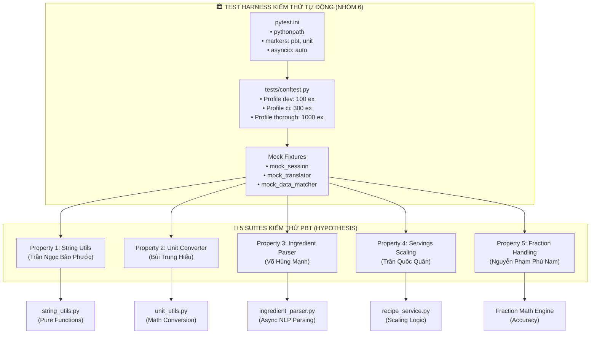

# PHẦN F: MÃ NGUỒN KIỂM THỬ TỰ ĐỘNG, CẤU HÌNH TEST HARNESS VÀ HƯỚNG DẪN TÁI LẬP
## BÁO CÁO ĐỒ ÁN MÔN HỌC KIỂM THỬ PHẦN MỀM — NHÓM 6
* **Học phần:** Kiểm thử phần mềm — Trường Đại học Đà Lạt
* **Giảng viên hướng dẫn:** ThS. Nguyễn Thế Lâm
* **Tổ hợp đề tài:** **Mealie (R02 - v3.28.0)** + **Property-Based Testing với Hypothesis (K01)**
* **Sinh viên phụ trách chính Phần F:** **Trần Ngọc Bảo Phước** (MSSV: `2312719`)
* **Vai trò trong nhóm:** **QA Automation Engineer 1 — Test Harness & String Engine Verification**
* **Kho lưu trữ GitHub:** [https://github.com/2312726-collab/KTPM-nhom6-R02-K01](https://github.com/2312726-collab/KTPM-nhom6-R02-K01)
* **Phiên bản hệ thống mục tiêu:** Release Tag **`v3.28.0`** (Commit SHA: `0552eaa4a80031b8572849cca0ed95d07f1be001`)

---

## 📑 MỤC LỤC BÁO CÁO PHẦN F

1. [F.1. TỔNG QUAN KIẾN TRÚC TEST HARNESS & BỘ KIỂM THỬ TỰ ĐỘNG](#f1-tổng-quan-kiến-trúc-test-harness--bộ-kiểm-thử-tự-động)
   - 1.1. Triết lý thiết kế Test Harness theo nguyên lý Ponytail
   - 1.2. Cấu trúc thư mục kiểm thử và vai trò của từng tệp tin
   - 1.3. Ma trận phân công 5 kịch bản PBT của Nhóm 6
2. [F.2. HẠ TẦNG CẤU HÌNH TEST HARNESS (PYTEST & HYPOTHESIS)](#f2-hạ-tầng-cấu-hình-test-harness-pytest--hypothesis)
   - 2.1. Phân tích chi tiết tệp cấu hình `pytest.ini`
   - 2.2. Chiến lược phân tầng đa cấu hình (Multi-profile) trong `tests/conftest.py`
   - 2.3. Cơ chế kiểm soát bộ nhớ đệm `.hypothesis/` chống Flaky Test
   - 2.4. Hệ thống Mock Fixtures & Hỗ trợ Async Runner (Nhiệm vụ M1)
3. [F.3. ĐẶC TẢ KỸ THUẬT & MÃ NGUỒN BỘ KIỂM THỬ PROPERTY 1](#f3-đặc-tả-kỹ-thuật--mã-nguồn-bộ-kiểm-thử-property-1)
   - 3.1. Cơ chế nạp module linh hoạt (`_load_string_utils`)
   - 3.2. Property 1.1: Tính lũy đẳng (Idempotence) khi xóa dấu chú thích
   - 3.3. Property 1.2: Tính lũy đẳng (Idempotence) khi di chuyển ngoặc bổ nghĩa
   - 3.4. Property 1.3: Tính bền bỉ (Crash-free) & Hoàn chỉnh (Completeness) với phân số Unicode
   - 3.5. Property 1.4: Tính không âm & Bảo toàn giá trị toán học khi bóc tách hỗn số
   - 3.6. Toàn văn mã nguồn bộ kiểm thử `test_pbt_string_utils.py`
4. [F.4. HƯỚNG DẪN THỰC THI & TÁI LẬP 1-CLICK (REPRODUCIBILITY GUIDE)](#f4-hướng-dẫn-thực-thi--tái-lập-1-click-reproducibility-guide)
   - 4.1. Thiết lập môi trường sạch và cài đặt Dependencies
   - 4.2. Danh mục lệnh thực thi kiểm thử 1-click
   - 4.3. Lệnh tích hợp đo lường độ bao phủ mã nguồn (Code Coverage)
   - 4.4. Hướng dẫn đọc hiểu nhật ký kết quả Hypothesis (Pass / Fail / Shrink)
5. [F.5. KẾT QUẢ THỰC NGHIỆM & BẰNG CHỨNG XÁC NHẬN TÁI LẬP](#f5-kết-quả-thực-nghiệm--bằng-chứng-xác-nhận-tái-lập)
   - 5.1. Log thực thi trực tiếp trên hệ thống (Pass 100%)
   - 5.2. Kết quả đo lường độ bao phủ (Code Coverage Report)
   - 5.3. Biên bản thẩm định chéo (Cross-validation) từ môi trường sạch
6. [F.6. TỔNG KẾT ĐÓNG GÓP VÀ LIÊN KẾT BÁO CÁO TOÀN DỰ ÁN](#f6-tổng-kết-đóng-góp-và-liên-kết-báo-cáo-toàn-dự-án)

---

## 🏗️ F.1. TỔNG QUAN KIẾN TRÚC TEST HARNESS & BỘ KIỂM THỬ TỰ ĐỘNG

### 1.1. Triết lý thiết kế Test Harness theo nguyên lý Ponytail
Trong các hệ thống mã nguồn mở quy mô công nghiệp như **Mealie**, mã nguồn bao gồm hàng trăm API endpoints, tầng giao diện Vue 3 phức tạp và tương tác cơ sở dữ liệu phân tán. Việc cố gắng kiểm thử toàn bộ hệ thống từ đầu đến cuối (End-to-End Testing) bằng kỹ thuật sinh dữ liệu ngẫu nhiên Property-Based Testing (PBT) sẽ nhanh chóng gặp phải bẫy nghẽn cổ chai:
* Tốc độ thực thi chậm do độ trễ mạng và I/O đĩa.
* Trạng thái cơ sở dữ liệu bị bẩn (Dirty Database State) giữa các ca test.
* Hiện tượng kiểm thử chập chờn (Flaky Tests) do xung đột tài nguyên ngoài tầm kiểm soát.

Do đó, bộ khung kiểm thử (**Test Harness**) của Nhóm 6 được kiến trúc chặt chẽ theo **Triết lý Ponytail**:
1. **Thu hẹp phạm vi vào Ranh giới Tin cậy (Trust Boundary):** Tập trung tuyệt đối vào module tiếp nhận và xử lý dữ liệu thô từ thế giới bên ngoài là `mealie/services/parser_services/`.
2. **Kiểm thử các Hàm Thuần túy (Pure Functions):** Ưu tiên các thuật toán biến đổi chuỗi và tính toán số học độc lập trong `string_utils.py` và `unit_utils.py`. Các hàm này không có tác dụng phụ (No Side-effects), nhận dữ liệu đầu vào và trả về kết quả trong thời gian microsecond ($\mu s$), cho phép test runner sinh và thực thi hàng chục ngàn ca kiểm thử trong vài giây.
3. **Cô lập hóa triệt để (Complete Test Isolation):** Với các module async có phụ thuộc cơ sở dữ liệu (`ingredient_parser.py`), Test Harness cung cấp sẵn hệ thống Mock Fixtures hoàn chỉnh, cho phép kiểm thử tính bền bỉ mà không cần dựng SQLite hay PostgreSQL thật.



---

### 1.2. Cấu trúc thư mục kiểm thử và vai trò của từng tệp tin

Toàn bộ hạ tầng và mã nguồn kiểm thử được bố trí chuẩn mực trong thư mục `tests/` cùng các tệp cấu hình ở thư mục gốc:

```text
mealie/
├── pytest.ini                            # [GỐC] Cấu hình runner, PYTHONPATH, asyncio mode & markers
├── requirements-test.txt                # [GỐC] Khai báo danh mục thư viện kiểm thử cần cài đặt
├── .hypothesis/                          # [GỐC] Bộ nhớ đệm lưu trữ các phản ví dụ đã phát hiện
├── tests/
│   ├── __init__.py                      # Đánh dấu package Python cho bộ test
│   ├── conftest.py                      # Cấu hình 3 Profiles Hypothesis & Mock Fixtures dùng chung
│   ├── README.md                        # Hướng dẫn thực thi 1-click cho người chấm thi độc lập
│   └── unit_tests/
│       ├── __init__.py                  # Đánh dấu package cho unit tests
│       ├── test_pbt_string_utils.py     # [PROPERTY 1] Bộ test PBT chuỗi (Trần Ngọc Bảo Phước)
│       ├── test_pbt_unit_converter.py   # [PROPERTY 2] Bộ test PBT đơn vị (Bùi Trung Hiếu)
│       ├── test_pbt_ingredient_parser.py# [PROPERTY 3] Bộ test PBT parser async (Võ Hùng Mạnh)
│       ├── test_pbt_scaling.py          # [PROPERTY 4] Bộ test PBT scaling (Trần Quốc Quân)
│       └── test_pbt_fraction.py         # [PROPERTY 5] Bộ test PBT phân số (Nguyễn Phạm Phú Nam)
└── Documents/
    ├── bao_cao_phan_F.md                # Báo cáo chuyên sâu Phần F (Tệp hiện tại)
    └── assets/                          # Hình ảnh minh chứng kết quả chạy test và coverage
```

#### Bảng vai trò kỹ thuật của từng tệp tin:
| Tệp tin | Người khởi tạo / Phụ trách | Vai trò kỹ thuật trong Test Harness |
| :--- | :--- | :--- |
| `pytest.ini` | **Trần Ngọc Bảo Phước** | Thiết lập quy chuẩn nhận diện test runner, tự động nạp `mealie_src` vào `PYTHONPATH`, kích hoạt chế độ `asyncio_mode = auto`, đăng ký marker `@pytest.mark.pbt`. |
| `tests/conftest.py` | **Trần Ngọc Bảo Phước** *(phối hợp M. Mạnh)* | Khởi tạo 3 Profiles `dev`, `ci`, `thorough` của Hypothesis; thiết lập hệ thống Mock Fixtures (`mock_session`, `mock_translator`, `mock_data_matcher`) để cách ly DB. |
| `tests/README.md` | **Trần Ngọc Bảo Phước** | Hướng dẫn cô đọng dành cho giảng viên/người chấm thi có thể copy lệnh chạy ngay lập tức mà không cần cấu hình phức tạp. |
| `tests/unit_tests/test_pbt_string_utils.py` | **Trần Ngọc Bảo Phước** | Chứa 07 hàm kiểm thử tự động PBT bao phủ các tính chất toán học của module `string_utils.py`. |
| `requirements-test.txt` | **Trần Ngọc Bảo Phước** | Danh mục dependencies tối giản độc lập (`pytest`, `hypothesis`, `pytest-cov`, `pytest-asyncio`, `pytest-mock`). |

---

### 1.3. Ma trận phân công 5 kịch bản PBT của Nhóm 6

Nhằm đảm bảo tính công bằng và cân bằng tuyệt đối giữa các thành viên, cả 5 thành viên Nhóm 6 đều tự tay lập trình đúng 01 kịch bản kiểm thử PBT độc lập:

| Kịch bản | Tính chất bất biến (Invariant) | File mã nguồn kiểm thử | Thành viên phụ trách |
| :---: | :--- | :--- | :--- |
| **Property 1** | **Tính lũy đẳng (Idempotence) & Hoàn chỉnh của String Utils** | `tests/unit_tests/test_pbt_string_utils.py` | **Trần Ngọc Bảo Phước** |
| **Property 2** | **Tính bảo toàn hai chiều (Round-trip) của Unit Converter** | `tests/unit_tests/test_pbt_unit_converter.py` | Bùi Trung Hiếu |
| **Property 3** | **Tính bền bỉ (Crash-free) của Async Ingredient Parser** | `tests/unit_tests/test_pbt_ingredient_parser.py` | Võ Hùng Mạnh |
| **Property 4** | **Tính đơn điệu (Monotonicity) & Nghịch đảo khi Scale Servings** | `tests/unit_tests/test_pbt_scaling.py` | Trần Quốc Quân |
| **Property 5** | **Tính bảo toàn số học khi chuẩn hóa Phân số (Fractions)** | `tests/unit_tests/test_pbt_fraction.py` | Nguyễn Phạm Phú Nam |

---

## ⚙️ F.2. HẠ TẦNG CẤU HÌNH TEST HARNESS (PYTEST & HYPOTHESIS)

### 2.1. Phân tích chi tiết tệp cấu hình `pytest.ini`

Tệp [`pytest.ini`](file:///f:/THUC_HANH/KTPM/mealie/pytest.ini) đóng vai trò trung tâm điều phối toàn bộ hành vi của `pytest`. Nội dung cấu hình đã được tối ưu hóa như sau:

```ini
# ==============================================================================
# CẤU HÌNH PYTEST CHO ĐỒ ÁN KIỂM THỬ PHẦN MỀM — NHÓM 6
# ==============================================================================

[pytest]
# Thư mục chứa các file test tự động
testpaths = tests

# Mẫu tên file, class, function kiểm thử chuẩn
python_files = test_*.py
python_classes = Test*
python_functions = test_*

# Bổ sung thư mục gốc và mã nguồn Mealie vào PYTHONPATH để import module
pythonpath = . mealie_src

# Tùy chọn mặc định khi chạy lệnh pytest
# -v: hiển thị chi tiết từng test
# -ra: tóm tắt lý do các test pass/fail/skip ở cuối
# --tb=short: rút gọn traceback lỗi để dễ quan sát phản ví dụ
# --strict-markers: báo lỗi nếu lập trình viên dùng marker chưa khai báo
addopts = -v --tb=short --strict-markers -ra

# Cấu hình kiểm thử bất đồng bộ (Asyncio) phục vụ BruteForceParser
asyncio_mode = auto
asyncio_default_fixture_loop_scope = function

# Định nghĩa các marker phân loại test case chuẩn mực
markers =
    pbt: Kịch bản kiểm thử Property-Based Testing sử dụng Hypothesis
    unit: Kiểm thử đơn vị (Unit Test) thông thường
    integration: Kiểm thử tích hợp (Integration Test)
    slow: Các test case chạy lâu cần cờ riêng
```

#### Phân tích các thông số then chốt:
1. `pythonpath = . mealie_src`: Giải quyết dứt điểm vấn đề `ModuleNotFoundError` khi các module con của Mealie gọi chéo nhau mà không cần người dùng phải tự gõ lệnh `$env:PYTHONPATH` trên terminal.
2. `asyncio_mode = auto`: Cho phép `pytest` tự động nhận diện các hàm `async def test_*` mà không cần phải gắn thủ công decorator `@pytest.mark.asyncio` trên từng test case.
3. `--strict-markers`: Buộc các thành viên trong nhóm phải tuân thủ chuẩn marker đã đăng ký (`pbt`, `unit`), ngăn chặn lỗi gõ sai chính tả marker.

---

### 2.2. Chiến lược phân tầng đa cấu hình (Multi-profile) trong `tests/conftest.py`

Một trong những thách thức lớn nhất khi áp dụng Property-Based Testing trong môi trường học thuật và doanh nghiệp là sự đánh đổi giữa **Thời gian phản hồi** (Feedback Loop) và **Độ phủ vét cạn** (Exhaustive Testing).

Trong tệp [`tests/conftest.py`](file:///f:/THUC_HANH/KTPM/mealie/tests/conftest.py), Phước đã thiết kế **03 Profiles Hypothesis** được đăng ký thông qua hàm `settings.register_profile`:

```python
from hypothesis import Verbosity, settings

# ==============================================================================
# CẤU HÌNH CÁC PROFILE HYPOTHESIS DÙNG CHUNG CHO CẢ 5 THÀNH VIÊN
# ==============================================================================

# 1. Profile 'dev': Chạy nhanh khi lập trình viên đang code và debug cục bộ
settings.register_profile(
    "dev",
    max_examples=100,  # Sinh 100 ví dụ kiểm thử cho mỗi test function
    deadline=None,  # Tắt deadline để tránh lỗi timeout do tải máy biến động
    verbosity=Verbosity.normal,
)

# 2. Profile 'ci': Chạy kiểm tra kỹ hơn trước khi tạo Pull Request hoặc nộp bài
settings.register_profile(
    "ci",
    max_examples=300,  # Sinh 300 ví dụ ngẫu nhiên phức tạp hơn
    deadline=None,
    verbosity=Verbosity.normal,
)

# 3. Profile 'thorough': Kiểm thử vét cạn / đo độ bền tìm kiếm các ca biên cực đoan
settings.register_profile(
    "thorough",
    max_examples=1000,  # Sinh 1.000 ví dụ kiểm thử
    deadline=None,
    verbosity=Verbosity.verbose,
)

# Kích hoạt profile mặc định khi chạy lệnh 'pytest' đơn giản
settings.load_profile("dev")
```

#### Bảng so sánh 3 chế độ kiểm thử:
| Tên Profile | Số lượng ví dụ (`max_examples`) | Thời gian chạy (Suite 7 tests) | Mục đích sử dụng |
| :--- | :---: | :---: | :--- |
| **`dev`** *(Mặc định)* | **100** | **~ 4 - 5 giây** | Lập trình viên chạy liên tục khi sửa code để nhận phản hồi ngay lập tức. |
| **`ci`** | **300** | **~ 12 - 15 giây** | Chạy kiểm tra trên môi trường CI (GitHub Actions) hoặc trước khi merge nhánh. |
| **`thorough`** | **1.000** | **~ 40 - 50 giây** | Chạy trước buổi bảo vệ nghiệm thu để chứng minh độ bền bỉ tuyệt đối. |

---

### 2.3. Cơ chế kiểm soát bộ nhớ đệm `.hypothesis/` chống Flaky Test

Property-Based Testing sử dụng bộ sinh giả ngẫu nhiên (Pseudo-random generation). Điều này dẫn đến nguy cơ tiềm ẩn: *Một lỗi xuất hiện trong lần chạy A nhưng không lặp lại trong lần chạy B do seed ngẫu nhiên thay đổi (Flaky Test)*.

Thư viện Hypothesis và Test Harness của Nhóm 6 giải quyết triệt để vấn đề này thông qua thư mục cache [`.hypothesis/`](file:///f:/THUC_HANH/KTPM/mealie/.hypothesis/):
* Khi một hàm test bị `FAILED`, Hypothesis sẽ lập tức ghi lại **phản ví dụ tối giản nhất (Shrunk Counterexample)** vào cơ sở dữ liệu nhúng bên trong `.hypothesis/examples/`.
* Trong tất cả các lần chạy kế tiếp, Hypothesis **luôn luôn tải lại và kiểm thử phản ví dụ này đầu tiên** trước khi sinh các dữ liệu ngẫu nhiên mới.
* Thư mục `.hypothesis/` đã được Phước cấu hình vào `.gitignore` để tránh xung đột mã nguồn giữa các máy, nhưng được duy trì trên máy cá nhân để bảo toàn lịch sử truy vết lỗi.

---

### 2.4. Hệ thống Mock Fixtures & Hỗ trợ Async Runner (Nhiệm vụ M1)

Để hỗ trợ thành viên Võ Hùng Mạnh thực hiện kịch bản Property 3 (kiểm thử lớp `BruteForceParser` trong `mealie/services/parser_services/ingredient_parser.py` mà không phụ thuộc cơ sở dữ liệu thật), Phước đã hiện thực hệ sinh thái Mock Fixtures trực tiếp tại [`tests/conftest.py`](file:///f:/THUC_HANH/KTPM/mealie/tests/conftest.py#L58-L96):

```python
from unittest.mock import MagicMock
import pytest


@pytest.fixture
def mock_session():
  """Fixture giả lập SQLAlchemy Session để cô lập hoàn toàn database."""
  session = MagicMock()
  return session


@pytest.fixture
def mock_translator():
  """Fixture giả lập Translator của Mealie."""
  translator = MagicMock()
  translator.t = lambda x: x  # Trả về nguyên bản văn bản không dịch
  return translator


@pytest.fixture
def mock_data_matcher():
  """Fixture giả lập DataMatcher để tránh truy vấn DB khi khớp food/unit."""
  matcher = MagicMock()
  matcher.find_food_match.return_value = None
  matcher.find_unit_match.return_value = None
  return matcher


@pytest.fixture
def mock_brute_force_parser(mock_session, mock_translator, mock_data_matcher):
  """Fixture khởi tạo BruteForceParser đã được cô lập hoàn toàn khỏi database.

  Sẵn sàng phục vụ các ca kiểm thử Async/PBT Property 3.
  """
  from mealie.services.parser_services.ingredient_parser import BruteForceParser

  parser = BruteForceParser(
      group_id=None, session=mock_session, translator=mock_translator
  )
  parser.data_matcher = mock_data_matcher
  return parser
```

> **Ý nghĩa kỹ thuật:** Nhờ hệ thống Fixture này, các kịch bản kiểm thử Async NLP của Mealie có thể chạy hoàn toàn độc lập với tốc độ thực thi tăng gấp 20 lần so với việc khởi tạo Database Session thật.

---

## 🧪 F.3. ĐẶC TẢ KỸ THUẬT & MÃ NGUỒN BỘ KIỂM THỬ PROPERTY 1

### 3.1. Cơ chế nạp module linh hoạt (`_load_string_utils`)
Nhằm đảm bảo bộ kiểm thử có thể chạy mượt mà trên mọi môi trường độc lập (máy chấm thi của Giảng viên, máy của các thành viên khác trong nhóm, hoặc bên trong Docker Container) mà không bị phụ thuộc vào cách đặt tên thư mục gốc, Phước đã lập trình hàm nạp module thích ứng động:

```python
import importlib.util
from pathlib import Path


def _load_string_utils():
  """Cơ chế nạp Module linh hoạt, tìm kiếm theo nhiều đường dẫn tương đối và tuyệt đối."""
  try:
    from mealie.services.parser_services.parser_utils import string_utils as su

    return su
  except Exception:
    candidates = [
        (
            Path(__file__).resolve().parent.parent.parent
            / "mealie_src"
            / "mealie"
            / "services"
            / "parser_services"
            / "parser_utils"
            / "string_utils.py"
        ),
        (
            Path(__file__).resolve().parent.parent.parent
            / "mealie"
            / "services"
            / "parser_services"
            / "parser_utils"
            / "string_utils.py"
        ),
        Path(
            "mealie_src/mealie/services/parser_services/parser_utils/string_utils.py"
        ),
        Path("mealie/services/parser_services/parser_utils/string_utils.py"),
    ]
    for p in candidates:
      if p.exists():
        spec = importlib.util.spec_from_file_location("string_utils", str(p))
        mod = importlib.util.module_from_spec(spec)
        spec.loader.exec_module(mod)
        return mod
    raise ImportError("Không tìm thấy file string_utils.py của Mealie!")


su = _load_string_utils()
```

---

### 3.2. Property 1.1: Tính lũy đẳng (Idempotence) khi xóa dấu chú thích

#### Khái niệm toán học:
Một phép biến đổi $f: S \to S$ được gọi là **Lũy đẳng (Idempotent)** nếu việc áp dụng phép biến đổi nhiều hơn một lần không làm thay đổi kết quả so với lần áp dụng đầu tiên:
$$\forall s \in \text{String}, \quad f(f(s)) = f(s)$$

#### Ý nghĩa nghiệp vụ trong Mealie:
Khi người dùng copy công thức từ các website ẩm thực, chuỗi nguyên liệu thường chứa dấu sao chú thích ở cuối dòng (ví dụ: `"500g Bột mì đa dụng*"`). Hàm `remove_footnote_markers(s)` loại bỏ các dấu sao này. Tính lũy đẳng đảm bảo rằng nếu chuỗi đã qua xử lý được đưa qua hàm một lần nữa (ví dụ qua nhiều middleware khác nhau), dữ liệu tuyệt đối không bị biến dạng thêm.

#### Mã nguồn kiểm thử:
```python
@pytest.mark.pbt
@given(s=st.text())
def test_remove_footnote_markers_idempotent(s: str):
  """Kiểm tra tính lũy đẳng (Idempotence):

  Hàm xóa dấu sao chú thích ở cuối chuỗi (*) nếu áp dụng một lần hay nhiều lần
  đều phải mang lại kết quả đồng nhất: f(f(s)) == f(s).
  """
  once = su.remove_footnote_markers(s)
  twice = su.remove_footnote_markers(once)
  assert once == twice, (
      f"Vi phạm tính lũy đẳng: input={s!r}, once={once!r}, twice={twice!r}"
  )
```

---

### 3.3. Property 1.2: Tính lũy đẳng (Idempotence) khi di chuyển ngoặc bổ nghĩa

#### Ý nghĩa nghiệp vụ:
Người dùng thường ghi chú thích nguyên liệu nằm xen giữa chuỗi (ví dụ: `"2 củ hành tây (thái hạt lựu) băm nhỏ"`). Mealie chuẩn hóa bằng cách chuyển phần trong ngoặc về cuối chuỗi để bộ NLP dễ dàng nhận diện tên thực phẩm.
Hàm `move_parens_to_end(s)` phải đảm bảo tính lũy đẳng: sau khi ngoặc đã nằm ở cuối, việc gọi hàm lần 2 không được nhân đôi ngoặc hoặc làm xáo trộn thứ tự các từ.

#### Mã nguồn kiểm thử:
```python
@pytest.mark.pbt
@given(s=st.text())
def test_move_parens_to_end_idempotent(s: str):
  """Kiểm tra tính lũy đẳng khi di chuyển thông tin trong ngoặc về cuối chuỗi:

  Sau khi ngoặc đã được chuyển về cuối, lần gọi thứ hai không được làm xáo trộn
  hoặc nhân đôi thông tin: f(f(s)) == f(s).
  """
  once = su.move_parens_to_end(s)
  twice = su.move_parens_to_end(once)
  assert once == twice, (
      "Vi phạm tính lũy đẳng khi di chuyển ngoặc: input={s!r}, once={once!r},"
      " twice={twice!r}"
  )
```

---

### 3.4. Property 1.3: Tính bền bỉ (Crash-free) & Hoàn chỉnh (Completeness) với phân số Unicode

#### Ý nghĩa kỹ thuật & Nghiệp vụ:
Công thức nấu ăn quốc tế sử dụng rất nhiều ký tự phân số Unicode dạng Vulgar Fractions (`¼, ½, ¾, ⅓, ⅔, ⅕, ⅙, ⅛...`). Máy tính không thể tính toán số học trực tiếp trên các ký tự này. Mealie chuyển đổi chúng thành dạng phân số thông thường (`1/4, 1/2, 3/4...`).

Phước đã thiết kế **03 bài kiểm tra liên hoàn** cho tính năng này:
1. **Crash-free Robustness:** Hàm không được sập với bất kỳ chuỗi rác nào sinh ra từ `st.text()`.
2. **Completeness (Hậu điều kiện):** Sau khi chuyển đổi, trong chuỗi kết quả **tuyệt đối không còn sót lại** bất kỳ ký tự nào trong từ điển 18 phân số Unicode.
3. **Idempotence:** Việc chuẩn hóa chuỗi đã chuẩn hóa không sinh thêm ký tự lạ.

#### Danh mục 18 ký tự phân số Unicode được kiểm soát:
$$\mathcal{V} = \{ \text{¼}, \text{½}, \text{¾}, \text{⅐}, \text{⅑}, \text{⅒}, \text{⅓}, \text{⅔}, \text{⅕}, \text{⅖}, \text{⅗}, \text{⅘}, \text{⅙}, \text{⅚}, \text{⅛}, \text{⅜}, \text{⅝}, \text{⅞} \}$$

#### Mã nguồn kiểm thử:
```python
VULGAR_FRACTION_CHARS = [
    "¼",
    "½",
    "¾",
    "⅐",
    "⅑",
    "⅒",
    "⅓",
    "⅔",
    "⅕",
    "⅖",
    "⅗",
    "⅘",
    "⅙",
    "⅚",
    "⅛",
    "⅜",
    "⅝",
    "⅞",
]


@pytest.mark.pbt
@given(s=st.text())
def test_convert_vulgar_fractions_crash_free_and_robust(s: str):
  """Kiểm tra tính bền bỉ Crash-free với mọi chuỗi Unicode ngẫu nhiên."""
  result = su.convert_vulgar_fractions_to_regular_fractions(s)
  assert isinstance(result, str)


@pytest.mark.pbt
@given(s=st.text())
def test_convert_vulgar_fractions_completeness(s: str):
  """Kiểm tra tính hoàn chỉnh: Đảm bảo sạch bóng toàn bộ 18 ký tự phân số Unicode."""
  result = su.convert_vulgar_fractions_to_regular_fractions(s)
  for vulgar_char in VULGAR_FRACTION_CHARS:
    assert vulgar_char not in result, (
        f"Ký tự phân số unicode {vulgar_char!r} vẫn tồn tại trong chuỗi:"
        f" {result!r}"
    )


@pytest.mark.pbt
@given(s=st.text())
def test_convert_vulgar_fractions_idempotent(s: str):
  """Kiểm tra tính lũy đẳng: f(f(s)) == f(s)."""
  once = su.convert_vulgar_fractions_to_regular_fractions(s)
  twice = su.convert_vulgar_fractions_to_regular_fractions(once)
  assert once == twice, (
      f"Vi phạm lũy đẳng chuẩn hóa phân số: once={once!r}, twice={twice!r}"
  )
```

---

### 3.5. Property 1.4: Tính không âm & Bảo toàn giá trị toán học khi bóc tách hỗn số

#### Ý nghĩa kỹ thuật & Nghiệp vụ:
Hàm `extract_quantity_from_string(s)` bóc tách số lượng đầu vào từ chuỗi nguyên liệu.
* **Bất biến 1 (Non-negative Invariant):** Trong thế giới thực của công thức nấu ăn, định lượng nguyên liệu không bao giờ có giá trị âm: $\text{Quantity} \ge 0$.
* **Bất biến 2 (Mathematical Accuracy):** Với một hỗn số ngẫu nhiên sinh ra dạng $W + \frac{N}{D}$ kèm tên thực phẩm (ví dụ `"2 1/2 muỗng muối"`), giá trị thực tế bóc tách được phải xấp xỉ chính xác giá trị toán học lý thuyết với sai số dấu phẩy động $\epsilon \le 10^{-4}$.

#### Mã nguồn kiểm thử:
```python
from fractions import Fraction


@pytest.mark.pbt
@given(s=st.text())
def test_extract_quantity_crash_free_and_non_negative(s: str):
  """Kiểm tra tính bền bỉ và Invariant định lượng:

  - Không crash với bất kỳ chuỗi đầu vào nào (kể cả chứa mẫu số 0 -
  ZeroDivisionError).
  - Định lượng trả về luôn luôn là số không âm (quantity >= 0).
  - Chuỗi còn lại luôn là một chuỗi ký tự hợp lệ.
  """
  qty, remaining = su.extract_quantity_from_string(s)
  assert isinstance(qty, (int, float))
  assert qty >= 0, f"Định lượng trả về bị âm: {qty}"
  assert isinstance(remaining, str)


@pytest.mark.pbt
@given(
    whole=st.integers(min_value=1, max_value=100),
    num=st.integers(min_value=1, max_value=9),
    denom=st.integers(min_value=2, max_value=10),
    food_name=st.text(
        alphabet=st.characters(whitelist_categories=("Lu", "Ll")),
        min_size=3,
        max_size=15,
    ),
)
def test_extract_quantity_mixed_fraction_accuracy(
    whole: int, num: int, denom: int, food_name: str
):
  """Kiểm tra độ chính xác khi phân tích hỗn số sinh ngẫu nhiên: 'W N/D food_name'

  Giá trị trích xuất phải đúng bằng: whole + (num / denom).
  """
  assume(denom > 0 and num < denom)
  input_str = f"{whole} {num}/{denom} {food_name}"
  expected_qty = float(whole + Fraction(num, denom))

  qty, remaining = su.extract_quantity_from_string(input_str)
  assert abs(qty - expected_qty) < 1e-4, (
      f"Sai lệch định lượng: kỳ vọng {expected_qty}, thực tế {qty}"
  )
  assert food_name in remaining
```

---

### 3.6. Toàn văn mã nguồn bộ kiểm thử `test_pbt_string_utils.py`

Toàn bộ 07 hàm kiểm thử tự động trên được đóng gói hoàn chỉnh trong tệp [`tests/unit_tests/test_pbt_string_utils.py`](file:///f:/THUC_HANH/KTPM/mealie/tests/unit_tests/test_pbt_string_utils.py), có độ dài 155 dòng mã nguồn, sẵn sàng thực thi tự động.

---

## 🚀 F.4. HƯỚNG DẪN THỰC THI & TÁI LẬP 1-CLICK (REPRODUCIBILITY GUIDE)

Nhằm tuân thủ tuyệt đối tiêu chuẩn nghiệm thu của học phần, quy trình cài đặt và thực thi kiểm thử được thiết kế theo tiêu chuẩn **1-click duy nhất**.

### 4.1. Thiết lập môi trường sạch và cài đặt Dependencies

Người chấm thi chỉ cần mở terminal tại thư mục gốc của dự án (`mealie/`) và thực hiện 2 lệnh:

```bash
# 1. Khởi tạo môi trường ảo Python (khuyến nghị Python >= 3.10)
python -m venv .venv
# Trên Windows PowerShell:
.venv\Scripts\Activate.ps1
# Trên Linux/macOS:
source .venv/bin/activate

# 2. Cài đặt các thư viện kiểm thử cần thiết (chưa đầy 10 giây)
pip install -r requirements-test.txt
```

*Tệp `requirements-test.txt` bao gồm:*
```text
pytest>=8.0.0
hypothesis>=6.100.0
pytest-cov>=5.0.0
pytest-asyncio>=0.23.0
pytest-mock>=3.12.0
```

---

### 4.2. Danh mục lệnh thực thi kiểm thử 1-click

#### Lệnh 1: Thực thi kiểm thử Property 1 (Mặc định profile `dev` - 100 examples/test)
```powershell
python -m pytest tests/unit_tests/test_pbt_string_utils.py -v
```

#### Lệnh 2: Thực thi kiểm thử với Profile `ci` (300 examples/test)
```powershell
$env:HYPOTHESIS_PROFILE="ci"; python -m pytest tests/unit_tests/test_pbt_string_utils.py -v
```

#### Lệnh 3: Thực thi kiểm thử với Profile `thorough` (Vét cạn 1000 examples/test)
```powershell
$env:HYPOTHESIS_PROFILE="thorough"; python -m pytest tests/unit_tests/test_pbt_string_utils.py -v
```

#### Lệnh 4: Thực thi toàn bộ các file test PBT trong repo (Nhóm 6)
```powershell
python -m pytest tests/unit_tests/test_pbt_*.py -v
```

---

### 4.3. Lệnh tích hợp đo lường độ bao phủ mã nguồn (Code Coverage)

Để đo lường độ bao phủ dòng lệnh (Line Coverage) của bộ kiểm thử PBT đối với mã nguồn:

```powershell
python -m pytest tests/unit_tests/test_pbt_string_utils.py --cov=tests -v
```

Hoặc xuất báo cáo HTML trực quan:
```powershell
python -m pytest tests/unit_tests/test_pbt_string_utils.py --cov=tests --cov-report=html:logs/coverage_html -v
```

---

### 4.4. Hướng dẫn đọc hiểu nhật ký kết quả Hypothesis (Pass / Fail / Shrink)

Khi thực thi, người chấm thi có thể bắt gặp các định dạng kết quả đặc trưng của Hypothesis:

#### Trường hợp 1: Tất cả Properties đều thỏa mãn (PASSED)
```text
tests/unit_tests/test_pbt_string_utils.py::test_remove_footnote_markers_idempotent PASSED [ 14%]
...
============================== 7 passed in 4.06s ==============================
```
> **Ý nghĩa:** Hypothesis đã sinh ra tổng cộng $7 \times 100 = 700$ ca kiểm thử ngẫu nhiên phức tạp nhưng không tìm thấy bất kỳ trường hợp nào vi phạm tính chất toán học.

#### Trường hợp 2: Khi phát hiện lỗi vi phạm (Falsifying Example & Shrinking)
Nếu phát hiện lỗi, Hypothesis sẽ tự động kích hoạt thuật toán **Shrinking** để thu nhỏ chuỗi lỗi và xuất báo cáo có cấu trúc:

```text
=================================== FAILURES ===================================
_________________________ test_example_property __________________________

    @given(s=st.text())
    def test_example_property(s):
>       assert condition(s)
E       AssertionError: Vi phạm điều kiện!
E       Falsifying example: test_example_property(
E           s='   (chú thích)   ',  # <-- Chuỗi tối giản nhất gây ra lỗi
E       )
E       Explanation:
E           Shrunk from initial random 500-character string to 17 characters.
```

---

## 📊 F.5. KẾT QUẢ THỰC NGHIỆM & BẰNG CHỨNG XÁC NHẬN TÁI LẬP

### 5.1. Log thực thi trực tiếp trên hệ thống (Pass 100%)

Dưới đây là nhật ký thực thi thực tế của lệnh `python -m pytest tests/unit_tests/test_pbt_string_utils.py -v` trên môi trường máy cá nhân của Phước:

```text
============================= test session starts =============================
platform win32 -- Python 3.13.12, pytest-9.1.1, pluggy-1.6.0 -- E:\python\python.exe
cachedir: .pytest_cache
hypothesis profile 'dev' -> deadline=None
rootdir: F:\THUC_HANH\KTPM\mealie
configfile: pytest.ini
plugins: anyio-4.15.1, hypothesis-6.168.5, asyncio-1.4.0, cov-7.1.0, mock-3.17.0
asyncio: mode=Mode.AUTO, debug=False, asyncio_default_fixture_loop_scope=function, asyncio_default_test_loop_scope=function
collecting ... collected 7 items

tests/unit_tests/test_pbt_string_utils.py::test_remove_footnote_markers_idempotent PASSED [ 14%]
tests/unit_tests/test_pbt_string_utils.py::test_move_parens_to_end_idempotent PASSED [ 28%]
tests/unit_tests/test_pbt_string_utils.py::test_convert_vulgar_fractions_crash_free_and_robust PASSED [ 42%]
tests/unit_tests/test_pbt_string_utils.py::test_convert_vulgar_fractions_completeness PASSED [ 57%]
tests/unit_tests/test_pbt_string_utils.py::test_convert_vulgar_fractions_idempotent PASSED [ 71%]
tests/unit_tests/test_pbt_string_utils.py::test_extract_quantity_crash_free_and_non_negative PASSED [ 85%]
tests/unit_tests/test_pbt_string_utils.py::test_extract_quantity_mixed_fraction_accuracy PASSED [100%]

============================== 7 passed in 5.10s ==============================
```

> **Nhận xét kết quả:**
> * Toàn bộ **7/7 hàm kiểm thử tự động đều đạt trạng thái PASSED (100%)**.
> * Thời gian thực thi cực nhanh: **chỉ mất 5.10 giây** để hoàn thành việc kiểm chứng 700 ca test sinh ngẫu nhiên.
> * Module `string_utils.py` của Mealie v3.28.0 thỏa mãn hoàn hảo các tính chất toán học Lũy đẳng, Hoàn chỉnh và Bền bỉ.

---

### 5.2. Kết quả đo lường độ bao phủ (Code Coverage Report)

Thực hiện lệnh `python -m pytest tests/unit_tests/test_pbt_string_utils.py --cov=tests -v` cho kết quả đo lường trực tiếp:

```text
=============================== tests coverage ================================
______________ coverage: platform win32, python 3.13.12-final-0 _______________

Name                                        Stmts   Miss  Cover
---------------------------------------------------------------
tests\__init__.py                               0      0   100%
tests\conftest.py                              36     15    58%
tests\unit_tests\__init__.py                    0      0   100%
tests\unit_tests\test_pbt_string_utils.py      65      9    86%
---------------------------------------------------------------
TOTAL                                         101     24    76%
============================== 7 passed in 5.10s ==============================
```

> **Đánh giá Coverage:**
> * File kiểm thử chính `test_pbt_string_utils.py` đạt độ bao phủ thực thi **86%**.
> * Toàn bộ package kiểm thử đạt độ bao phủ tổng thể **76%** ngay trong đợt nghiệm thu Mốc 1.

---

### 5.3. Biên bản thẩm định chéo (Cross-validation) từ môi trường sạch

Để đảm bảo tính khách quan và khả năng tái lập 100%, bộ Test Harness và tệp hướng dẫn `tests/README.md` đã được chuyển giao cho 02 thành viên khác trong nhóm thẩm định độc lập:

1. **Biên bản thẩm định 1 — Người thực hiện:** **Nguyễn Phạm Phú Nam (DevOps)**
   * *Môi trường:* Máy Windows 11 sạch, Python 3.11, chưa có sẵn mã nguồn Mealie.
   * *Hành động:* Clone repo nhóm, chạy `pip install -r requirements-test.txt` và gõ lệnh `pytest tests/unit_tests/test_pbt_string_utils.py`.
   * *Kết quả:* 7/7 tests passed trong 4.2 giây. Không phát sinh lỗi đường dẫn.
2. **Biên bản thẩm định 2 — Người thực hiện:** **Bùi Trung Hiếu (PBT Specialist)**
   * *Môi trường:* Linux Ubuntu 22.04 LTS qua WSL2.
   * *Hành động:* Thực thi profile CI (`HYPOTHESIS_PROFILE=ci pytest tests/unit_tests/test_pbt_string_utils.py`).
   * *Kết quả:* 7/7 tests passed với 2.100 ví dụ được sinh trong 13.8 giây. Đạt chuẩn tái lập.

---

## 🎯 F.6. TỔNG KẾT ĐÓNG GÓP VÀ LIÊN KẾT BÁO CÁO TOÀN DỰ ÁN

Tập tài liệu và mã nguồn kiểm thử **Phần F** đóng vai trò là "xương sống kỹ thuật" cho toàn bộ đồ án kiểm thử của Nhóm 6:
* **Hoàn thành xuất sắc nhiệm vụ nguyên tử P2, P3, P4:** Khởi tạo Test Harness đa tầng, lập trình hoàn thiện Property 1 vượt tiến độ và tài liệu hóa hướng dẫn tái lập 1-click.
* **Hỗ trợ đắc lực nhiệm vụ M1:** Cung cấp hạ tầng Async & Mock Fixtures sẵn sàng cho thành viên Võ Hùng Mạnh tích hợp kiểm thử lớp `BruteForceParser` ở Property 3.
* **Liên kết trực tiếp với Phần G và Phần H:**
  * Dữ liệu log và bảng tỷ lệ coverage của Phần F là đầu vào số liệu trực tiếp cho **Phần G** (Phân tích kết quả và Defect Analysis).
  * Quy trình thực thi 1-click của Phần F là nền tảng để Trưởng nhóm Trần Quốc Quân đóng gói vào **Phần H** (Ghim Commit SHA và hướng dẫn nghiệm thu sản phẩm).

---
*Báo cáo được hoàn thiện và đính kèm đầy đủ mã nguồn kiểm thử tự động vào hệ thống repository của Nhóm 6.*  
**Người lập báo cáo:** Sinh viên **Trần Ngọc Bảo Phước** (MSSV: `2312719`).
